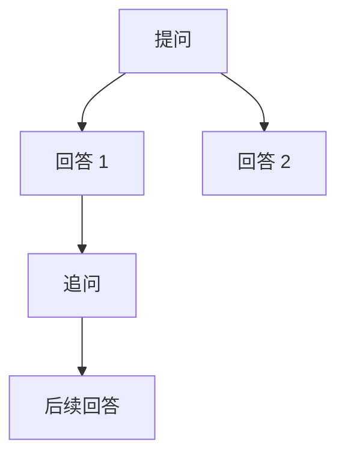

# EverChat：气泡下的分支切换方案

日期：2026-10-16。状态：待实施。

目标：对话区只呈现当前选择的一条消息路径；同一位置的其他提问版本或回答版本，通过气泡下的 `‹ 2 / 3 ›` 切换。切换后，下游消息、发送上下文、搜索定位和导出均与所选路径一致。

## 1. 现状与改进范围

现有存储已经支持分支，主要问题在显示和选择状态，而不是缺少消息树。

| 现有实现 | 当前行为 | 本次调整 |
|---|---|---|
| [`Message.parentId`、`revisionOf`、`branchPath`](../shared/types.ts) | 保存父链、版本来源，可读取从根到指定消息的路径 | 保留存储关系，增加统一的分支投影与同级版本索引 |
| [`App.tsx`](../src/App.tsx) 的消息列表 | 直接遍历 `snapshot.messages`，按写入顺序显示全部消息 | 仅遍历所选路径；其他分支不挂载消息正文 |
| [`MessageActions`](../src/MessageActions.tsx) | “继续此分支”只选择后续发送的完成回答，并显示“当前分支” | 用气泡下的版本导航切换显示；保留中途另起后续的能力 |
| [`contextSource`](../shared/context-budget.ts)、[`Conversation.submit`](../worker/conversation.ts) | 未指定分支时，回退到全局最后一条完成消息 | 普通发送显式指定当前路径的父消息，取消全局回退 |
| [`useConversationRoute`](../src/useConversationRoute.ts) | 每个对话一个 SPA URL | 增加分支位置参数，支持刷新、前进／后退和新标签打开 |
| 搜索、文本导出、摘要展示 | 与完整消息集合或当前 DOM 耦合 | 明确当前路径与完整消息图各自的用途 |

保持 shadcn/ui、现有 DeepSeek 风格、正文与思考的流式 Markdown，以及客户端解析／服务端低频持久化架构。原型阶段直接采用新状态与请求约定，不设计旧交互兼容层。

## 2. 用户看到的交互

### 2.1 每个位置只显示一个版本

例如，同一提问生成了两个回答，其中第一份回答又有后续：

- 选择回答 1：显示“提问 → 回答 1 → 追问 → 后续回答”，回答 1 下为 `‹ 1 / 2 ›`。
- 切到回答 2：显示“提问 → 回答 2”，回答 2 下为 `‹ 2 / 2 ›`，原来的追问随其所属分支隐藏。
- 切回回答 1：恢复它上次选中的后续路径。
- 编辑提问同样处理：在用户气泡下切换提问版本，并一起切换该版本的后续回答。

隐藏只改变显示，不删除消息或重新调用模型。回答正文、思考、附件和生成信息作为同一消息一起切换。

#### 版本与分支的来源

这里的“版本”表示同一父节点下可切换的消息选项，不要求它们都由修改同一条原文产生。现有消息创建逻辑覆盖以下来源：

| 用户操作 | 新建的消息与关系 | 气泡下的切换位置 | 是否请求模型 |
|---|---|---|---|
| 修改历史发送消息后重新发送，包括修改文字或附件 | 新用户消息与原用户消息具有相同 `parentId`，`revisionOf` 指向被修改消息；新回答接在新用户消息下 | 用户消息之间切换，并切换各自的全部后续 | 是，为新提问生成回答 |
| 对历史回答点击“重新生成” | 复用原用户提问，新助手消息与原回答具有相同 `parentId`，`revisionOf` 指向被重生成的回答 | 助手回答之间切换 | 是，创建新的生成任务 |
| 对失败或已停止回答主动再次生成 | 与重新生成采用相同关系；保留旧回答的失败状态或部分输出 | 助手回答之间切换，包括失败／停止版本 | 是，用户主动创建新的生成任务 |
| 手动修改历史助手回答并保存 | 新助手消息与原回答具有相同 `parentId`，`revisionOf` 指向被修改回答；正文来自用户输入 | 助手回答之间切换 | 否；不复制原任务的思考、工具结果和用量报告 |
| 回到某条历史回答，选择“从这里继续”并发送不同追问 | 新用户消息以该回答为 `parentId`，与原有追问成为同级；`revisionOf` 为空，因为它不是对特定追问的修订 | 同级追问之间切换，并切换各自的后续回答 | 是，为新追问生成回答 |

前三类中的失败重试与正常重新生成共用机制，区别在原回答状态。手动修改助手回答后，不自动重做旧后续；需要从新版本继续发送。修改历史用户消息时，也只为新提问生成新回答，不自动重放整条旧分支，避免额外模型调用。

后续若增加“换模型重新生成”“调整思维强度／参数后重新生成”或“同一提问用多个模型分别回答”，仍归入同一提问下的助手版本，不单独建立另一套分组。当前重新生成按钮沿用原回答记录的供应商和模型；单纯切换输入框模型或修改设置，不会生成新版本。

以下动作不计为创建聊天版本：

- 切换已存在的版本、查看后续、只进入编辑但未提交，或只改变模型及会话参数。
- 同一回答的正文／思考流片段、持久化确认、生成完成或停止；它们更新同一个消息 ID。
- 网络失败后的自动重发，以及使用同一个请求 ID 重试未知结果；服务端必须返回同一次提交，而不是新增版本。只有用户明确再次生成、使用新请求 ID，才新建回答。
- 删除消息；删除改变可见状态，不增加新版本。
- 复制到新对话或导入备份；它们恢复或复制已有分支关系，不在来源对话追加版本。
- 创建或重新生成历史摘要；摘要是派生记录，采用独立入口，不加入聊天版本计数。

如果要在更多信息中展示来源，应明确区分“用户修改提问”“模型重新生成”“用户修改回答”和“从历史回答另起追问”。`revisionOf` 只记录被替代对象，不能单独区分模型重生成与手动修改回答；复制／导入又会清空任务 ID，因此也不能仅凭 `runId` 推断来源。需要展示来源标签时，应由服务端在创建时记录明确的来源类型，并在复制和备份中保留；该标签不影响按 `parentId` 分组，也不作为常驻解释文字。

### 2.2 切换器的位置与外观

- 与复制、重新生成、更多操作共用气泡下的一行；用户消息右对齐，助手消息左对齐。
- 仅在有至少两个可浏览同级版本时显示；箭头切换前／后版本，中间 `2 / 3` 只作位置指示。
- 到达首尾时禁用相应箭头，不循环切换。不加常驻说明、分支卡片、树形面板或额外边框。
- 移除重复的“当前分支”“新版本”常驻标签。版本来源仍保留在数据中，必要时放入更多信息。
- 切换器始终可见，不随消息操作的悬停效果隐藏；窄屏允许操作行换行。
- 复用现有语义色、ghost 按钮和焦点样式；箭头图标约 `1rem`，点击区域至少 `max(2.75rem, 44px)`，数字使用等宽数字。
- 可访问名称包含消息类型和动作，例如“上一个回答版本”；切换后以简短的 `aria-live="polite"` 状态播报“回答版本 2，共 3 个”。不把整篇回答放入 live region。
- Enter／Space 操作聚焦按钮；不占用页面级左右键，以免影响输入、选字和辅助技术。

### 2.3 从中途另起后续

保留已完成助手消息菜单中的操作，文案统一为“从这里继续”。它把显示路径暂时结束在该回答，并让输入框从这里续聊；发送后，新追问成为该回答下面的一个新分支。原有后续仍保留。

若路径被主动截在一个仍有后续的消息上，在该消息操作行提供“查看后续”，恢复该节点上次选择的后续路径。该操作只在需要时出现，避免用户截断路径后无法返回。版本切换器负责同级替换，“从这里继续”负责选定新的续聊起点。

## 3. 消息图与选择状态

### 3.1 同级版本的判定

1. 普通消息按 `parentId` 分组。同一用户消息下的多个助手回答是一组，同一助手回答下的多个用户追问是一组；`parentId = null` 的消息组成根版本组。通常同组消息的角色一致，但不能据此过滤：现有“失败回答后继续提问”可能让同一父节点同时拥有助手和用户子节点，这些路径也必须能相互切换。同组角色一致时使用“回答版本／提问版本”的可访问名称，混合时使用“上一分支／下一分支”。
2. `revisionOf` 只表示版本来源。不能仅沿着 `revisionOf` 分组，否则对同一版本多次重新生成、手动编辑回答，以及独立续聊形成的分支会漏掉。
3. 顺序采用服务端快照中稳定的消息插入顺序。流式更新不改变顺序；不依赖可能相同的时间戳或随机 ID 排版本。
4. 排队、生成、完成、失败、停止的普通消息均可被浏览。显示选择不能沿用目前“只允许已完成助手”的 `branchHead` 状态。
5. 带 `summary` 的记录是派生摘要，不是聊天分支或回答版本；从普通消息树和同级计数中排除。
6. 已删除节点若仍连接未删除后代，保留“消息已删除”占位及导航位置；没有可见后代的已删除末端不再作为版本候选。不能把删除的连接节点从父链中直接抹掉。

不修改 `Message` 的父链存储格式，不复制公共祖先，不把分支拆成多个对话。

### 3.2 分离显示位置、后续偏好与发送父消息

建议新增纯函数模块 `shared/conversation-branches.ts`，以及前端状态钩子 `src/useConversationBranches.ts`，集中处理以下状态：

| 状态 | 含义与保存方式 |
|---|---|
| `viewHeadId` | 当前显示路径的末端，允许是用户、失败或生成中的消息；URL 和本机按对话保存 |
| `preferredChildByParent` | 各分叉上次选择的子节点 ID，按对话本地保存；同级切换后用于恢复嵌套选择 |
| `continuationParentId` | 从显示路径计算出的发送父消息，不作为第二份可任意修改的状态保存 |
| `activeRunId` | 实际生成任务，继续来自完整同步状态；不因浏览其他分支改变 |

切换某个消息的版本时，替换它所在父节点的子选择，再沿目标分支向下恢复已记住的选择。某一层没有有效记忆时选择最新插入的可浏览子节点，直到末端。最终用现有 `branchPath` 得到完整显示路径，并记住路径上的子选择。

“从这里继续”仅把 `viewHeadId` 暂时设为该节点，不清除后续偏好；“查看后续”沿保留的偏好继续向下解析。这样截断起点与记住的既有后续互不覆盖，切换其他版本也能恢复嵌套选择。

初始化优先级：有效 URL 位置 → 有效本地显示位置 → 最新插入的可浏览普通消息及其父链。普通流片段、远端追加消息和摘要完成都不重置已经建立的选择。初次打开时若没有本地选择，可以落在正在生成的普通回答上。

索引至少包括 `byId`、`childrenByParent`、同级序号和可浏览后代标记，一次线性构建；不要在每个气泡中反复扫描全部历史。结构索引只在增删节点或父链关系变化时重建，逐 Token 的正文更新只更新消息内容，避免每次流片段重算整棵树。

### 3.3 URL 与失效恢复

- 路由采用 `/c/:conversationId?branch=:viewHeadId`，`branch` 表示这次显示路径的末端，也可以是中途续聊起点。
- 显式切换版本、点击“从这里继续”“查看后续”和搜索跳转使用 `pushState`，浏览器后退可以恢复上一次显示路径。
- 本人新消息被接受后、默认位置初始化和失效位置修正使用 `replaceState`；流式内容增长不写 history。
- `popstate` 只恢复显示和导航，不发送请求、不自动聚焦输入框。
- URL 指定尚未出现在本地缓存的消息时，先等待权威快照再判定失效，不能因同步顺序提前回退。
- 删除当前末端后，优先选择同级前一个仍可浏览的版本，再选后一个；均不存在则退到最近可浏览祖先。仍有后代的删除连接节点保持原路径。
- URL 中的消息不属于该对话或已失效时，回退到有效本地位置或默认位置，并以一次必要状态提示告知；不得跳转到其他对话的数据。
- 缺失父消息或循环属于消息图错误，显示必要错误并禁止在无效路径上发送，不把残缺节点拼成时间线。

分支选择是每个浏览器自己的阅读状态，不写入 DO，不在设备之间抢占选择；共享 URL 可以明确指定位置。

## 4. 发送、编辑和生成行为

### 4.1 发送必须与所见路径一致

普通发送改为显式携带 `parentId: string | null`，取代请求中的 `branchHead` 和“全局最后完成消息”回退。`null` 只用于没有普通消息的新对话；已有路径取该路径最后一条未删除、已完成、非摘要的普通消息。

这样既支持正常结束于助手回答的分支，也保留当前“复制到用户消息为止”“失败回答后继续提问”的行为：末端为失败／停止回答时，其未完成正文不进入上下文，发送父节点可以是该路径上的用户消息。预算、摘要选择和最终服务端上下文必须使用同一个父节点与既有删除过滤规则。

服务端验证父节点属于该对话、可用于上下文且父链完整；不存在时明确拒绝，不改接其他分支。已有对话找不到有效发送父节点时提示选择其他版本或新建对话，不隐式创建新根。

用户修订仍由 `revisionOf` 决定父节点；重新生成仍由 `retryOf` 决定原提问。两种请求均不额外携带普通发送的 `parentId`，避免多个字段争夺上下文。摘要请求继续独立处理。

离线队列在入队时固定父节点、请求 ID 与所需配置。恢复网络、刷新或切换分支都不能重新计算已入队请求的父节点；失效时保留草稿／待发送内容并报错。原型阶段同步更新请求校验、前端和测试，不维护新旧字段双协议。

### 4.2 本人创建新版本后显示新版本

- 重新生成：创建同一提问下的新助手版本，立即进入新回答的路径，原回答与其后续保持可切回。
- 编辑用户消息并发送：进入新提问及其新回答的路径，旧提问的后代不跟随新版本显示。
- 手动编辑回答：使用 PATCH 返回的 `messageId` 选择新版本；不能再通过清空选择、等待全局最新消息来推断结果。
- 消息创建 POST 返回的 `Submission.assistantId` 用于选中新回答；若响应先于同步节点到达，短暂保留带目标 ID 的待定位状态，节点到达后完成切换。
- 接受请求期间记录导航版本号：本人发送时先进入该请求的待发送分支；若此后用户已经主动切换，迟到的响应不把界面拉回。相同请求 ID 的重试也不反复抢占显示。

### 4.3 流式生成与后台分支

允许在生成中切换版本和浏览其他分支。保留每个对话现有的任务并发限制，切换本身不停止、不重新调用、不改变任务归属。

正在生成的回答不在显示路径时，只保留一处紧凑的“另一分支生成中 · 返回”状态和停止入口。结束后该位置提供一次“已完成 · 查看”状态，查看或关闭后消失；不要自动跳转。自动摘要及等待它的回答也通过同一任务状态关联，不能出现重复进度入口。

同步层继续接收整个对话的实时与持久化变化，并解析、缓存后台分支的流内容；只省略隐藏分支的 Markdown DOM。切回来使用已有状态，不重开上游连接。离线待发送卡片绑定入队时的分支，不挂在用户当前查看的另一条路径末尾。

### 4.4 草稿、焦点和滚动

- 普通未发送草稿仍按对话保存；切换分支不清空文字和附件，发送时采用当前所见分支。已入队请求不随浏览改变。
- 用户消息编辑稿绑定原消息 ID。编辑期间允许浏览其他分支，但编辑来源始终有可返回的必要标记；发送前先恢复编辑来源路径，再生成新版本。不能把编辑稿静默当作另一分支的普通提问。
- 点击版本箭头后，焦点保留在同一个切换器的对应按钮；若按钮在新版本中到达边界，移到仍可操作的另一箭头。不要自动跳到输入框或唤起手机键盘。
- 切换前记录切换器操作行在滚动容器中的位置，暂停自动跟随；渲染后以替换后的操作行为锚点恢复相对位置，保证聚焦的导航仍可见，不强制滚到新分支末尾。缩短内容无法维持原位置时限制到合法滚动范围。
- 流式自动跟随仅作用于当前显示且用户仍在底部跟随的路径；隐藏分支增量不触发滚动。新发送／重新生成可跟随本人新回答；手动切换后的阅读位置保持，直到用户主动回到底部。
- “从这里继续”是输入动作，可以聚焦输入框；关闭弹窗、浏览器导航和后台完成不额外抢焦点。

## 5. 关联功能的统一规则

| 功能 | 计划行为 |
|---|---|
| 对话内查找 | 仅查找当前显示路径，包括正文和思考；输入占位使用必要提示“查找当前分支”；切换后重新计算位置，不把隐藏分支混入结果计数 |
| 全局搜索 | 继续搜索全部未删除普通消息。结果携带消息位置，先恢复包含命中消息的路径，再展开对应思考、滚动和高亮。链接的 `href` 也携带该位置，支持新标签打开 |
| Markdown／TXT／HTML 导出 | 导出当前路径的已持久化正文、思考、附件引用和状态，继续跳过已删除正文；生成中沿用已有部分结果规则，不使用未确认实时尾部 |
| 完整备份与恢复 | 保留全部分支、父链、修订关系和摘要；本地阅读偏好不写进内容备份 |
| 完整复制对话 | 继续复制完整消息图；新对话默认显示来源当前路径对应的副本。需要在复制结果中返回映射后的显示末端 ID |
| 消息菜单“复制到新对话” | 继续只复制根到该消息的路径及适用摘要；复制后的消息 ID 独立，显示定位使用新 ID，不复用旧选择 |
| 历史摘要 | 不参与普通版本计数；在对应覆盖边界后显示折叠的摘要入口，仅展示覆盖 ID 与当前路径匹配的记录。同边界多个摘要放在该入口内，保留查看、重新生成和删除；无效／失败摘要仍可查看但不用于上下文 |
| 摘要生成与预算 | 从当前路径的发送父节点计算，继续遵守覆盖前缀和删除过滤规则；切换分支不自动生成摘要 |
| 单条删除 | 沿用内容清除与父链墓碑规则，不把“删除消息”扩大为“删除整条分支”；根据第 3 节调整选择并保留可达后代 |

## 6. 实施顺序

各阶段按以下顺序完成；包含关联行为与回归验收后，才算本功能完成。

### A. 先统一树投影与上下文约定

- 新建分支纯函数模块，完成同级分组、路径解析、嵌套选择、删除回退和摘要排除。
- 更新 `SubmitInput`、`worker/index.ts` 校验、`Conversation.submit`、`contextSource`、待发送队列与幂等指纹，普通发送固定 `parentId`。
- 用带唯一旁支内容的测试图验证：选中哪条路径，服务端最终输入就只来自那条路径；失败、停止、用户末端和摘要都遵守现有上下文过滤。

### B. 替换消息列表与气泡操作

- 新建 `useConversationBranches` 和 `BranchSwitcher`；`App` 使用路径投影渲染，`MessageActions` 接入同级导航。
- 实现嵌套偏好、从中途续聊、新生成定位、草稿保留和后台任务返回入口。
- 调整 `useFollowScroll` 的显式暂停／锚点恢复，完成键盘与焦点行为。

### C. 接通导航、搜索和内容操作

- 扩展 `useConversationRoute`，覆盖查询参数、原生链接、`popstate`、加载等待及失效位置。
- 更新对话内查找、全局命中定位、文本导出、复制定位、摘要入口和删除后的回退。
- 更新 README 中“默认续聊依附全局最后完成消息”及分支显示的描述；完整备份格式保持原有消息图语义。

### D. 验收并移除旧状态

- 移除旧 `branchHead` 显示状态、清空选择触发全局回退的代码，以及冗余标签。
- 更新原先假设“所有版本同时可见”的 E2E；测试断言消息 ID、父链和实际模型上下文，不只检查按钮或总文本是否出现。
- 使用 `pnpm typecheck`、`pnpm test`、相关 Playwright 回归和 `pnpm build` 验证；本计划阶段不执行运行时代码改动。

## 7. 验收清单

| 场景 | 必须满足的结果 |
|---|---|
| 一问三答 | 只挂载一份回答；`1 / 3` 到 `3 / 3` 顺序稳定，边界禁用，无额外 API 调用 |
| 根提问编辑、回答重试、手动回答编辑 | 均形成正确同级版本；默认显示本人新版本，旧版本可恢复 |
| 两层以上分叉 | 切换上层后，下层跟随路径改变；切回恢复先前下层选择，无孤立后代 |
| 中途续聊 | 原后续隐藏而保留；可查看已有后续；新发送产生明确父节点的同级追问 |
| 分支上下文 | 旁支唯一标记不会进入真实模型输入、摘要或预算预览；服务端不因全局新消息改接分支 |
| 等待接受、离线入队、未知网络结果 | 刷新和重试沿用同一父节点与请求 ID；用户切换后迟到响应不抢回视图 |
| 生成中浏览其他分支 | 正文、思考、工具与持久化继续；返回看到完整进度；停止作用于真实运行任务 |
| 失败／取消／用户末端 | 消息可浏览、可按现有规则重试或续聊；不把未完成正文加入后续上下文；同一父节点下角色不同的子路径也可互相切换 |
| 删除 | 叶节点选择按既定顺序回退；连接墓碑保留后代可达；删除内容不进入导出、搜索或模型输入 |
| 摘要 | 不增加回答版本数，不让摘要成为默认路径末端；仅匹配当前父链的摘要可被使用 |
| URL | 刷新、新标签、前进／后退恢复同一显示路径；错误 ID、加载竞态和失效位置有确定结果 |
| 搜索／导出／复制／备份 | 当前路径与完整消息图的范围符合第 5 节，副本定位不引用来源 ID |
| 草稿与焦点 | 草稿和附件不丢失；编辑来源不变；箭头切换不唤起键盘；必要时焦点仍可见 |
| 长回答与流式滚动 | 切换保持分叉阅读位置；底部继续生成可跟随；隐藏分支、搜索和上翻阅读不被拉到底部 |
| 浅色／深色／窄屏／键盘 | 导航对比度、焦点、44px 操作区域和换行符合已有设计要求；屏幕阅读器可辨认版本与状态 |

新增测试以 `tests/conversation-branches.test.ts` 和现有 `tests/e2e/conversation-branches.spec.ts` 为主；按受影响能力补充 navigation、message-mutations、search、streaming、summaries、copy 和 backup 回归。分支切换不新增第三方依赖、服务端写入或供应商调用；主要成本是客户端对图的索引和当前路径渲染，继续复用已有完整消息同步机制。
