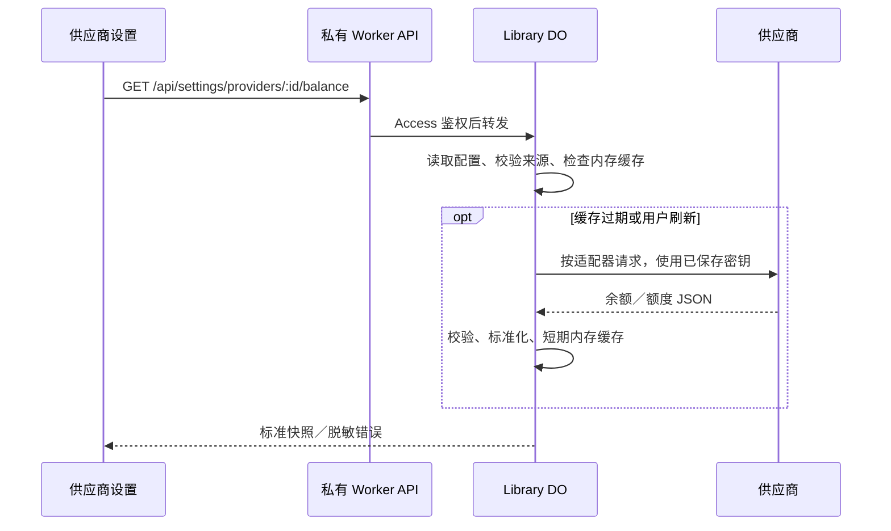

# 供应商余额与额度查询设计

日期：2026-10-20。状态：设计完成，待实施。本次只核对接口与制定方案，没有修改业务代码、查询真实账户余额或发起模型请求。

## 目标与边界

在「设置 → 供应商」中查看供应商返回的余额、密钥额度及订阅用量，复用已保存的 API 密钥。优先实现 DeepSeek、new-api、Sub2API，随后接入 OpenRouter；协议、余额来源和模型能力分别配置。

现有「用量统计」记录通过 EverChat 发起的请求及费用估算，供应商余额可能还包含其他客户端的消费、充值、赠金、订阅与管理员调整，两者独立展示。不根据本地消耗倒推账户余额，不将查询结果写入本地费用账本。

首版无需账号密码、供应商管理密钥、网页抓取或任意脚本。不做定时余额监控、低余额推送、自动充值、自动停用模型或跨供应商金额汇总。

## 已核实的接口

以下按调研时的官方文档和上游源码核对。不同部署版本、定制网关和权限配置仍需在接入时验证，接口失败不能等同于余额为零。

| 来源       | 查询与认证                               | 能够获得的数据                                                       | 必须保留的区别                                                                 |
| ---------- | ---------------------------------------- | -------------------------------------------------------------------- | ------------------------------------------------------------------------------ |
| DeepSeek   | `GET /user/balance`，Bearer 模型密钥     | 账户可用性、各币种总余额、赠金、充值余额                             | 账户钱包；CNY、USD 分开，不自动换汇                                            |
| new-api    | `GET /api/usage/token/`，Bearer 模型密钥 | 令牌总额度、已用、剩余、无限额度、过期时间；允许时附带用户额度       | 令牌额度与用户余额分别显示；原始额度不是直接可显示的货币金额                   |
| Sub2API    | `GET /v1/usage`，Bearer 模型密钥         | 根据模式返回密钥总额度、5 小时／日／周限制，或订阅周期额度、钱包余额 | `quota_limited` 与 `unrestricted` 的含义不同；`remaining` 不能一律标成钱包余额 |
| OpenRouter | `GET /api/v1/key`，Bearer 模型密钥       | 当前密钥额度、剩余、消费、重置规则及有效预算等                       | 当前密钥／有效预算，不冒充整个账户钱包                                         |

来源：[DeepSeek 余额文档](https://api-docs.deepseek.com/zh-cn/api/get-user-balance/)、[new-api 接口文档](https://docs.newapi.pro/en/docs/api/management/token-management/usage-token-get)、[new-api 返回字段](https://github.com/QuantumNous/new-api/blob/afe73b08ff6432aca4749a024391c7f886a5bd2d/controller/token.go)、[Sub2API 返回模式](https://github.com/Wei-Shaw/sub2api/blob/8f2cbb53d9d1c40e1865b07ac460571f7d4c48de/backend/internal/handler/gateway_handler.go)、[OpenRouter 密钥信息](https://openrouter.ai/docs/api/api-reference/api-keys/get-current-api-key)。

不以 OpenAI／Anthropic／Gemini 聊天协议推定存在余额接口。首版对没有适配器的来源显示「未支持余额查询」，正常聊天不受影响。例如 Anthropic 的组织用量／成本接口需要管理级凭据，不是一般工作区密钥的余额查询；Gemini 的账务由 Cloud Billing／AI Studio 管理，不能由 EverChat 的 Token 估算替代。[Anthropic 认证要求](https://platform.claude.com/docs/en/manage-claude/usage-cost-api)、[Gemini 计费说明](https://ai.google.dev/gemini-api/docs/billing)。

### DeepSeek

展示 `balance_infos` 中的币种、`total_balance`、`granted_balance`、`topped_up_balance`，保留十进制字符串，不先转换成浮点数再进行金额运算。`is_available` 单独表示供应商报告的账户可用性。赠金已经包含在总余额中，不能再次相加。

官方主机 `api.deepseek.com` 可自动识别。模型基础地址使用根路径或 `/v1` 时，余额查询均为 `/user/balance`。自定义代理必须显式选择来源并确认余额基础地址，不将其密钥转发到 DeepSeek 官方站点探测。

### new-api

解析应用级成功／失败以及 `data`，不能仅凭 HTTP 200 判定成功。当前源码返回 `total_granted`、`total_used`、`total_available`、`unlimited_quota`、`expires_at`；仅当密钥获准查询用户额度时，才返回 `user_quota`。

默认展示「密钥剩余额度」，有 `user_quota` 时另列「账户剩余额度」。`unlimited_quota=true` 表示令牌没有自身额度上限，不表示账户余额无限，也不意味着请求必定可用。

通过同实例的公开 `GET /api/status` 获取 `quota_per_unit` 等计量元数据，并按站点缓存。原始额度始终保留；只有换算语义和比例得到确认后才附加金额或等值额度。不能硬编码常见比例，不能将自定义货币符号直接当作 ISO 币种。元数据缺失、非法或获取失败时，仍能显示原始额度，不显示猜测金额。[状态元数据](https://github.com/QuantumNous/new-api/blob/afe73b08ff6432aca4749a024391c7f886a5bd2d/controller/misc.go)。

该版本使用只读令牌认证：允许过期、耗尽令牌查询，但禁用令牌、用户状态与 IP 限制仍会影响访问。Cloudflare Worker 的出口地址可能与用户浏览器不同，权限错误需明确展示，不能尝试绕过 IP 限制。[认证源码](https://github.com/QuantumNous/new-api/blob/afe73b08ff6432aca4749a024391c7f886a5bd2d/middleware/auth.go)。

### Sub2API

按 `mode`、实际存在的结构字段和明确单位解析，避免使用 `remaining ?? quota.remaining ?? balance` 后统一标成余额的简化方式：

- `quota_limited`：显示密钥额度及 `rate_limits` 中各时间窗口的已用、上限、剩余和重置时间。只有周期限制而没有总额度时，也能正常展示，不补一个虚构钱包余额。
- `unrestricted` 且有 `balance`：显示账户钱包。这里的 unrestricted 指密钥级限制模式，不代表免费无限使用。
- `unrestricted` 且有 `subscription`：按日／周／月展示订阅用量与上限、到期时间。上游若提供综合 `remaining`，标注为订阅剩余额度，不与各周期相加。
- 只返回套餐名称而无余额或订阅详情：显示套餐及「未返回额度详情」，不回退为零、不臆造无限额度，也不转而登录管理面板。

`isValid` 在当前源码中对某些已过期／耗尽状态仍可为 true，不能单靠它判断是否能生成；结合明确 `status`、有效期与额度展示。只对响应明确给出的窗口显示重置时间，不根据缺失的窗口起点推算精确时间。当前 `/v1/usage` 允许过期／耗尽密钥查询，但仍校验基础身份与 IP 等限制。[认证源码](https://github.com/Wei-Shaw/sub2api/blob/8f2cbb53d9d1c40e1865b07ac460571f7d4c48de/backend/internal/server/middleware/api_key_auth.go)。

## 配置与界面

供应商详情增加紧凑的「余额与额度」section：来源选择、解析后的查询地址、查询结果及刷新按钮。来源选项为「自动」「不查询」「DeepSeek」「new-api」「Sub2API」，接入 OpenRouter 时再增加对应项。

「自动」只匹配明确的官方主机；未知主机不枚举接口、不根据供应商显示名或模型名发送密钥。new-api 导入预览可明确预选 new-api，普通手动添加的中转站由用户选择。聊天 API 类型的切换不重置余额配置、密钥或其他输入。

默认从模型基础地址和适配器已知后缀推导平台基础地址；必要时允许修改同源的余额基础地址，并始终显示最终查询路径。只移除明确的末尾协议路径，不丢弃反向代理前缀。Sub2API 的 `/antigravity` 等专用前缀不能盲目当作站点根路径；无法确定时要求核对，不向多个路径试发密钥。

例如模型地址 `https://relay.example.com/newapi/v1`，new-api 查询建议为 `https://relay.example.com/newapi/api/usage/token/`；最终地址在保存和首次查询前可见。首版余额接口限定为配置供应商同源，跨域管理接口另作后续设计。用户修改模型地址后，自定义余额地址若不再同源，应提示修正，不静默改写输入或继续发送密钥。

供应商列表只在有缓存结果时显示一行必要摘要，例如「账户余额 CNY 23.50」「密钥额度 120,000」「订阅日额度 USD 4.20」。未查询、失败和不支持保持可区分；列表初始化不批量查询全部供应商。详细周期信息留在详情中，避免增加大量卡片、边框和垂直空隙。

有上次成功结果时，刷新失败保留结果并标记「更新失败」与查询时间；不能把旧余额伪装成最新。刷新只更新局部内容，不使名称、密钥或模型配置消失。错误详情复用现有 HTTP 状态与正文诊断，但必须脱敏，不直接渲染供应商 HTML。

## 统一数据模型

查询返回结构化快照，前端不读取上游原始 JSON：

| 字段                                | 含义                                                                             |
| ----------------------------------- | -------------------------------------------------------------------------------- |
| `source`、`providerId`、`fetchedAt` | 实际适配器、供应商引用和获取时间；供应商未提供数据时间时不虚构 `sourceUpdatedAt` |
| `availability`                      | 供应商明确报告的可用／不可用／未知，不根据金额单独决定是否允许生成               |
| `metrics[]`                         | 多个独立指标，可同时容纳账户、密钥和订阅限制                                     |
| `scope`                             | `account`、`api-key`、`subscription`，不能混淆来源范围                           |
| `kind`、`unit`                      | 钱包／额度／周期预算；明确币种、原始额度、Tokens 或次数                          |
| `remaining`、`used`、`limit`        | 可选的十进制字符串；零是有效值，字段缺失是未知                                   |
| `limitState`                        | `limited`、`unlimited`、`unknown`；不以 null 或零同时表达三种含义                |
| `period`、`resetAt`、`expiresAt`    | 可选的周期与时间；秒、毫秒和 ISO 时间由各适配器明确转换                          |
| `breakdown`                         | 赠金／充值等分项，标记其已包含于总额，避免重复相加                               |

new-api 的原始整数必须验证精度；超过 JavaScript 安全整数范围时不得静默舍入，保留精确值或明确报告无法可靠解析。USD 计价的订阅额度也不能默认为可提现的钱包。

不汇总不同币种，不把同一账户的多个密钥余额相加；没有账户唯一标识时不猜测哪些密钥共享钱包。首版不增加「供应商总余额」数字。

## 请求、缓存与免费层资源

复用现有 Library DO 和供应商配置存储。查询在拥有配置的 DO 中完成，HTTP Worker 只鉴权与转发，保持现有模型列表接口的处理方式。无需新 DO、Workflow、Cron、R2 或余额历史表。

- 只有进入已启用查询的供应商详情且缓存过期，或用户点击刷新时请求；聊天启动、逐 Token 输出和生成完成不触发余额查询。页面隐藏或关闭后不轮询。
- 前端使用现有 TanStack Query 内存缓存，关闭默认的窗口聚焦自动重查与自动失败重试。服务端成功缓存建议 5 分钟，手动刷新可绕过新鲜期，但同一连接 30 秒内合并请求并返回已有结果／重试时间。这是避免误触连发的初始策略，实施时按接口表现核对。
- DO 内按连接身份合并在途请求；new-api 单独缓存同站点的单位元数据，建议 1 小时，元数据请求不携带模型密钥。默认 new-api 查询需要一条额度请求，元数据缓存未命中时再增加一条公开读取。
- 只存紧凑的标准快照，不缓存整份 Sub2API 历史统计响应。不上报或复制其额外的每日／模型用量，也不自动分页获取账单。单次请求建议 10 秒超时、1 MiB 响应保护；超限明确报错而不截断 JSON。
- 每次设置保存后仅对受影响的连接取消／失效缓存，模型名称等无关编辑不清空余额。旧请求完成后须重新核对连接身份，防止密钥更换、地址修改或删除后旧结果重新写回。
- 缓存身份包含来源、查询地址和密钥的内部连接标识；不把密钥或密钥摘要放进客户端查询键、URL、日志或公开响应。DO 重启／休眠失去缓存后按需重查，不为保住缓存写库、定时保活或设置 alarm。
- 接口使用 `Cache-Control: no-store`，SW 不缓存私有余额响应，前端退出登录／Access 失效时清理相关内存结果。失败可短暂合并，429 遵守 `Retry-After`；保留旧成功快照和原获取时间。

刷新所有供应商如果后续增加，必须由用户主动触发并限制并发，不能把打开设置变成 50 个上游请求。低频查询增加的资源主要是 HTTP 请求与短暂 DO 活跃时间，没有每 Token／每次生成的额外数据库读写；实际免费层占用需在实施后测量，不用本地耗时替代 Cloudflare 账单证据。

## 持久化与离线迁移

只持久化余额查询配置，查询快照与错误不落库。现有 `provider_profiles` 使用固定列，不能仅扩展 TypeScript 类型就声称配置可以保存。

建议增加可空的 `balanceConfig` JSON 列，保存来源及可选同源基础地址；原有模型密钥继续共用，不另存余额专用凭据。新增配置进入校验、设置保存／读取和不含密钥的配置备份流程。

按现有运维流程提供本地维护迁移：备份 → 维护窗口内增加列并初始化 → 校验 → 部署匹配代码 → 复测／回滚。全新库的建表定义直接含新列；生产旧库由运维脚本处理。不在业务启动、用户请求或配置加载中加入探测列、`ALTER TABLE`、自动回填或多版本兼容逻辑。实施时与其他配置变更合并为一次迁移，不为余额维护一套独立迁移系统。

## 与 Sub2API 连接导入的关系

Sub2API 当前密钥页提供「导入 CC Switch」，也能复制不同客户端的配置。其导出使用 `ccswitch://v1/import?...`，含名称、端点、密钥、客户端类型和余额查询脚本；不是 new-api 的 `newapi_channel_conn` JSON。[入口源码](https://github.com/Wei-Shaw/sub2api/blob/8f2cbb53d9d1c40e1865b07ac460571f7d4c48de/frontend/src/views/user/KeysView.vue)、[链接与余额脚本](https://github.com/Wei-Shaw/sub2api/blob/8f2cbb53d9d1c40e1865b07ac460571f7d4c48de/frontend/src/utils/ccswitchImport.ts)。

后续可给[连接信息导入](new-api-connection-import-plan.md)增加格式适配器，共用预览、保存、去重和模型获取；客户端类型提示可映射协议，但仍允许核对。只在专用粘贴入口本地解析链接，不为 EverChat 注册／接管 CC Switch 协议，也不将带密钥的深链用作网页跳转。

导入的 `usageScript` 即使来自熟悉的平台也不执行；余额查询由 EverChat 内置适配器负责。CC Switch 链接也可能来自其他服务，不能仅凭链接协议自动判为 Sub2API。未知来源需用户选择。new-api 导入首版仍按原方案实施，Sub2API 格式支持作为后续扩展，不以调研记录表示已经支持。

## 实施顺序与验收

1. 定义 `shared/providers` 的查询配置与快照；设计并验证离线迁移、配置保存与备份流程。
2. 实现 `worker/providers/balance` 中的适配器接口和 DeepSeek，接入现有鉴权路由、DO 内缓存与错误诊断。
3. 完成供应商详情／列表的紧凑展示与 zh-CN／English 词条，再接入 new-api 和 Sub2API，覆盖单位、窗口与权限差异。
4. 与 new-api 导入预览关联来源选择；完成三类适配器验收后再扩展 OpenRouter，管理级账务接口保持后续独立评估。

必须验证：多币种与赠金不重复相加；零、无限、缺失、过期、禁用和权限错误可区分；new-api 原始额度／换算失败／可选用户额度；Sub2API 三种返回模式、只有周期限制及缺失订阅详情；应用级失败、HTML 登录页、401／403／404／429、超时、超大或损坏响应；代理前缀及同源校验；更新连接时旧请求不覆盖新配置；所有余额入口均需 Access、匿名分享页不能查询。

测试使用上游响应形状的脱敏夹具，禁止在测试或快照中写真实密钥。完成 `pnpm test`、`pnpm typecheck`、构建、相关浏览器回归和格式检查；真实供应商验收单独记录版本、状态与资源证据。以上实施和运行验收尚未执行。
