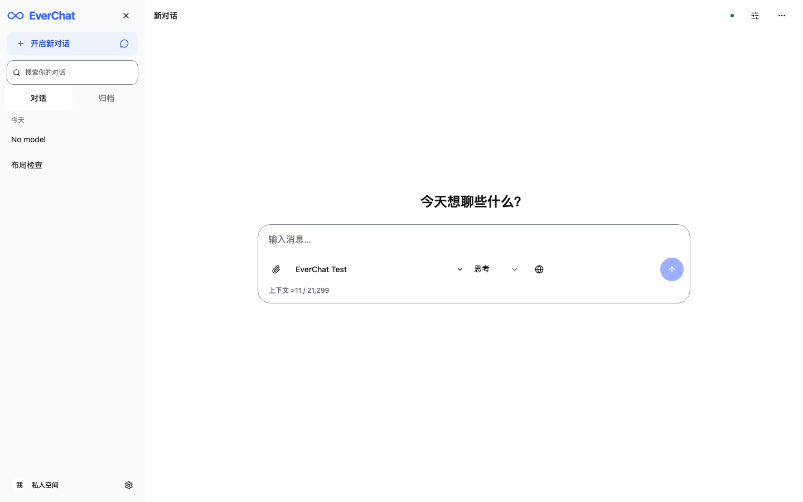

# EverChat：shadcn/ui 迁移与 DeepSeek 视觉对齐方案

方案日期：2026-10-15。实施验收日期：2026-10-16。状态：A–E 已完成；真实移动设备验收未测。

用户在方案完成后已要求完成迁移与风格重写。实施目标是用 shadcn/ui 替换 DaisyUI，尽可能接近 DeepSeek 的布局、配色与交互密度，同时保留 EverChat 已有的功能和可访问性要求。

## 1. 决策与范围

采用 **shadcn/ui + Radix primitives + Nova 样式基底 + 自定义语义色**。继续使用 React、Vite、Tailwind CSS、Lucide 和 Streamdown。Nova 的紧凑间距适合当前设计方向，圆角、聊天布局和颜色再按本方案调整；这是一项项目设计选择，不表示默认预设就与 DeepSeek 相同。[shadcn 的样式与 primitives 选择说明](https://ui.shadcn.com/docs/changelog/2025-12-shadcn-create)

迁移包含主布局、输入区、消息呈现、侧栏、模型选择、设置、菜单和弹窗。保留 EverChat 品牌与文案，不使用 DeepSeek 的鲸鱼标志、品牌名称、账号体系或服务入口。

以下约束继续有效：

- 只显示必要的导航、操作、状态与错误；正常状态不增加解释段落。
- 减少重复边框与留白，低频设置按需展开；保持正文可读和操作可达。
- 支持浅色、深色、系统三种模式，满足现有对比度与至少 44 CSS px 的主要操作区域要求。
- 原型阶段不设计旧 UI 兼容层、双主题长期共存方案或迁移开关；最终直接移除 DaisyUI。
- 保留当前数据结构、API、SPA 对话 URL、客户端流式响应、低频服务端持久化及 Cloudflare 部署方式。本次不扩展 Agent、OCR、MCP 或知识库。

本方案接替[首轮前端方案](frontend-refinement-plan.md)和[紧凑布局方案](frontend-compact-layout-plan.md)中的组件库、配色和页面骨架决策；其单位规则、紧凑原则、焦点要求和功能回归要求继续有效。旧文档的完成记录保留为历史记录。

## 2. 参考界面实查

### 2.1 观察口径

参考：[DeepSeek Web](https://chat.deepseek.com/)，2026-10-15 在用户已登录的内置浏览器中检查。实际检查了 1440 × 900 桌面、390 × 844 窄屏的空对话与已有回答，以及桌面侧栏、设置、浅色与深色模式。

用户已授权临时切换主题并发送一条测试消息。本次只用测试消息检查标题、列表、表格、代码和思考内容，没有打开账号中的其他历史对话。主题已恢复为原来的“跟随系统”，新对话的思考／搜索开关也已恢复；新增的测试对话保留。

本节尺寸和颜色来自渲染后 DOM 的 `getBoundingClientRect()` / `getComputedStyle()`，单位为 CSS px。它们是本次页面快照，不是对 DeepSeek 全部页面或内部设计系统的推断。网页可能随版本、屏幕和账号变化；后文标为“目标”的数值属于 EverChat 的设计决策。

| 已观察区域    | 实测／可见特征                                                                                   | EverChat 的取舍                                                    |
| ------------- | ------------------------------------------------------------------------------------------------ | ------------------------------------------------------------------ |
| 桌面侧栏      | 外宽 261px，含 1px 右边界；历史行高 40px，圆角 12px；按时间分组                                  | 宽度约 16.25rem；行高保留至少 44px；使用淡背景表示当前对话         |
| 桌面空对话    | 简短问候与输入框组成一个居中单元；输入框 776 × 124px，圆角 24px；外层宽 840px、水平内边距各 32px | 使用同样的视觉重心，不加说明卡片；保留 EverChat 名称和必要配置入口 |
| 空对话问候    | 桌面 24px / 32px、字重 600；390px 窄屏 20px / 28px                                               | 换算成 rem；文字按内容换行，避免固定高度                           |
| 手机空对话    | 390px 视口中输入框 326 × 106px，距左右各 32px                                                    | 空页面可保留较宽页边距；短屏优先可用高度                           |
| 进行中的对话  | 输入框移到底部；桌面正文宽 752px，比输入框内收各 12px；用户气泡右对齐，助手正文开放排版          | 统一居中内容列；保留单一消息滚动容器和稳定的输入组件               |
| 手机对话输入  | 390px 视口中输入框宽 358px、左右各 16px，高 106px                                                | 普通对话左右各 1rem；为 44px 操作区域预留略高的工具栏              |
| 用户消息      | 浅色淡蓝、深色中性灰；圆角 22px；内边距上下 10px、左右 16px                                      | 沿用相近气泡，长文本、附件和分支状态仍可辨认                       |
| 助手 Markdown | 正文 16px / 28px，H1 24px / 34px；表格 15px / 25px，以横线分行；代码块有轻背景和一排工具         | 保留 Streamdown，只调整排版和外壳，避免双层代码框                  |
| 思考区        | 可折叠标题、用时、浅灰正文、展开区左侧细线；测试回答完成后内容仍展开                             | 保留流式 Markdown、默认展开和用户手动折叠状态；不在完成时自动收起  |
| 工具按钮      | 输入框内部一排胶囊与图标，发送按钮圆形；实测部分按钮仅 34px 高                                   | 视觉可保持紧凑，但实际点击区域至少 44px，不能叠压相邻区域          |
| 桌面设置      | 760 × 500px，圆角 24px；标题和关闭入口在顶部，左侧分类、右侧内容                                 | 借用分区方式；EverChat 的供应商表单更多，应使用更大的自适应窗口    |

深色用户气泡局部，仅含本次测试文字：


### 2.2 配色观察与可访问性差异

| 用途             | 参考站浅色实测 | 参考站深色实测                 |
| ---------------- | -------------- | ------------------------------ |
| 页面背景（body） | `#ffffff`      | `#151517`                      |
| 侧栏表面         | `#f9fafb`      | `#1b1b1c`                      |
| 输入框表面       | `#ffffff`      | `#2c2c2e`                      |
| 输入／普通文字   | `#0f1115`      | `#f9fafb`                      |
| 输入框边界       | 黑色 10%       | 白色 6%                        |
| 输入占位文字     | `#adb2b8`      | `#81858c`                      |
| 思考标题文字     | `#61666b`      | `#cfd3d6`                      |
| 用户气泡表面     | `#edf3fe`      | 深色截图中呈中性灰，未单独测色 |

实测浅色占位文字 `#adb2b8` 在白底上的对比度约 **2.13:1**，不足普通文字的 4.5:1 要求；不能原样复制。弱边界可以用于装饰分隔，但输入控件、焦点和必要图标必须另做合格的识别方式。普通文字、占位文字及悬停文字的判断依据见 [WCAG 1.4.3](https://www.w3.org/WAI/WCAG22/Understanding/contrast-minimum.html)；必要非文字识别信息见 [WCAG 1.4.11](https://www.w3.org/WAI/WCAG22/Understanding/non-text-contrast.html)。

尚未实测的参考状态：真实手机软键盘、安全区域、参考站上传流程、长时间生成与失败状态、移动端设置。对应行为由 EverChat 现有能力和本方案验收定义，不能写成已与参考站完全一致。

## 3. EverChat 的目标视觉规范

### 3.1 主题 token

使用 shadcn 的语义 token 与 `.dark` 覆盖方式；组件使用 `bg-background`、`text-foreground` 等语义工具类。CSS 中以完整颜色值定义 token，并通过 Tailwind 4 的 `@theme inline` 暴露。参考 [shadcn 主题规则](https://ui.shadcn.com/docs/theming)。

以下是目标色板，不是声称从 DeepSeek 提取出的完整 token。输入边界与占位文字已作可访问性调整。颜色只在主题文件中定义，调用处不散布十六进制颜色。

| Token／用途                                       | 浅色目标              | 深色目标              |
| ------------------------------------------------- | --------------------- | --------------------- |
| `background`                                      | `#ffffff`             | `#151517`             |
| `foreground`                                      | `#0f1115`             | `#f9fafb`             |
| `sidebar`                                         | `#f9fafb`             | `#1b1b1c`             |
| `sidebar-foreground`                              | 同 `foreground`       | 同 `foreground`       |
| `card` / `popover`                                | `#ffffff`             | `#2c2c2e`             |
| `card-foreground` / `popover-foreground`          | 同 `foreground`       | 同 `foreground`       |
| 自定义 `composer`                                 | `#ffffff`             | `#2c2c2e`             |
| `muted` / `secondary`                             | `#f3f4f6`             | `#2c2c2e`             |
| `muted-foreground`（含占位文字）                  | `#61666b`             | `#a3a7ae`             |
| `secondary-foreground`                            | 同 `foreground`       | 同 `foreground`       |
| `primary` / `primary-foreground`                  | `#3964fe` / `#ffffff` | `#3964fe` / `#ffffff` |
| `accent` / `sidebar-accent`                       | `#edf3fe`             | `#313b62`             |
| `accent-foreground` / `sidebar-accent-foreground` | `#294dd5`             | `#c5d2ff`             |
| `sidebar-primary` 配对                            | 同 `primary` 配对     | 同 `primary` 配对     |
| 自定义 `user-message` 配对                        | `#edf3fe` / `#0f1115` | `#2c2c2e` / `#f9fafb` |
| `border` / `sidebar-border`（装饰分隔）           | `#e5e7eb`             | `#3b3b3f`             |
| `input`（必要控件边界）                           | `#858b95`             | `#858b95`             |
| `ring` / `sidebar-ring`                           | `#3964fe`             | `#8fa8ff`             |

对不透明的目标色做 sRGB 计算：浅色正文约 18.90:1，浅色次级文字约 5.80:1，主要按钮白字约 4.74:1，深色正文约 17.45:1，深色占位文字在输入表面约 5.77:1；输入边框分别约 3.43:1 / 4.06:1，选中行文字分别约 6.05:1 / 7.26:1。数字仅验证这些配对，最终仍须测浏览器中包含透明度、悬停和状态覆盖的实际组合。

错误、警告、成功另定义语义配对，不把现有 DaisyUI 的 `error`、`warning`、`success` 直接删成默认文字色。实施阶段逐个验证错误提示、联网失败、待发送、同步状态、搜索高亮、选中文本和能力检测状态；每种状态同时有文字或图标，避免仅靠颜色。

**边界原则：** 消息、字段组、模型编辑区不用包围卡片；菜单和弹窗由浮层表面负责层级；输入区只保留一层必要边界与清晰的聚焦轮廓。普通布局接缝可以没有分隔线。保持输入边框合格，通过减少边界数量获得轻量观感。

### 3.2 尺寸与排版

继续遵守[尺寸单位决策](frontend-compact-layout-plan.md#33-尺寸单位选择)：`html` 字号为 `100%`；字体、间距、圆角和宽度上限使用 rem；行高使用无单位值；细线 1px、焦点线 2px；页面高度用 dvh，安全区域使用 `env()`；DOM 滚动与高度测量继续按 CSS px 运算。

| 项目                 | EverChat 目标（括号为默认字号下的尺寸）                                 |
| -------------------- | ----------------------------------------------------------------------- |
| 桌面侧栏             | 16.25rem（260px）左右；可收起，主内容在剩余空间内居中                   |
| 桌面聊天输入框       | 最大 48.5rem（776px）；可用空间不足时收缩                               |
| 桌面正文             | 最大 47rem（752px）；相对输入框两侧各内收约 0.75rem                     |
| 页面左右留白         | 普通手机对话 1rem；空对话在空间足够时 2rem；桌面按内容列分配            |
| 顶栏                 | 最小 3.5rem（56px），按安全区域与字体增高；移除常驻粗分隔               |
| 问候文字             | 桌面 1.5rem / 1.33，手机 1.25rem / 1.4，字重 600                        |
| 正文／输入文字       | 1rem（16px）；正文行高 1.75，输入行高 1.5                               |
| 思考正文             | 0.9375rem（15px），行高 1.8；由合格次级文字色区分                       |
| 菜单／表单／侧栏文字 | 通常 0.875rem（14px）；短辅助状态可用 0.75rem                           |
| 气泡／输入／弹窗圆角 | 用户气泡 1.375rem、输入与大弹窗 1.5rem；普通菜单约 0.75rem              |
| 普通控件圆角         | 基准 `radius` 为 0.75rem；圆角胶囊单独用全圆角，避免所有组件都变成 24px |
| 控件与折叠标题       | 至少 `max(2.75rem, 44px)` 操作区域；图标可为 1–1.125rem                 |
| 消息之间             | 沿用手机 1.25rem、桌面 1.5rem；不复制参考站所有段落留白                 |
| 字段间距             | 同组 0.5–0.75rem，组间 1rem，标签到输入 0.25rem                         |

正文从现有 15px 改到 16px、行高从 1.9 改到 1.75 是明确的视觉调整：接近参考站的阅读比例；通过减少容器与重复标题占位维持可视范围，不缩小操作区域。字体继续采用系统字体及中文回退，暂不增加外部字体请求；字形差异不算完全像素一致。

桌面输入框在空页面可接近参考的 124px；普通对话以约 112px 起步，文字区单行自动增高，主要工具保持 44px 点击区域。具体高度由内容与 padding 决定，不固定死高。320 × 568、默认字体、空草稿且没有额外提示时，输入区域目标不超过 144px，消息视口至少 300px。放大文字、附件和错误出现时允许合理增高。

## 4. 页面与交互设计

### 4.1 主布局与新对话

- 桌面使用侧栏和主区两列。侧栏收起后，消息与输入区按整个可用主区居中；收起入口始终可见。手机使用带遮罩的 Sheet。
- 空对话将一句“今天想聊些什么？”与输入框放在视觉中心略偏上的位置。移除现有常驻的三个开场建议按钮，减少同屏竞争。
- 首次没有可用模型时，输入区显示直接的“配置模型”操作；供应商入口可定位到供应商 Tab，不显示演示模式或虚构模型。
- 发送后使用底部输入区。整个页面始终只有一个 `Composer` 实例，草稿、附件、输入法组合状态和编辑器引用保持稳定；通过布局切换位置，避免两份输入框互相同步。
- 新对话聚焦输入框；浏览器前进／后退、恢复对话、打开菜单、流式片段到达不抢焦点。焦点动作由用户触发的意图决定。

### 4.2 侧栏与顶栏

- 顶部保留 EverChat 品牌、搜索、收起入口；新对话使用单个胶囊按钮，不叠加卡片外框。
- 搜索入口打开后呈现搜索框与结果，关闭后归还焦点。搜索词与现有跨对话检索行为保留，不因视觉折叠丢失；有搜索词时保持搜索状态可见。
- 置顶、普通历史和归档入口保持可达。按日期分组可直接根据现有时间数据计算，避免为视觉分组增加服务端请求。归档使用同一列表的筛选入口。
- 当前对话用 `sidebar-accent` 配对、字重与 `aria-current="page"` 表示；取消大面积纯蓝选中条，继续保证文字对比度。置顶与待发送提示各有可访问名称。
- 对话项仍是真实 `/c/:id` 链接；普通点击 SPA 切换，修饰键点击和新标签打开保留浏览器行为。
- 顶栏保留短标题、当前会话搜索、会话参数和更多菜单。正常“已同步”收为可访问状态图标／提示；离线、同步失败、保存未确认继续有明确状态，不能藏进仅悬停可见的内容。

### 4.3 输入区与模型选择

结构保持为“文本区 + 一排工具”，外层只有一个圆角表面。正文输入、模型和工具栏内部不重复画边框。

工具按以下优先级排布：可搜索的模型选择、思考设置、联网、附件、右侧固定发送／停止。保留思考强度在聊天框中的现有约定。思考选择显示当前有效值；未知能力模型继续遵守现有自动识别／尝试与手动覆盖规则。

模型选择使用 `Popover + Command`，按供应商分组，显示已启用模型的显示名；必要时显示供应商或 ID，避免重名歧义。保留稳定的供应商 ID + 模型 ID 选择值。菜单通过自身的筛选输入接收键盘焦点，选中后归还聊天输入框，不改变提示词、草稿和其他会话参数。

思考强度选项较少时使用 `Select`。联网沿用当前设置入口和状态；附件入口仍支持文件与图片。320px 下模型选择可以收缩并截断显示名，必要时工具栏换成两行，不能把发送／停止挤出屏幕或缩小到 44px 以下。

附件预览、上传进度、失败、取消和移除入口保持原有语义。没有启用相应后端能力时不显示空的附件入口。Enter 发送、Shift+Enter 换行、中文输入法与粘贴行为保持。

### 4.4 消息、思考和工具

- 用户消息使用右侧气泡，助手使用全宽开放正文，模型名表示该条回答真实使用的模型；不建立整列头像占位。
- 思考、联网与摘要用独立轻量折叠标题；不再套一层“过程”总卡片。无对应内容就没有空入口。
- 思考继续流式 Markdown 输出，默认展开，完成后维持用户选择。现有“查找思考内容并自动展开”和定位失败工具调用必须有效。
- 正文与思考共用 Streamdown。代码、数学和 Mermaid 插件、按需加载、离线回退、安全设置保持；表格只保留必要横线，宽表与代码局部横向滚动。
- 常用复制、重新生成、引用与更多动作在键盘和触屏上始终可达；不照搬鼠标悬停才出现的操作。分支、编辑版本、摘要选用状态继续可辨认。
- 复用现有自动跟随滚动：位于底部则跟随，主动上滚后暂停，点击向下按钮恢复。字体、代码高亮、图表和图片加载引起高度变化也必须正确处理。

### 4.5 设置窗口

桌面采用左侧分类、右侧内容，仍为通用／供应商／对话／预设／联网五个 Tab；使用纵向 Tabs 语义与方向键导航。窗口目标最大宽度 60rem，高度不超过 `min(48rem, 92dvh)`，不照搬参考站 760 × 500px 的固定容量。手机使用横向可滚动 Tab，设置窗口占满可用视口。

标题、关闭按钮、分类入口和当前数据归属的保存状态保持可达；只有主体滚动。长表单下滑后关闭按钮仍在视口内，最后一个字段不被状态区遮挡。

供应商仍采用主从布局：宽屏左列表右编辑，窄屏列表与详情切换并提供返回。连接字段直接显示；类型切换、端点编辑均只改变目标字段，不联动清空名称、密钥或模型。名称为空的新供应商保留为本地草稿，满足非空校验后才能持久化。

模型列表保留多选启用、获取、添加、删除、ID 与显示名编辑、统一／专属系统提示词、能力来源与测试。常见字段直接编辑，能力细项折叠。自动保存、失败重试与恢复、密钥显示开关均保留；切 Tab 不得将未保存数据错误标为已保存。

## 5. 组件与代码迁移清单

### 5.1 基础选型

shadcn/ui 将组件源代码加入项目，基础交互由选定的 primitives 提供。项目统一使用 Radix 版本，避免在同一个组件体系混用 Base UI 的 `render` 与 Radix 的组合 API。当前 shadcn 支持两种基础库；选择 Radix 是本项目减少交互选型变量的决定。[官方 CLI 说明](https://ui.shadcn.com/docs/changelog/2026-03-cli-v4)

| 现有区域／实现                        | 目标组件                                              | 涉及文件与注意事项                                                                                                        |
| ------------------------------------- | ----------------------------------------------------- | ------------------------------------------------------------------------------------------------------------------------- |
| `btn`、`loading`、`badge`、`alert`    | Button、Spinner、Badge、Alert                         | 所有 UI 文件；统一尺寸和状态变体，错误不重复显示                                                                          |
| `input`、`textarea`、`select`         | Input、Textarea、Select／NativeSelect、Label          | `ProviderSettings`、`ModelMetadataFields`、`ConversationSettings`、`PromptPresets`、`WebToolSettings`；保留受控草稿与校验 |
| `checkbox`、`toggle`                  | Checkbox、Switch                                      | 模型启用与布尔设置；处理 Radix 的 checked / indeterminate 类型                                                            |
| radio 充当 Tab                        | Tabs                                                  | `ProviderSettings`、侧栏分类；完整标签、panel 关联与键盘导航                                                              |
| 原生 popover 的 `ActionMenu`          | DropdownMenu                                          | `ActionMenu`、`MessageActions`、`ConversationActions`；改用组件菜单项，移除手写循环焦点与 anchor 定位                     |
| 上下文估算浮层                        | Popover                                               | `ContextEstimate`；保留紧凑摘要、明细与异常，不把关键错误放入 Tooltip                                                     |
| 原生 dialog + `modal-*`               | Dialog；确认删除用 AlertDialog                        | `App`、供应商删除、会话操作、消息操作、附件、图片、摘要、备份；一起检查焦点与嵌套浮层                                     |
| 手写手机侧栏焦点陷阱                  | Sheet                                                 | `App`、`useSidebar`；保留响应式与关闭意图，移除重复焦点陷阱                                                               |
| 聊天模型原生 select                   | Popover + Command                                     | 聊天输入区；多供应商分组、搜索、空状态、稳定选择值                                                                        |
| `Disclosure` 的 DaisyUI collapse 外观 | 保留原生 details/summary，使用新 token 与 Lucide 箭头 | `Disclosure`、`GenerationMetadata`；保留展开记忆、强制展开和搜索定位行为                                                  |
| 原生 progress + `progress` 类         | Progress 或有统一样式的原生 progress                  | 上传与备份；保留真实进度、取消和状态播报                                                                                  |
| Markdown、代码、公式、图表            | 保留 Streamdown 和现有插件                            | `App`、`style.css`；只适配主题与边界，不替换渲染或通信协议                                                                |
| 主消息滚动容器                        | 保留原生 overflow 容器                                | `useFollowScroll`、搜索定位；不同时换成 ScrollArea 或新的 MessageScroller                                                 |

保留原生 details 是有意的范围选择：当前 `ConversationSearch.reveal()`、`ToolActivity.locate()` 直接展开 details，搜索文本也依赖折叠内容仍在 DOM 中。更换颜色和外观即可消除 DaisyUI 依赖；若以后改用 Collapsible，须同时迁移展开接口与搜索索引，单独验证隐藏内容检索，不能只替换标签。

暂不引入额外表单框架、完整 Sidebar 模板或 AI 聊天整套组件。现有受控输入、自动保存、流式协议与滚动行为已有业务约束；本次使用 UI primitives 组合这些能力，保持排错范围清楚。

### 5.2 配置与目录

基线为当前工作区，包括已存在的未提交改动。迁移基线锁定为 React 19.3、Tailwind 4.2、Vite 8、TypeScript 6，已有 Tailwind Vite 插件，无需重建项目或升级整套工具链。shadcn 官方支持 React 19 / Tailwind 4。[兼容说明](https://ui.shadcn.com/docs/tailwind-v4)

实施时：

1. 增加 `components.json`，选择 `radix-nova`、Neutral 基色、Lucide、`rsc: false`、`tsx: true`、`cssVariables: true`，CSS 指向现有 `src/style.css`。以实施时核定版本的 CLI schema 为准，记录实际 CLI 版本。
2. 基础组件放在 `src/components/ui/`，`cn()` 放在 `src/lib/utils.ts`；聊天组合组件可放在 `src/components/chat/`，设置组合组件放在 `src/components/settings/`。业务 hooks 和 API 模块不随目录重排一起大改。
3. 为编辑器与 CLI 在根 `tsconfig.json` 和 `config/tsconfig.app.json` 配置 `paths: { "@/*": ["./src/*"] }`，保留现有 references。Vite 增加同义的 `resolve.alias`；使用 ESM 的 `fileURLToPath(new URL('./src', import.meta.url))`，保持 Worker／tools 配置边界。
4. TypeScript 6 已弃用 `baseUrl`；不直接照抄安装示例中的 `baseUrl`，也不为消除警告添加 `ignoreDeprecations`。[TypeScript 6 说明](https://www.typescriptlang.org/docs/handbook/release-notes/typescript-6-0.html)
5. 按实际组件引入 CLI 生成的 Radix 依赖、`clsx`、`tailwind-merge`、变体工具及 Command 所需依赖；保留已有 Lucide。动画／基础 CSS 导入采用所选版本生成的规则，避免混合不同代际模板。
6. 安装过程逐项审查 CSS、配置与 lockfile diff。合并 Vite alias，保留 React、Tailwind、Cloudflare、PWA 插件、测试环境配置和 SPA fallback；不能用官方最小示例覆盖整个 Vite 文件。[已有 Vite 项目的安装方式](https://ui.shadcn.com/docs/installation/vite)
7. UI 完全迁移后使用 `pnpm remove daisyui`，删除 DaisyUI plugin、组件类与变量；仅保留 Tailwind 和新主题规则。

原方案的 CLI 命令示例（实际安装过程与例外见第 10 节）：

```sh
pnpm dlx shadcn@latest init --base radix --preset nova
pnpm dlx shadcn@latest add button input textarea label select native-select checkbox switch tabs dialog alert-dialog sheet dropdown-menu popover command tooltip badge alert progress spinner
```

正式运行前核对当时 CLI 支持项与版本，将实际配置和依赖锁进仓库；不使用生成新项目模板的参数，也不批量覆盖已有业务文件。

### 5.3 主题迁移

- 将 `src/platform/theme.ts` 的解析结果应用到根元素 `.dark`，继续保留 light / dark / system 的用户选择、系统偏好监听与跨标签页同步；设置 `color-scheme`，同步浏览器 `theme-color`。
- 首屏加载前应用有效主题，避免浅色闪屏；增加受存储限制时的回退。现有主题存储值可以继续使用，不额外设计旧配色兼容层。
- 将 `base-100/200/300`、`base-content`、`primary-content`、`rounded-box/field`、`--color-*` 等引用按用途迁移，不能全局字符串替换成单一色阶。
- 同步 Streamdown 代码主题、Mermaid、滚动条、文本选中、搜索高亮、输入占位和 focus-visible；检查第三方内部控件，避免迁移后仍出现旧颜色。
- PWA manifest、HTML theme-color、EverChat 图标底色同步新色板；保留品牌形状与离线能力。静态 manifest 与动态主题的职责分开，安装启动页也应合理。

## 6. 关键交互风险与处理

| 风险                                               | 迁移要求                                                                                                                                                       |
| -------------------------------------------------- | -------------------------------------------------------------------------------------------------------------------------------------------------------------- |
| 原生 dialog 的 top layer 与 Radix body portal 混用 | 同一阶段成组迁移所有弹窗及其内部浮层；跨阶段若临时共存，portal 必须在正确的宿主内，不能靠增大 z-index 解决                                                     |
| `dialog[open]` 检查迁移后失效                      | `App` 与 `useSidebar` 中的快捷键、发送后聚焦判断改为统一的 React 模态状态；停止查询旧标签；避免模态存在时输入框抢焦点                                          |
| 重复焦点管理                                       | Dialog／Sheet／DropdownMenu 接管各自范围，删除对应手写 focus trap、Escape 和循环方向键；只保留业务需要的初始焦点与关闭后目的地                                 |
| 关闭后触发按钮已被卸载                             | 删除对话、切换路由、手机侧栏转设置时指定后备焦点；菜单打开 Dialog 时协调两者的自动归还焦点                                                                     |
| 删除与提交语义丢失                                 | AlertDialog 初始聚焦取消；迁移 `form method="dialog"`、`showModal()`、`.close()` 为受控状态；确认动作仍由业务处理，不将关闭等同保存                            |
| Select 不允许空字符串选项                          | 为 UI 的“默认／继承／不设置”使用明确的内部标识，并在边界转回已有 `undefined`、`null` 或空值语义，不能把 UI 标识写进配置                                        |
| Tabs 卸载引起草稿丢失                              | 草稿和自动保存状态位于 Tab 内容之上，或采用必要的稳定挂载；切换 Tab、供应商、模型时逐项验证                                                                    |
| 数值输入被立即解析                                 | 保留现有文本草稿和非法输入反馈，不因清空、半输入或格式化触发联动重置与错误保存                                                                                 |
| 输入框从居中切到底部                               | 保持组件实例、ref、草稿与附件稳定；发送期间不因布局变化重复订阅流或重复提交                                                                                    |
| 自定义滚动组件改变真实 viewport                    | 主消息区保留原生滚动；跟随、搜索、图片加载和折叠变化统一观察原有容器                                                                                           |
| CLI 更新默认尺寸／颜色                             | 基础组件集中调整产品尺寸；不使用全局 `.btn` 等旧规则修补；每次生成检查 diff，不无条件覆盖自定义样式                                                            |
| DaisyUI 与新主题的同名颜色／基础样式冲突           | 过渡阶段显式检查 `primary`、`border` 等生成规则的层级与覆盖；旧组件尚在时暂时同步 `.dark` 与 `data-theme`，清理阶段删除旧属性和 plugin，不将其设计成长期适配层 |

文件选择器也需回归：菜单关闭、文件选择、取消返回后的焦点与上传流程不能被 Radix 的自动聚焦覆盖。API 密钥默认遮蔽、主动查看、切供应商后的遮蔽行为保持，不在测试截图或日志中记录真实密钥。

## 7. 实施顺序与阶段门槛

每个阶段都形成可运行的完整改动。迁移期间短暂存在两套样式属于实施过程；最终删除旧系统，不保留长期适配。A–E 已实施，实际验证结果与未测项见第 10 节。

| 阶段                  | 工作内容                                                                                  | 阶段通过条件                                                                                    |
| --------------------- | ----------------------------------------------------------------------------------------- | ----------------------------------------------------------------------------------------------- |
| A：基线与基础         | 使用当前全部工作区改动记录功能基线；核定依赖；配置 alias、组件目录、主题 token 和基础控件 | pnpm 类型检查／构建通过；浅深色和系统切换有效；生成过程未覆盖业务、Cloudflare 或 PWA 配置       |
| B：交互基础成组迁移   | Dialog、AlertDialog、Sheet、DropdownMenu、Popover、Tabs；同步替换宿主、受控状态与模态判断 | 嵌套删除、菜单转弹窗、焦点返回、Escape、Tab 循环、设置长滚动均通过；无 top layer 与 portal 冲突 |
| C：聊天主页面         | 侧栏／顶栏、空页面居中输入、单实例 Composer、模型选择、发送停止、消息和 Markdown          | 桌面／手机形成主要视觉；新对话焦点、SPA、流式正文与思考、底部跟随和向上阅读均通过               |
| D：完整设置与辅助界面 | 五类设置、供应商主从列表、模型编辑、附件／图片、备份、摘要、搜索与状态样式                | 设置自动保存与失败恢复、独立字段修改、全部模型与提示词能力、已有功能入口均保留                  |
| E：清理与验收         | 删除 DaisyUI 及旧规则；统一字体、边界、动画、PWA；完成视觉与可访问性回归                  | 无残余依赖与运行时主题耦合；第 8 节检查通过，记录真实结果与未测项                               |

阶段 C 可从 `App.tsx` 提取 Sidebar、ChatHeader、Composer、MessageView 等展示组合组件；保留 API 调用、订阅与存储逻辑的归属，避免一边换 UI 一边重写生成链路。阶段 B 对弹窗和菜单做成组调整，优先解决交互基础，再进行大面积视觉应用。

## 8. 验收方案

### 8.1 视觉与可视区域

在 1440 × 900、1024 × 768、390 × 844、320 × 568 分别检查浅色与深色；系统模式另验证 OS 偏好变化、跨标签同步、刷新与首屏主题。1440px 和 390px 与本次实查参考对照，其余是 EverChat 的适配验收尺寸。

固定使用本地合成 fixture：空对话、短问答、长中文、长代码、宽表、公式／Mermaid、长模型名、思考流、联网工具、上传、离线、生成失败、长设置表单。设置与历史使用虚构名称，不使用真实密钥和个人对话截图。

验收重点：

- 整体比例、阅读列、输入框位置、表面和圆角与第 2–4 节一致；参考已测几何在相同视口下目标误差约 4px，明确的无障碍、文字与功能差异除外。
- 无页面级横向滚动；代码、表格和必要 Tab 仅局部滚动。320px 仍可选模型、设置思考、发送和停止。
- 短屏默认输入区和消息可用高度满足第 3.2 节预算；设置的关闭入口、分类和保存状态始终可达。
- 200% 文字放大和 320 CSS px reflow 下，内容不被固定高度截断；200% 文字放大测试与完整页面缩放／系统字体偏好测试分别记录，不能互相代替。
- 真机验证 iOS／Android 软键盘、safe-area、横屏、输入法、多行草稿和附件预览；桌面模拟截图不能替代这些结果。

### 8.2 可访问性

普通文字、占位文字和选中导航文字至少 4.5:1；必要图标、控件识别信息和自定义焦点指示至少 3:1。按真实前景、底色和透明度合成测量，不只验证 token 表。

主要操作区域继续采用至少 44 × 44 CSS px 的产品要求，文本按钮可随内容增高；这是 EverChat 的较高要求。WCAG 2.2 AA 的 Target Size Minimum 为 24 × 24 CSS px 并存在间距等例外，不把 44px 错称为所有控件的 AA 强制值。[目标尺寸标准](https://www.w3.org/WAI/WCAG22/Understanding/target-size-minimum.html)

完整键盘路径包含：侧栏、对话链接、新对话、聊天输入、模型筛选、工具菜单、设置各 Tab、供应商与模型编辑、嵌套确认、关闭并返回。检查 focus-visible、可访问名称、表单标签、aria-current、aria-pressed、错误关联与状态播报；生成 token 不逐字触发屏幕阅读器播报。尊重 reduced-motion，必要功能不依赖 Tooltip 或 hover。

### 8.3 功能与工程检查

复用现有测试，按组件真实语义更新定位，不删除或放宽功能断言以迁就 UI：

| 检查范围                       | 优先覆盖的现有测试                                                                            |
| ------------------------------ | --------------------------------------------------------------------------------------------- |
| 页面布局、窄屏、焦点与对比度   | `frontend-acceptance`、`frontend-refinement`、`compact-layout`、`settings-layout`             |
| URL、新对话、历史与搜索        | `navigation`、`search`、`library-search`、`management`                                        |
| 流式响应、思考、滚动、停止     | `streaming`、`chat`，补足布局切换和异步内容增高路径                                           |
| 供应商与模型、系统提示词、能力 | `provider`、`model-metadata`、`model-capabilities`、`conversation-settings`、`prompt-presets` |
| 工具、分支、编辑、摘要         | `web-tool-ui`、`message-actions`、`message-mutations`、`conversation-branches`、`summaries`   |
| 附件、备份与离线               | `images`、`documents`、`pdf`、`attachments`、`backup` 及 PWA 测试                             |

例如 `ul[popover]:popover-open`、`dialog[open]` 和 DaisyUI 类选择器需要替换为正确的 menu／dialog 角色或稳定测试标识；原生 details 保留的搜索与定位断言继续执行。新 primitive 自带的内部逻辑不再逐项重复单测，重点测试与 EverChat 的组合行为。

阶段检查使用 `pnpm typecheck`、`pnpm test` 与 `pnpm build`，相关 UI 改动运行对应 E2E；最终运行 `pnpm test:e2e` 和 `pnpm test:pwa`。建立迁移前后的 production bundle／CSS 体积记录，核对 Radix、Command 和动画依赖是否按实际使用引入；不预设迁移一定缩小包体。

最终检查范围为运行源码、构建配置、依赖与当前测试：无 DaisyUI 包／plugin，无 `base-*`、`*-content`、`btn-*`、`modal-*`、`collapse-*` 等旧语义残留；按完整 token 匹配并人工复核，避免把 Tailwind 的 `text-base` 或历史文档误报为残留。清理旧 `data-theme` 依赖及测试选择器，确认 Worker／shared 未引入 UI 依赖。

## 9. 本轮交付与后续记录

- [x] 检查登录后的 DeepSeek 桌面与窄屏界面。
- [x] 检查浅色、深色、侧栏、设置、真实测试回答与思考区。
- [x] 测量主要几何与颜色，区分参考实测、目标设计和未测状态。
- [x] 对照当前源码，形成组件映射、技术风险、阶段顺序和验收要求。
- [x] 实施 A–D。
- [x] 完成 E 的浏览器与工程验收。
- [x] 记录实现后的截图、功能测试、对比度、包体积与真机未测范围。

最初规划阶段仅新增方案与参考图；后续实施已替换前端组件、样式、主题与交互基础。最终结果以第 10 节的检查记录为准。

## 10. 实施记录

### 10.1 已实施的结构与视觉

- 使用 `src/components/ui/` 中的 shadcn/ui Radix primitives、Nova 样式与 `src/lib/utils.ts` 的 `cn()`；删除 DaisyUI 依赖、plugin、组件类和 `data-theme` 耦合。
- 根 `.dark` 统一主题，首屏脚本、系统偏好与跨标签同步继续有效；PWA 和品牌图标同步新蓝色，保留 EverChat 标志。
- 桌面 260px 侧栏可收起，手机使用 Sheet；对话按置顶／今天／昨天／过去 7 天／月份分组。搜索暂保持直接可见，保留现有快速搜索路径与结果状态；其占位已经纳入窄屏可视范围验收。
- 空对话使用居中的问候与 776px 最大宽度输入框，发送后同一个编辑器移到底部；消息为右侧用户气泡与开放的助手正文，Markdown 表格使用横向分隔，思考使用轻量左侧线并保持展开选择。
- 设置最大 960px，桌面纵向分类、手机横向分类；固定标题、关闭与保存状态，主体独立滚动。供应商的未保存草稿状态位于 Dialog 之上，关闭再打开不会丢失。
- 模型选择使用 Popover + Command，支持供应商分组、名称／ID 搜索和键盘操作；选择后回到消息输入框。思维强度继续使用 NativeSelect，保留原生选项与键盘行为。
- Dialog、AlertDialog、DropdownMenu、Sheet 接管焦点范围；菜单关闭后才执行打开弹窗的动作，删除确认初始聚焦取消。常用消息图标保留可访问名称与 Tooltip。
- 摘要提交成功后由弹窗关闭回调归还输入焦点；普通弹窗的退出动画不覆盖用户在关闭后作出的新焦点选择。
- 主要控件为至少 44px；上下文估算的次级浮层入口为 24px。必要边界和不透明焦点线使用可访问主题色，主按钮悬停改为压暗底色，避免白字对比度下降。

### 10.2 依赖与生成过程

实际 CLI 为 **shadcn 4.21.5**。官方 registry 初始化请求超时，改从 shadcn/ui 官方 GitHub 修订 `c2477f311c19982ef6e246085438e6cfec3e35ea` 取得 Radix 组件、Nova class map 与 MIT 许可，展开样式映射后纳入项目。组件来源和局部调整见 [UI source](../../src/components/ui/README.md)。没有引入双框架兼容层。

新增主要依赖：`radix-ui` 1.8.1、`cmdk` 1.1.1、`class-variance-authority` 0.7.1、`clsx` 2.1.1、`tailwind-merge` 3.7.0、`tw-animate-css` 1.4.0；实际解析版本以 `pnpm-lock.yaml` 为准。安装时现有 `latest` 约束同时将 Playwright 更新到 1.64.1、Workers types 更新到 5.20261014.1，React 没有随本次迁移升级。

生成源码在接入时补充了 Tabs 的 `orientation` 向 Radix Root 传递、Progress 的真实 `value`、中文关闭名称、NativeSelect 内外层样式区分和可访问焦点／尺寸规则。

本地浏览器测试使用各自独立的 Vite 缓存，并预优化备份 Worker 使用的 `fflate`。这避免首次导出触发开发依赖重优化、整页刷新和任务中断，也避免不同本地服务共享缓存造成互相失效；生产备份协议保持原样。

### 10.3 验证记录

- 迁移前基线：303 项单元测试、类型检查、生产构建通过。
- 迁移后：303 项单元测试通过；类型检查与生产构建通过。
- 完整端到端用例集共 269 项，经全量执行与修复后的定向复测，269 个不同用例全部通过。最后 21 项专项复查全部通过，覆盖关闭动画期间的新焦点选择、摘要提交、菜单转弹窗、嵌套删除、长设置、图片／文件预览、冷缓存 ZIP 备份及新增的三项迁移测试。
- 两种主题的 320 × 568、360 × 640、390 × 844、768 × 1024、1024 × 768、1280 × 720、1440 × 900、844 × 390 视口矩阵通过；320px reflow、200% 文字、浏览器默认字号 20／24px、正文与占位文字／选中导航／输入边界／焦点／主按钮悬停对比度通过。
- 320 × 568 默认空草稿的输入区不超过 144px，进入对话后消息视口至少 300px；工具栏主要控件至少 44 × 44px。设置长滚动、供应商独立字段修改、未命名校验和关闭重开后的未保存草稿均通过。
- 流式正文与思考、底部跟随／主动上滚、SPA 前进后退、搜索定位、摘要、分支、工具、跨设备同步、附件与备份继续通过现有功能回归。
- 未进行真实 iOS／Android 软键盘与系统安全区域验收；桌面浏览器模拟不作为真机通过记录。

生产构建与类型检查已通过；生产 PWA 的离线对话 URL／正文／思考恢复和真实 PDF Worker／中文 CMap 两项检查通过。开发测试缓存独立于生产构建缓存。

以下为同一工作区迁移前后的 Vite 构建输出；kB 为构建工具的十进制单位，预缓存总量为工具报告的 KiB。主入口不代表全部按需资源，PWA 总量包含既有 Markdown／图表／PDF 等资源。

| 指标                   |               迁移前 |               迁移后 |                 变化 |
| ---------------------- | -------------------: | -------------------: | -------------------: |
| 主入口 CSS             |            201.90 kB |            136.78 kB |  −65.12 kB（−32.3%） |
| 主入口 CSS gzip        |             34.49 kB |             26.03 kB |   −8.46 kB（−24.5%） |
| 主入口 JavaScript      |            565.20 kB |            742.70 kB | +177.50 kB（+31.4%） |
| 主入口 JavaScript gzip |            160.02 kB |            216.11 kB |  +56.09 kB（+35.1%） |
| PWA 预缓存             | 425 项／15069.24 KiB | 425 项／15149.98 KiB |  +80.74 KiB（+0.5%） |

本次减少了 CSS，但 Radix、Command 与新的交互组合增加了入口 JavaScript；不能将整体迁移描述为包体积优化。后续若进一步降低首屏传输，可单独评估设置界面的按需加载，并保留当前草稿和自动保存生命周期。

### 10.4 最终截图

均来自本地浏览器的合成测试数据，使用虚构供应商与密钥。截图等待弹窗退出动画结束；没有使用真实账号的配置或历史。

- [浅色新对话](../references/everchat-new-chat-light-2026-10-16.png)
- [深色新对话](../references/everchat-new-chat-dark-2026-10-16.png)
- [深色对话与底部输入](../references/everchat-conversation-dark-2026-10-16.png)
- [桌面供应商设置](../references/everchat-settings-desktop-2026-10-16.png)
- [320px 手机设置](../references/everchat-settings-mobile-2026-10-16.png)


