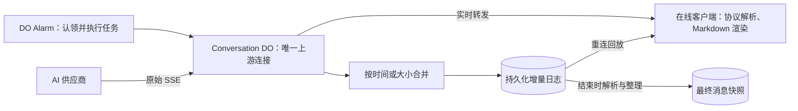

# EverChat 功能实施路线图：Serverless 约束下的 Chatbox 对照

更新时间：2026-10-15。

对照基线：EverChat 提交 `70f36cd`；Chatbox `main` 提交 `0ac6385ae1ff5bf778777826da3c5edcd55b61b8`（2026-09-24）。本文是功能取舍和实施建议，阶段编号不代表功能已经实现，也不承诺交付日期。

推荐顺序：**流式执行与免费层适配 → 日常聊天与数据管理 → 分支和会话配置 → 长对话上下文 → 图片与轻量附件 → 联网搜索与网页读取**。完整桌面 Agent、本地命令和任意代码执行不纳入本路线图。

## 1. 架构边界

EverChat 当前使用静态 PWA、Cloudflare Workers、SQLite Durable Objects 和休眠 WebSocket。模型调用由 Conversation DO 的 Alarm 在云端执行，用户关闭网页后继续生成，客户端重新连接后读取持久化结果。配置见 [wrangler.jsonc](../wrangler.jsonc)，生成流程见 [worker/conversation.ts](../worker/conversation.ts)。Workflow 仅在后续多步工具编排确有需要时增加。

**原型约束：不考虑版本兼容。** 数据结构、协议和执行器可以直接调整，只维护当前实现；不增加旧客户端、旧任务或旧配置格式的自动迁移和回退分支。下方执行记录记载当时的实现，历史记录中的兼容能力不构成后续要求。测试使用隔离数据，不以清空用户对话或配置作为开发步骤。

本计划采用以下范围：

- 保持现有 Serverless 部署方式，不引入容器、虚拟机、常驻计算服务或用户电脑上的本地桥接程序。
- 允许按阶段增加 R2 等托管存储，或调用用户配置的 HTTPS 模型、搜索、解析服务；这些依赖需要在功能中明确配置。
- 通用聊天在未配置附件、搜索等可选能力时仍能独立使用。
- 已接受任务的输入与配置先保存在云端，生成进度按检查点持久化，后续阶段继续满足断线恢复和跨设备读取；实时预览与已确认保存的进度分开管理。

### 平台限制如何影响功能

| 限制 | 对 EverChat 的影响 |
|---|---|
| `nodejs_compat` 不等于完整 Node.js 主机；`node:child_process` 是不能执行底层功能的 stub | 无法直接启动 Shell、Python、npm、Git 等本地进程。[Node.js 兼容性](https://developers.cloudflare.com/workers/runtime-apis/nodejs/#non-functional-stub-modules) |
| Workers 文件系统是内存中的虚拟文件系统；`/tmp` 不跨请求持久化，也不能访问用户电脑 | 上传文件和产物必须进入持久化存储；不能移植桌面工作目录、真实文件编辑或本地技能目录发现。[文件系统说明](https://developers.cloudflare.com/workers/runtime-apis/nodejs/fs/) |
| 请求受 CPU、内存和连接配额约束 | 大文件解析要限制规模或调用托管服务；不能在单次请求中无限累积正文、附件和工具结果。[Workers 限制](https://developers.cloudflare.com/workers/platform/limits/) |
| 普通 HTTP 请求的生命周期受客户端连接影响 | 新的后台工作继续使用持久化任务机制，不能只依赖页面请求或 `waitUntil()`。[请求生命周期](https://developers.cloudflare.com/workers/platform/limits/#duration) |
| Durable Objects 提供状态和协调，但仍受运行时资源限制 | 普通聊天由 DO 执行有时限的模型生成、保存和同步；CPU、内存及活跃时长都需要测量和限制。[Durable Objects 限制](https://developers.cloudflare.com/durable-objects/platform/limits/) |

当前代码中的 14 分钟供应商超时、15 分钟看门狗 Alarm、最近 40 条／80,000 字上下文，以及正文和思考各 100,000 字上限，属于 EverChat 的应用策略。默认不设置输出 Token 上限没有取消这些边界。不能把它们误认为所有 Serverless 产品统一的硬限制。

### 免费层选择：普通聊天使用 DO＋Alarm，Workflow 留给多步编排

目标架构：**普通聊天由 Conversation DO 持有唯一模型连接，通过 Alarm 启动后台生成；客户端负责高频解析和渲染，DO 负责流转发、批量持久化与最终结果整理。** Workflow 在后续搜索等多步任务中负责调度，不直接承担逐 Token 流解析。阶段 0 已实现 DO 执行、原始流客户端解析、低频持久化和云端最终回放；Workers Free 隔离部署已通过 9 项功能场景、3 项一分钟以上生成和 30 次终态重连。大历史快照改由 DO 构造 Response，避免 Worker 全文序列化。存储／历史总量边界与超限状态已经落实；阶段 0 按已测个人负载收敛，偶发连接 CPU 高样本及未采样的账户存储单独记录。

以下额度依据 2026-10-13 查阅的 Cloudflare 官方文档，实施前需要重新核对；不同产品的额度分别计量，不能相加当作同一预算。

| 维度 | SQLite Durable Objects 免费层 | Workflows 免费层 | 对本方案的影响 |
|---|---|---|---|
| CPU 上限 | 默认每次调用 30 秒 CPU | 每步 10ms CPU | 流缓冲、解析与最终整理优先放在 DO；浏览器解析不能保证整个 Workflow 步骤低于 10ms |
| 等待上游响应 | 等待不计 CPU，但对象不能休眠时消耗活跃时长额度 | 等待网络不消耗 CPU | 长时间等待、低计算的编排适合 Workflow；持续接收模型流适合 DO |
| 请求与执行额度 | 10 万请求／天，包含 RPC、Alarm 等；13,000 GB-s 活跃时长／天 | 10 万次调用／天，与 Workers 共享；3,000 步／天 | 在同一个 DO 内读取、写入和推送，避免每个流片段跨对象 RPC；持久化批次不作为 Workflow 步骤 |
| 存储额度 | 500 万行读取／天、10 万行写入／天、SQL 总存储 5GB | 状态存储 1 GB-month | DO 保存聊天数据；Workflow 只保存编排状态及数据引用 |
| 后台执行时长 | Alarm 处理程序最长 15 分钟 | 步骤没有固定实际时长上限，仍受 CPU 与配置超时约束 | 普通聊天保留约 14 分钟的供应商超时，给最终保存留出时间；更长任务另行设计 |

来源：[DO 限制](https://developers.cloudflare.com/durable-objects/platform/limits/)、[DO 定价](https://developers.cloudflare.com/durable-objects/platform/pricing/)、[Workflow 限制](https://developers.cloudflare.com/workflows/reference/limits/)、[Workflow 定价](https://developers.cloudflare.com/workflows/reference/pricing/)。

DO 的免费 CPU 余量更适合流处理，但运行时长不会因客户端离线而消失。按官方计费示例的 128MB 分配计算，100 次各活跃一分钟的生成约消耗 `100 × 60 × 0.128 = 768 GB-s`，约为每日免费时长的 6%。这只是时长估算，不包括其他对象、额外活跃时间、数据库读写及外部 API 费用；小缓冲也不会降低每个对象按分配内存计算的时长消耗。

免费层的资源超限需要明确报错，不能假设会自动升级或无限继续执行。上线前以真实 Cloudflare 指标验证 CPU、活跃时长、SQL 读写、请求数量和存储占用。全文搜索使用增量索引；附件限制容量；重文档解析和多轮联网功能后置。摘要、自动命名、识图和图片生成的供应商费用另行计算。

### 分层流式处理与持久化语义

目标链路：

- **连接与任务层：**先保存请求 ID、输入、配置快照和任务状态，再由 Alarm 启动。DO 维护模型连接，客户端上线、断线或切换页面只改变订阅，不重新调用模型，也不把浏览器发起的连接移交给服务端。
- **实时层：**客户端解析正文、思考内容等供应商事件，合并渲染更新。AI SDK 负责构造请求，客户端和云端快照／最终整理共用 SSE 分帧与协议适配；DO 高频接收路径封装、转发和保存原始字节，让正文和思考的逐事件解析由浏览器完成。首 Token 计时只在云端检测最初的流前缀，收到首段正文或思考后立即停止检测，不解析其余高频输出。
- **持久化层：**服务端持续读取上游，以“每 1–2 秒或累计 16–64 KiB”为初始提交条件，任一条件先到即提交；结束、停止和错误时立即保存剩余缓冲。这些是待测量的参数，不承诺固定延迟或资源节省比例。
- **数据层：**批次保存 `runId`、协议版本、连续字节偏移和增量数据，正文与思考使用同一机制。不再每批更新完整消息并记录累积全文事件。生成完成后在云端验证供应商完成状态，解析日志并保存最终消息；必要时增加周期性快照，只有快照可靠保存后才清理其覆盖的原始日志。
- **离线与恢复层：**没有客户端在线时仍持续保存，最终整理不依赖客户端上报。重连读取已保存的快照或日志，并补齐 DO 内存中的实时尾部，再接入后续数据；回放与订阅建立需要一致的切换边界，避免并发到达的片段被遗漏。
- **同步层：**分别维护 `liveOffset` 和 `durableOffset`，客户端按任务与偏移去重，只有连续前缀提交成功才推进持久化确认位置。原始字节批次可以切在 UTF-8 字符、SSE 事件或 JSON 中间，解析器必须支持跨批次恢复；实时消息不能复用持久化事件序号冒充已保存进度。
- **缓冲与客户端层：**后台分支持续读取，只降低写入频率。所有缓冲有大小上限；慢客户端断开后按偏移恢复，不阻塞持久化分支；存储落后时对上游施加反压，不能无限缓存。客户端在内存中实时更新，本地对话缓存按较低频率及终态写入，避免每个流片段都保存整个历史。

实时预览允许先于持久化显示。正常写入情况下，尾部保存窗口由提交参数决定；客户端断线后云端继续生成，但云端实例在提交前中断，尚未保存的尾部可能丢失，即使客户端已经看到。重连以已保存进度为恢复基线，不能将实时预览或客户端缓存当作云端已确认结果。保存失败或延迟时不推进持久化确认，也不显示生成已完成。导出、备份和后续上下文使用已保存结果；生成中的备份明确为部分结果。

Alarm 至少执行一次且可能自动重试。启动模型前先原子认领任务；重入发现已开始但无法接续的上游调用时，保留部分结果并标记中断，由用户主动重新生成。停止需要持久化取消状态、终止上游并提交已接收尾部；尾部保存失败则保留最近检查点并记录错误，不再接受后续片段。DO 和 Workflow 都不能凭检查点恢复已断开的同一条供应商 SSE 连接，也不能借自动重试保证模型调用恰好一次。

来源：[Alarm 执行语义](https://developers.cloudflare.com/durable-objects/api/alarms/)、[Streams 转发](https://developers.cloudflare.com/workers/runtime-apis/streams/)、[ReadableStream 反压](https://developers.cloudflare.com/workers/runtime-apis/streams/readablestream/)、[DO 生命周期](https://developers.cloudflare.com/durable-objects/concepts/durable-object-lifecycle/)。

### Agent 能力的取舍

这里需要区分两种能力：

- **不纳入：**Chatbox 式桌面 Agent，包含任意代码执行、用户文件系统、工作目录、命令审批、本地技能安装和本地进程。现有架构无法直接提供这些能力。
- **可以后置：**模型调用已配置的搜索和网页读取服务。这可以通过 Serverless 的网络调用和持久化编排实现，但不提供通用自主执行环境。

本文仅保留搜索和网页读取所需的有限工具调用，排除完整 Agent、执行型 Skills 和代码沙箱。未来若引入外部执行服务，应另行制定路线图。

## 2. 已有能力及应保留的行为

当前已经支持多供应商列表、四类生成协议、获取和编辑模型、启用／禁用模型、聊天框选择模型、全局／模型／会话级系统提示词、命名提示词预设、思维强度、思考内容和正文的流式 Markdown、停止、重新生成、用户和助手消息修订、自动保存设置、三种颜色模式、文本导出与可恢复备份、离线待发送及跨设备同步。

后续实施继续保留：

- 接受请求先持久化，再启动生成；同一请求 ID 重试不重复创建消息。
- 模型调用失败不自动重新发起付费生成，用户可以主动重试。
- 不同对话可以并行；同一对话先维持一个活跃生成。
- 每次请求使用接受时的配置快照，设置修改不影响已排队任务。
- 输入和配置在接受请求时已持久化；实时预览可以先广播，持久化确认及完成状态必须在提交成功后发布；页面关闭、断网和重连能够恢复已保存结果。

阶段 1 已补独立对话 URL、SPA 导航、改名、置顶、归档、删除和正文搜索。阶段 2 已接入可切换的消息父链、从指定消息复制出新对话、助手修订及单条删除、会话参数、提示词预设、生成信息和内容部分；助手历史版本仍以同一对话中的消息形式保留。依据见 [src/App.tsx](../src/App.tsx)、[worker/index.ts](../worker/index.ts) 和 [worker/conversation.ts](../worker/conversation.ts)。

## 3. 功能取舍总表

“直接实现”指复用现有前端与持久化架构；“增加依赖”指需要托管存储或外部 HTTPS 服务；“后续按需”指可行但优先级较低。

| Chatbox 功能 | EverChat 当前情况 | Serverless 取舍 | 推荐位置 |
|---|---|---|---|
| 流式聊天、停止、重新生成、思考内容 | 已有 | 阶段 0 改为 DO＋Alarm、增量日志与分层同步 | 阶段 0，后续持续验证 |
| 自定义供应商、模型列表与选择 | 已有 | 保留四种通用协议 | 所有阶段 |
| 独立对话 URL、前进／后退 | 已完成 SPA 导航与离线恢复 | 保留直接链接及浏览器历史行为 | 阶段 1 第 1 项已完成 |
| 改名、置顶、归档、删除、排序 | 已有管理入口、跨设备同步、置顶与活动时间排序 | 已补持久化删除语义；手动排序后补 | 阶段 1 第 2 项已完成 |
| 正文搜索、结果定位 | 已有当前对话和跨对话正文／思考查找、结果定位 | 继续观察索引容量与查询成本 | 阶段 1 第 3 项已完成 |
| 消息引用、复制 | 用户和助手消息均可复制，引用会填入带 Markdown 引用标记的输入框 | 继续观察长消息引用和移动端操作布局 | 阶段 1 已完成 |
| 代码高亮、LaTeX、Mermaid | 已有 Shiki、KaTeX、Mermaid 与代码复制 | 继续观察大图表和大代码块的客户端资源预算 | 阶段 1 第 4 项已完成 |
| TXT／HTML 导出、可恢复备份 | 支持 Markdown／TXT／HTML 导出、包含配置、消息和私有附件的 ZIP 备份恢复 | 文件及引用独立恢复；API 密钥不进入备份 | 阶段 1 第 5 项及阶段 4 第 5 项备份检查点已完成 |
| 分支切换、编辑后重发、复制对话 | 已支持父链分支选择、编辑／重新生成、完整对话复制及从指定消息复制父链路径，附件独立保存 | 副本独立 URL、消息及文件 ID，保留会话参数；复制不调用模型，生成中只复制已保存前缀 | 阶段 2 第 2 项及阶段 4 的附件复制检查点已完成 |
| 编辑助手消息、删除单条消息 | 已有助手修订和单条删除，保留父链并同步、索引及备份 | 后续参数与上下文策略继续遵循同一分支语义 | 阶段 2 第 3 项已完成 |
| 会话级系统提示词和模型参数 | 已有会话提示词、Temperature／Top P、输出上限覆盖及自动保存同步 | 参数按模型／思考模式过滤，任务接受后固定配置 | 阶段 2 第 4 项已完成 |
| Copilot／提示词预设 | 已有命名系统提示词预设、自动保存与管理入口，可应用到会话并离线使用 | 应用时复制内容，后续预设编辑不改变已有配置或任务 | 阶段 2 第 5 项的预设部分已完成 |
| Token 用量、首 Token 延迟 | 已有供应商用量、缓存／思考细分、云端计时与消息下方展示，复制和备份保留 | 未返回的字段不伪装为 0；部分报告与完整报告区分 | 阶段 2 第 5 项已完成 |
| 消息内容部分 | 正文与思考统一为带类型的 `parts`，图片与文本文件使用私有引用，复制和备份保留 | 正文／思考各汇总为一个部分；工具结果随后增加 | 阶段 2 的内容结构与阶段 4 的附件输入、复制、备份已接入 |
| 模型能力和上下文窗口元数据 | 已有窗口、最大输出、图片／工具／结构化／思考能力、原生目录读取及逐字段手动覆盖 | 后续预算与附件、工具入口使用统一解析；未知字段明确回退 | 阶段 3 第 1 项已完成 |
| Token 估算、上下文控制、摘要压缩 | 已有近似估算、输入预算、完整轮次选择、手动及默认关闭的自动摘要 | 云端先保存分支摘要，再构建回答；失败不自动重复付费 | 阶段 3 第 2–4 项已完成 |
| 同一会话内的新话题／线程历史 | 未有 | 可行；先完成分支，再按需要补入口 | 阶段 3 后按需 |
| 图片输入与识图 | 已有上传／粘贴、缩放、私有预览、仅图片提问与视觉模型接入 | R2 保存文件，任务固定引用；支持独立复制及 ZIP 备份恢复 | 阶段 4 第 1–2 项及第 5 项附件复制、备份检查点已完成 |
| 文本、代码、文档附件 | 已支持 TXT／Markdown／代码／受限 CSV 及 PDF 文本提取、私有预览和模型问答 | PDF 使用浏览器 Worker，提取结果保存后接受任务；Office 重解析需独立服务 | 阶段 4 第 1–3 项及第 4 项 PDF 检查点已完成 |
| 联网搜索、网页读取 | 未有 | 使用已配置的 HTTP 工具 | 阶段 5 |
| 图片生成和参考图编辑 | 未有 | 调用供应商 API，复用附件存储 | 阶段 4 后按需 |
| Azure／Bedrock 专用接入、供应商预设 | 未有专用适配 | 按实际供应商需求增加 | 阶段 2 后按需 |
| 供应商 OAuth 登录 | 未有 | 仅评估支持网页回调和云端使用的官方流程 | 后续按需 |
| 用户可管理的跨对话记忆 | 未有 | 存储和提示词注入可行；先手动管理 | 阶段 3 后按需 |
| 纯提示词型 Skill | 未有 | 作为预设或按需加载文本；不附带执行权限 | 后续按需 |
| 生成中排队消息 | 只有离线待发送 | 可实现，但不是第一轮目标 | 后续按需 |
| 生成中即时追加指令／Steering | 未有 | 涉及多步执行边界，暂缓 | 暂不纳入 |
| 桌面 Agent、代码沙箱、Shell、Python | 未有 | 无法直接运行于当前架构 | 不纳入 |
| 真实工作目录、文件编辑 | 未有 | 依赖本地主机或桥接程序 | 不纳入 |
| 本地 Ollama／LM Studio 直连 | 未有 | 云端不能直接访问用户设备的 localhost | 不纳入；公开 HTTPS 网关另按通用供应商处理 |
| 执行型 Skills、扫描本地技能和记忆目录 | 未有 | 依赖本地文件系统和执行环境 | 不纳入 |

上述 Chatbox 能力依据：[会话管理](https://github.com/chatboxai/chatbox/blob/0ac6385/docs/technical/session-management.md)、[聊天与工作模式](https://github.com/chatboxai/chatbox/blob/0ac6385/docs/technical/chat-work-mode-split.md)、[工具与集成](https://github.com/chatboxai/chatbox/blob/0ac6385/docs/product/tools-and-integrations.md)、[桌面代码执行](https://github.com/chatboxai/chatbox/blob/0ac6385/docs/product/code-execution.md)。阶段与取舍是对 EverChat 的设计建议。

## 4. 分阶段实施

### 阶段 0：流式执行与免费层适配

**目标：**在扩展功能前，减少高频全文保存与传输，并验证普通聊天的 DO＋Alarm 架构能在免费层运行。仅更新计划不代表已经完成架构迁移。

实施顺序：

1. 测量现有生成链路的 CPU、DO 活跃时长、SQL 读写、RPC、传输字节和客户端缓存开销。覆盖长正文、长思考、客户端在线及离线场景，记录基线。
2. 定义任务、增量日志、快照、实时偏移和持久化偏移，只维护当前数据结构与同步协议。先复用现有服务端 AI SDK，用批量增量保存代替约每 100ms 更新和记录累积全文。
3. 将普通模型调用移到 Conversation DO 的 Alarm 执行，落实原子认领、幂等提交、取消和异常终态，保留约 14 分钟供应商超时。仅保留 DO 执行器，删除普通聊天的 Workflow 路径。
4. 分离实时预览与低频持久化通道，增加持久化确认和有界缓冲，降低客户端完整快照保存频率。持久化确认只对应实际提交的数据。
5. 为四类供应商协议验证客户端原始流解析、服务器最终解析与回放的一致性，覆盖正文、思考、完成原因、错误和用量事件。复用可共享的协议适配与解析代码；最终解析只处理已有日志，不重新请求模型。
6. 完成重连、跨设备读取、快照整理和日志清理。阶段 5 按需增加 Workflow 编排，不在普通生成中保留它。
7. 在真实免费层部署上与基线对比，调整批次时间、大小和缓冲上限，记录个人使用预算。CPU、时长或写入超限时给出明确状态，不能只凭本地测试宣称免费层可用。

验收：四类协议的实时内容与最终持久化内容一致；原始流任意分段后仍能正确解析；关闭所有页面后任务继续完成；第二设备能回放生成中和已完成结果；回放接入实时流时无重复、缺口或次序错乱；客户端落后不阻塞其他订阅；持久化失败不产生虚假确认；停止、Alarm 重试和实例重启不重复发起模型调用；实例中断最多恢复到最近已保存的进度并明确标记失败；导出和备份仅使用已保存内容；日志整理后可恢复的正文与思考不变。资源指标在免费额度内，并记录测试负载与余量。

### 阶段 1：补齐每天使用的聊天与数据管理

**目标：**能可靠地找到、整理、阅读和备份对话。阶段 0 验证后优先完成这一阶段，不增加模型调用成本。

实施顺序：

1. 独立对话 URL，建议 `/c/:conversationId`；新对话使用 `/`，支持直接访问和浏览器前进／后退。
2. 手动改名、置顶、归档和删除；列表默认按更新时间排列，手动排序可以后补。
3. 正文搜索和结果定位；首先实现当前对话搜索，再补跨对话搜索。
4. 消息引用、代码高亮、数学公式和 Mermaid。代码块提供复制；插件按需加载。
5. TXT／HTML 导出和带版本号的可恢复备份。先覆盖文本对话、思考内容、模型信息和预设配置；密钥默认不进入备份。

实现重点：

- 路由变化与当前对话保持一致；不存在或已删除的 URL 显示可恢复的空状态。
- 对话索引和正文分属不同 Durable Object，删除需要协调停止任务、写入删除状态、清除索引和通知客户端。离线 outbox 的迟到请求不能把已删除对话重新创建出来。
- 删除状态需要进入快照或同步协议，不能只在一个浏览器中隐藏条目。
- 跨对话搜索使用增量文本索引和分页；不在每次搜索中读取所有 Conversation 的完整快照。索引先按个人规模设计，只有实际查询需求超出现有存储能力时才增加 D1 等索引存储。
- 前端渲染模型输出的 HTML/SVG 预览属于单独功能，不在这一阶段自动执行输出代码。

验收：直接打开 URL、后退／前进和刷新都能恢复正确对话；第二设备能看到改名、归档和删除；正文搜索能定位消息；备份可恢复到独立测试空间；大段代码和公式不会破坏流式滚动。

### 阶段 2：建立分支、会话配置和生成元数据

**目标：**让编辑、重新生成和模型切换具有清楚的上下文语义，为附件和工具留下数据扩展位置。

实施顺序：

1. 明确消息、修订版本、分支路径和生成任务的关系，直接定义当前分支数据结构。
2. 编辑用户消息或重新生成时创建可切换分支；允许从指定消息复制出新对话。
3. 补助手消息修订、删除单条消息，并明确它们如何影响后续上下文。
4. 会话级系统提示词、Temperature、Top P 和输出上限；按模型能力提供参数，不支持时隐藏。
5. 命名提示词预设，以及供应商报告的 Token 用量、缓存用量、首 Token 延迟等元数据。

实现重点：

- 当前 `parentId` 只连接回答与提问，不能直接当作完整对话树。先定义分支和有效路径，再修改上下文构建。
- 为消息引入可扩展的内容部分和生成元数据，统一正文、思考与扩展内容的数据结构；此阶段不提前实现工具执行。
- 分支切换不改变已启动任务的输入；任务持久化到其所属分支，并在重连后可读取。
- 系统提示词的覆盖顺序为：会话显式配置 → 模型配置 → 全局配置。参数留空继承，输出上限保留“未设置”的语义。
- 使用供应商返回的用量作为已确认消耗；本地估算单独标注，不伪装成账单。首 Token 延迟在云端测量，排队和客户端同步延迟另行区分。

验收：切换旧分支后继续对话时，模型只收到当前路径；重连不混入其他分支；配置快照和参数继承正确；未返回用量的供应商不会显示虚构数值。

参考：[Chatbox 分支](https://github.com/chatboxai/chatbox/blob/0ac6385/src/shared/session/message-forks.ts)、[会话参数](https://github.com/chatboxai/chatbox/blob/0ac6385/src/renderer/modals/SessionSettings.tsx)、[消息用量展示](https://github.com/chatboxai/chatbox/blob/0ac6385/src/renderer/components/chat/message-token-display.ts)。

### 阶段 3：改善长对话，减少无提示的历史丢弃

**目标：**用上下文预算与摘要替换当前按字数和条数丢弃最早消息的主要策略。

实施顺序：

1. 模型上下文窗口、最大输出和能力元数据，支持手动覆盖；未知模型保留保守回退。
2. 显示输入和上下文 Token 估算，提供最近消息条数或上下文预算配置。
3. 先实现手动压缩，再实现达到阈值时自动摘要压缩。
4. 提供摘要查看和重新生成；摘要按分支及覆盖边界关联，原始消息继续保留。
5. 如确有需要，再加入新话题历史和用户手动管理的跨对话记忆。

实现重点：

- 后端决定最终发送上下文；浏览器估算只用于即时反馈，不能成为唯一依据。
- Tokenizer 使用能运行于 Workers 的实现；无法精算时明确显示近似值。长文本计算要有规模上限。
- 预算包括系统提示词、摘要、附件、工具结果和为输出预留的空间；默认不设输出上限仍需要合理的输入预算。
- 摘要生成是单独的付费模型调用：界面说明自动压缩会额外调用模型，可关闭；摘要和覆盖范围先持久化，再启动回答。
- 压缩失败保留原始数据并提供重试；不静默重复付费请求，也不把已压缩分支的摘要套到其他分支。

验收：长对话能保留较早的重要信息；摘要与分支正确对应；刷新和换设备不会重复压缩；上下文估算和未知模型回退清楚可见；压缩失败不会丢弃历史。

参考：[Chatbox Token 估算](https://github.com/chatboxai/chatbox/blob/0ac6385/docs/token-estimation.md)、[上下文构建](https://github.com/chatboxai/chatbox/blob/0ac6385/src/shared/context/README.md)、[摘要压缩](https://github.com/chatboxai/chatbox/blob/0ac6385/src/renderer/packages/context-management/compaction.ts)。

### 阶段 4：图片与轻量文件附件

**目标：**提供识图和文档问答，避免把 Worker 变成通用文件处理主机。

实施顺序：

1. 添加 R2 附件存储、上传进度、附件元数据和受鉴权的读取接口。**已完成存储检查点**，规则见 [对话文件](attachments.md)。
2. 图片上传、粘贴和预览；只允许向支持视觉的模型发送图片。**已完成图片输入检查点**，规则见 [图片输入](images.md)。
3. TXT、Markdown、代码和受限大小的 CSV 等轻量文本格式。**已完成轻量文本检查点**，规则见 [文本文件输入](documents.md)。
4. PDF 的可提取文本。**已完成 PDF 文本检查点**，规则见 [PDF 文本输入](pdf.md)；Office 文档在验证托管解析服务后逐项增加。
5. 扩展备份和删除流程，纳入附件及引用关系。**独立附件复制、可恢复 ZIP 备份与中断清理检查点已完成**，见 [含附件的对话复制](attachment-copies.md)及 [含附件的对话备份与恢复](attachment-backups.md)。图片生成可在这一基础上按需增加。

实现重点：

- 原文和图片放 R2，Durable Objects 保存元数据、解析状态和引用；不把大块 base64 写入消息事件、快照或 Workflow 步骤返回值。[R2](https://developers.cloudflare.com/r2/)
- 接受带附件的任务前，上传或必要解析结果应已可靠保存；任务启动后不能依赖浏览器继续在线解析。
- 浏览器可以做压缩和轻量提取，但结果需要上传。要求页面关闭后仍能继续的解析必须使用后台兼容实现或托管服务。
- 不承诺任意大小／格式文档；限制附件数量、大小和注入上下文长度，超出限制时提示用户拆分文件或选择片段。
- 输出 HTML 的客户端预览可以按需单独实现，但要隔离运行且不授予宿主权限；这不包含云端执行模型生成的脚本。

验收：关闭页面后，已经接受的图片／附件请求仍能完成；第二设备可读取附件；不支持视觉的模型有明确限制；解析失败不损坏对话；删除和备份能正确处理附件引用。

参考：[Chatbox 附件](https://github.com/chatboxai/chatbox/blob/0ac6385/src/renderer/components/InputBox/Attachments.tsx)、[文件能力](https://github.com/chatboxai/chatbox/blob/0ac6385/docs/product/tools-and-integrations.md)。

### 阶段 5：联网搜索与网页读取

**目标：**补充最新信息和网页内容，不提供完整 Agent 或任意执行权限。

实施顺序：

1. 工具调用、参数、结果、错误和状态的持久化与流式展示。
   - **供应商协议与逐轮 SQLite 状态基础检查点已完成**，见 [工具协议基础](tool-protocol.md) 和 [持久化状态日志](tool-task-state.md)；生产 Conversation／Workflow 调度及过程展示尚未接入，本项继续推进。
2. 接入一种明确配置的搜索 API，展示来源引用；之后补网页正文读取。
3. 增加搜索和网页读取的会话开关，只允许有限轮数和预算内的只读调用。

实现重点：

- 模型必须支持工具调用；入口和服务端校验共用能力判断。
- 使用 Workflow 组织有限的“模型 → 工具 → 模型”步骤，模型流仍由 DO 执行，Workflow 只等待结果并保存编排状态和数据引用。每步状态写入持久化存储；等待人工操作时使用持久化事件或状态机制，不占着内存 Promise。增加 Workflow 不会免除 DO 执行期间的活跃时长消耗。[Workflows API](https://developers.cloudflare.com/workflows/build/workers-api/)
- 明确超时、轮数、结果大小和请求预算，停止后不再发起下一步。检查点只能恢复任务进度，不能恢复供应商已中断的同一次 Token 生成。
- 只读查询可有限重试；模型调用仍需要请求标识、结果落盘与重入策略，不能依赖 Workflow 自动重试避免重复计费。
- 远程地址、重定向、凭据范围和响应大小需要限制；搜索和抓取服务密钥保存在服务端，不进入消息内容。
- 不提供“Full Access”，不把模型返回的命令当作可执行指令。

验收：工具过程断线后可恢复查看；重复提交不重复启动任务；超时或预算用尽时停止并说明；引用能打开到实际来源；未知模型不被强行注入工具。

参考：[Chatbox 工具与搜索](https://github.com/chatboxai/chatbox/blob/0ac6385/docs/product/tools-and-integrations.md)。

## 5. 后续按需功能与明确排除项

| 功能 | 建议 |
|---|---|
| AI 自动命名 | 在阶段 2 后增加；用户可以指定小模型，失败退回首条消息标题。它会增加独立模型请求，不作为阶段 1 的前置条件 |
| 图片生成／编辑 | 复用阶段 4 的图片存储，通过供应商 API 实现；先证明实际需求，不另起复杂图片产品 |
| Azure／Bedrock | 有实际使用需求再增加鉴权和协议适配；不为供应商数量复刻整个预设目录 |
| 供应商 OAuth | 逐供应商验证官方流程；桌面 localhost 回调服务不直接移植 |
| 手动记忆和纯文本 Skills | 可复用预设和提示词注入；需要可查看、编辑、删除及禁用，不赋予代码执行能力 |
| 普通聊天消息队列 | 可通过持久化队列实现；先保留现有同对话单活跃生成，避免与分支语义同时改造 |
| 多候选回答并发 | 技术上可行，但会改变费用、锁和同步语义；先用串行重新生成满足主要需求 |
| 团队协作、多用户隔离 | 属于身份与数据边界的独立项目，当前个人空间路线图不扩展到此 |
| Agent 的本地命令、代码沙箱和真实文件系统 | 不实现；引入容器或外部执行服务后必须重新评估架构 |
| 本地模型直连、自动扫描技能目录 | 不实现；不增加本地桥接客户端 |
| 执行型 Skills、自动安装依赖、全权限模式、Steering | 不纳入这轮聊天产品范围 |

## 6. 开发切分与整体完成标准

下一轮先完成阶段 0 的资源基线、增量日志、DO＋Alarm 执行与分层同步，并通过真实免费层验收。随后完成阶段 1，推荐拆成以下可独立验收的改动：

1. SPA 路由与导航。
2. 对话改名、置顶和归档。
3. 删除、取消生成、跨设备同步与迟到离线请求处理。
4. 当前对话搜索，再增加跨对话索引和搜索。
5. 消息引用及渲染插件。
6. 导出和可恢复备份。

之后按阶段 2 → 3 → 4 推进。阶段 5 在已有聊天体验稳定后再启动，并明确搜索和网页读取服务的配置要求。功能顺序由用户价值、依赖关系、后台可靠性和维护成本决定，不照搬 Chatbox 的桌面能力。

每个阶段除自身验收外，都检查同一组核心行为：**关闭页面后任务继续、断网后恢复已保存进度、第二设备已确认结果一致、实时预览与保存确认分开、请求幂等、停止后无新步骤、失败保留已保存内容**。这是 EverChat 在增加功能时需要保持的基础。

## 7. 执行记录

### 2026-10-13：计划与本地流式基线

- 计划检查点已提交为 `a40a8c4`，确定普通聊天迁移到 DO＋Alarm、实时预览与持久化确认分离，以及后续功能的实施顺序。
- 已增加可关闭的生成计数和 `pnpm measure:stream`。使用隔离数据库、真实本地 Cloudflare 运行时及模拟供应商，验证在线正文、在线正文加思考，以及回答开始后关闭唯一订阅的场景。三个场景均得到完整的持久化结果，没有真实模型调用。
- 测量口径和复现步骤见 [流式资源测量](stream-measurements.md)，首次报告见 [stream-baseline.json](measurements/stream-baseline.json)。

本次基线每个场景有 120 个正文增量，间隔约 25ms；思考场景另有 120 个思考增量。字符数按 JavaScript 字符串长度计，字节数按 UTF-8 计。

| 场景 | 最终正文／思考字符 | 检查点 | 实际 SQL 写入行 | 累计事件负载字节 |
|---|---:|---:|---:|---:|
| 在线正文 | 24,000／0 | 31 | 132 | 1,030,077 |
| 在线正文与思考 | 24,000／24,000 | 31 | 132 | 2,012,907 |
| 回答开始后断开订阅 | 90,000／0 | 29 | 124 | 3,506,989 |

该结果确认累积全文检查点会放大事件日志；它覆盖任务认领至终态的 Conversation SQL 和广播，未包含任务接受前、Library、RPC、Alarm、诊断保存和平台计量。`elapsedMs` 是经过时间，不能用作 CPU 或计费时长。客户端计数来自本地 WebSocket 订阅，尚未测量浏览器渲染及缓存开销。

当前验证：42 项单元测试、13 项浏览器端到端测试、类型检查和生产构建通过；三个本地测量场景通过。浏览器测试已补充 Markdown 加载完成后的双设备比较，并明确配置默认值的测试前提，避免使用其他测试留下的输出上限。新增计数默认关闭，不保存正文、提示词或密钥。

**阶段 0 尚未完成。** 后续依次完成增量日志与旧数据兼容、DO＋Alarm 执行迁移、实时和持久化通道分离、四类协议解析与回放、日志整理和真实免费层验收。Cloudflare 登录已验证，但未据此视为免费层通过，也尚未更换现有 Workflow 生成路径。

### 2026-10-13：增量日志与消息快照

已实现阶段 0 第 2 项中的增量数据结构和兼容路径：

- 新任务固定使用 `semantic-delta-v1`，保存任务／消息标识、连续批次序号、UTF-8 字节偏移和正文／思考增量。单批语义负载最多 64 KiB；较大片段拆分时保持 UTF-16 代理对完整。偏移目前指向语义增量 JSON，原始供应商 SSE 的任意分段解析仍待第 5 项实现。
- 生成期间不再更新完整消息或保存累积全文事件。生成中的读取从消息基底和增量日志重建；终态把正文、思考、状态、事件和日志清理放在同一个 SQLite 事务中。保存失败时不会留下已经清理日志的虚假完整快照。
- 新客户端协商 `protocol=2`，按事件序号和增量偏移校验回放；旧客户端接收完整消息。旧表、旧事件和已经接受的旧任务保留原有语义，不因迁移重新调用模型。
- 本地资源基线检查点为 `4628168`。本次报告见 [stream-incremental.json](measurements/stream-incremental.json)，使用相同的 120 个增量、25ms 间隔负载，并验证在线订阅重建结果与最终持久化快照一致。

| 场景 | 原基线事件负载字节 | 增量事件负载字节 | 原基线／增量 SQL 写入行 |
|---|---:|---:|---:|
| 在线正文 | 1,030,077 | 127,332 | 132／164 |
| 在线正文与思考 | 2,012,907 | 247,368 | 132／164 |
| 回答开始后断开订阅 | 3,506,989 | 457,626 | 124／164 |

三个场景的累计事件负载均减少约 87%。本次没有宣称写入额度已优化：当前仍约每 100ms 提交，独立增量日志的最终清理增加了行写入；9 万字符场景的检查点数还从 29 浮动到 31。SQL 行写入下降需在 DO 执行和低频批量持久化后再次验证。

当前验证：47 项单元测试、类型检查和生产构建通过。完整 14 项浏览器回归通过，之后两项专项回归验证了生成中异常断开订阅和上游提前结束：正文与思考尾部仍能保存，失败状态可回放，重复提交不创建新任务。旧客户端兼容、正常生成、断线、关闭页面、第二设备、停止、思考渲染和滚动跟随也已验证。

**本检查点不代表阶段 0 完成。** 普通生成仍由 Workflow 执行；高频预览／低频持久化分离、低频客户端缓存、执行器版本迁移、原始 SSE 解析和真实免费层验收继续按计划推进。

### 2026-10-13：DO＋Alarm 执行迁移

阶段 0 第 3 项已接入新任务：

- 接受请求时，在同一个存储事务中提交输入、配置快照、请求 ID、outbox 和 Alarm。认领持久化后才发起模型请求；同一请求并发重试返回同一任务。
- 新任务固定为 `do-v1`，由 Conversation DO 的 Alarm 持有上游连接、执行 AI SDK 解析、保存增量和广播。旧任务经迁移默认保留 `workflow-v1`，继续由原有 Workflow 完成；不同执行器不能认领、保存或终结彼此的任务。
- DO 使用 14 分钟供应商超时和 15 分钟看门狗 Alarm。Alarm 重入不发起第二次模型调用；实例重置后，再次激活或执行 Alarm 时发现已认领但失去上游的任务，保留检查点并明确标记中断，由用户主动重新生成。
- 停止保存取消意图并立即终止上游，提交已接收尾部；停止过程中存储失败或实例重置时标记失败，保留最近检查点。上游静默时也能停止，后续任务的 Alarm 不被前一任务的清理覆盖。
- 生成缓冲只保存待提交尾部，仍约每 100ms 写入，并在上游暂时静默时由计时器保存尾部。写入失败后停止接受片段，避免继续缓存或发布未经保存的完成状态。

相同负载的本地测量见 [stream-do.json](measurements/stream-do.json)。三个场景均记录执行器为 `do-v1`，在线增量回放与最终快照一致；关闭唯一订阅后 9 万字符回答仍完整保存。每个场景本次有 32 个检查点、169 行 SQL 写入；事件负载分别为 127,543、247,581 和 457,839 字节。与上一个检查点的微小差异来自计时器调度和检查点数量，不据此宣称免费额度或 CPU 已优化。

当前验证：53 项单元测试、类型检查、生产构建和完整 21 项浏览器回归通过；最后三项专项回归再次验证了普通实例重置、停止过程中实例重置，以及停止时尾部写入失败，累计覆盖 22 个端到端场景。测试使用隔离的真实本地 Cloudflare 运行时和模拟供应商，模型执行计数在实例重置后仍为一次；旧 Workflow 任务仍正常完成。原生重置故障被测试入口转换为预期错误响应，避免开发服务器错误遮罩污染后续页面测试。

**下一检查点为阶段 0 第 4 项。** 保持微批次的偏移边界，增加高频预览和低频提交／确认通道，分别维护实时和持久化进度，并降低客户端完整缓存的保存频率。若将多个预览片段合并提交，需要保留可确认的边界，不能重新计算偏移后使已显示内容重复或缺失。原始 SSE 解析、四类协议回放及真实免费层验证仍待后续完成。

### 2026-10-13：实时预览与低频持久化

阶段 0 第 4 项已实现；上一检查点为 `ae7684d`。

- 生成缓冲约每 100ms 封装一个正文／思考预览，约每 1.5 秒或达到 32 KiB 保存一组增量。单次提交最多 64 KiB、32 个微批次；批量保存保留每个预览的序号和字节边界，不重新拼接并计算另一套偏移。正文与思考仍流式 Markdown 渲染。
- 每组增量只写一条日志；日志、任务进度和回放事件在同一 SQLite 事务中提交。在线客户端收到简短的保存确认，重连客户端读取包含完整增量的事件。终态立即保存尾部并原子整理快照；失败只保留已提交前缀，不确认失败的预览。
- 客户端分别维护实时视图和持久化快照。缓存、导出与重连游标只使用持久化快照；缓存按 2 秒窗口保存最新内容，初始快照、完成、切换对话和隐藏页面立即刷新。清除本地记录后，旧缓存计时器不能重新写入已清除的私密内容。尚未保存的预览显示“保存中”。
- 重连同步按“持久化回放／快照 → ready → 内存尾部 → 后续预览”衔接，无异步间隙。服务器按客户端接收确认约束预览窗口，未确认窗口最多 128 KiB；超过上限或长时间不确认时主动断开，让客户端重新同步，不等待该订阅，也不影响其他客户端和云端保存。
- 根据原型阶段的新要求，只保留当前协议和 DO 执行器，删除普通生成的 Workflow 实现／绑定、旧客户端全文同步分支、旧全文检查点、旧配置格式转换和数据库自动迁移。没有清空用户数据或调用模型补做迁移。后续阶段也不要求维持旧版本兼容。

相同的 120 个增量、25ms 间隔负载见 [stream-layered.json](measurements/stream-layered.json)：

| 场景 | DO 检查点／分层检查点 | DO SQL 写入行／分层写入行 | 写入行降幅 | 分层事件负载字节 |
|---|---:|---:|---:|---:|
| 在线正文 | 32／3 | 169／24 | 85.8% | 127,908 |
| 在线正文与思考 | 32／4 | 169／29 | 82.8% | 248,057 |
| 首个预览后断开订阅 | 32／7 | 169／44 | 74.0% | 458,648 |

在线实时结果和持久化快照一致；离线场景在首次低频提交前断开唯一客户端，9 万字符正文仍完整保存。事件负载与上一版本基本持平，本次优化的是提交频率和 SQL 写入，并未宣称原始流解析 CPU、DO 活跃时长或 Cloudflare 免费层已通过验收。

当前验证：63 项单元测试、类型检查和生产构建通过；完整 24 项浏览器回归通过，新增退出清理专项测试也通过，累计覆盖 25 个端到端场景。三种本地资源测量通过。测试确认预览早于保存、生成中导出只包含已保存内容、40 个增量的缓存写入少于 10 次、失败保存不确认尾部、慢订阅断开后可回放，退出后 localStorage 和 IndexedDB 的对话缓存不会被延迟写入恢复。

原始供应商 SSE 的客户端解析、四类协议最终回放、真实免费层指标仍待阶段 0 后续检查点。后续继续按当前协议直接实施。

### 2026-10-13：原始 SSE 客户端解析与云端回放

阶段 0 第 5 项及第 6 项中的日志整理／重连已实现，上一检查点为 `f60c97f`。仅维护当前 `raw-sse-v1` 协议。

- 四种供应商仍由 AI SDK 构造请求，DO 持有唯一真实上游连接，自动重试为零。服务端高频路径不逐 Token 解析正文／思考；原始 SSE 字节按 8 KiB／100ms 封装实时预览，按 1.5 秒／32 KiB 保存，单组最多 64 KiB／32 批。
- 客户端、生成中快照读取、最终结果整理共用 `eventsource-parser` 与四种协议适配；字节偏移指向原始响应。解析检查点包含未完成 SSE 事件、UTF-8 字符及协议状态，允许提交停在字符或 JSON 中间。Responses 的原始思考优先于摘要，完成事件中的文字不重复追加。
- 最终状态由云端解析已有日志验证，保存完成原因及供应商实际报告的 Token／缓存／思考用量；正文、思考、结果元数据、终态事件和原始日志清理原子提交。没有客户端在线也能完成；客户端没有最终结果审批权。当前保存元数据，为阶段 2 的用量展示提供基础。
- 读取下一段上游前等待存储提交；待保存字节缓冲有界，慢订阅仍按接收确认窗口断开。停止或错误提交已接收尾部，写入失败不确认预览；实例重置保留持久化前缀并标记中断，不重发模型请求。
- 原始响应最多 4 MiB，SSE 数据事件最多 256 Ki 字符，正文与思考各最多 100,000 字。语义长度和完成状态在云端读取／最终整理时校验，原始接收阶段以字节／时间限制终止；客户端解析发现问题不等于上游已经终止。

相同负载的报告见 [stream-raw.json](measurements/stream-raw.json)：

| 场景 | 提交次数 | SQL 写入行 | 原始 SSE 字节 | 事件负载字节 |
|---|---:|---:|---:|---:|
| 在线正文 | 3 | 26 | 71,378 | 162,485 |
| 在线正文与思考 | 4 | 31 | 134,138 | 306,386 |
| 首个预览后断开订阅 | 7 | 46 | 236,498 | 548,297 |

提交频率保持低频；每个场景多写 2 行用于结果元数据。完整供应商事件和 base64 编码使事件负载比语义增量版本增加约 27%、24%、20%。这一步减少高频语义解析，不宣称平台 CPU 或活跃时长已经下降。

当前验证：83 项单元测试、类型检查和生产构建通过；完整 29 项浏览器回归通过，最终 7 项专项回归也通过，累计覆盖 30 个端到端场景。新增四种协议“保存半个 UTF-8 字符 → API 快照 → 重连继续解析 → 最终结果／用量一致”，并验证停止时处理最后一个 CR 换行事件。三种本地资源测量通过。

**阶段 0 的真实免费层验收尚未完成。** 下一检查点核对账户套餐和隔离部署，记录 CPU、活跃时长、请求、SQL 读写与存储；本地结果不能替代平台计量。其他阶段继续按计划推进。

### 2026-10-13：Workers Free 隔离部署与平台指标

账户套餐由用户确认是 Workers Free；订阅查询因账户 API 权限不足返回 403，未将登录成功或 `usageModel` 当作套餐证明。隔离 Worker 禁止访问真实供应商，关闭诊断计数，使用独立 namespace 和随机登录 Secrets。9 项流式功能场景全部通过，覆盖四协议断字重连、正文与思考、离线完成、多订阅、慢订阅恢复、取消和幂等提交。报告见 [功能结果](measurements/cloudflare-functional.json)、[平台指标](measurements/cloudflare-metrics.json)。

本轮调用窗口中 Worker 85 次请求、DO 405 次调用，DO 约 4.415 GB-s、SQL 读取 1,299 行／写入 614 行，CPU／内存超限和内部致命错误计数为零。成功 Worker 请求最高 CPU 7.434ms，所有状态最高 12.448ms，后者属于断线状态。最终部署对象 SQLite 分配约 3.44 MiB；平台存储 GraphQL 为空，不将其视为零计费存储。具体窗口、采样、断线错误和个人预算见 [测量说明](stream-measurements.md#workers-free-隔离部署验证)。

工具类型检查和部署入口类型检查通过。测试 Worker 和本轮两个 DO namespace 清理后保存 [清理确认](measurements/cloudflare-cleanup.json)，临时随机 Secrets 删除，没有修改正式资源。当前报告建立改造后的真实平台基线，未补出改造前的 CPU 数据，也没有维护旧协议或执行器。

**阶段 0 第 7 项尚未完全验收。** 下一检查点补充重复连接／断开和一分钟以上负载，定位超过 10ms 的 Worker CPU 样本，核实平台存储与长期数据预算。不能凭本次短负载断言完整免费层验收通过；阶段 1 的 SPA 导航仍按既定顺序实施。

### 2026-10-13：长流、重复重连与 CPU 样本

上一检查点为 `8243f56`。新增隔离测试工具的长流与重连模式，以及只保存调用元数据的实时 tail；生产流处理没有改动。三个约 72 秒的生成全部通过，覆盖 16,000 字符输入、84,000 字符正文、84,000 字符思考、生成中 20 次重连、第二订阅及关闭唯一订阅后完成。随后对已完成对话的 30 次连接全部恢复正确结果，未重复调用模型。

长流窗口 DO 活跃时长为 27.48776704 GB-s，SQL 读取 2,361 行／写入 872 行；CPU、内存超限和内部致命错误计数为零。按三个样本的均值外推每日 100 次类似生成，约消耗 916.26 GB-s 和 29,067 行写入，即每日额度约 7.05% 和 29.07%；这是预算估算，不是 100 次实测。报告和计量边界见 [测量说明](stream-measurements.md#一分钟以上生成与重复重连)。

长流 Worker 最高 CPU 为 11.518ms，重复终态重连为 5.738ms，没有出现 `exceededCpu`。实时 tail 的路径与对象类型区分后显示一次 Worker `/sync` 高样本，但未证明原因，不能依据后续低样本宣称风险消失。SQL 存储 GraphQL 暂无采样；部署对象最终分配约 3.68 MiB，不等同账单量或峰值。测试资源与随机 Secrets 已清理，保存 [清理确认](measurements/cloudflare-sustained-cleanup.json)。

工具类型检查通过。**阶段 0 第 7 项仍待大历史快照验证和存储预算确认。** 下一检查点构造大段持久化历史，测量当前 RPC→Worker JSON 快照返回；如证实接近 CPU 限制，将序列化移入 DO 并转发响应。它是独立代码风险，尚不能归因于本轮 `/sync` 样本。完成这些明确边界后推进阶段 1，避免把免费层验收扩展成无止境的性能测试。

### 2026-10-13：大历史快照 CPU 修复

上一检查点为 `18eb774`。在 Workers Free 上分别测量约 0.5MB、2MB、8MB 的模拟完成历史，快照返回的 Worker 全文处理多次超过 10ms，成功请求最高 CPU 为 79.691ms、内存约 85.54 MiB。随后在 DO 中构造 JSON Response，由 RPC 流传输响应体，再复测同一组数据。成功请求最高 CPU 为 8.191ms、内存约 13.23 MiB；部分 tail 快照读取样本最高为 2ms。两轮各 15 次读取、6 次 WebSocket 恢复均一致，详见 [测量说明](stream-measurements.md#大历史快照的-worker-cpu-修复)。

本地 83 项单元测试、类型检查、构建和 9 项专项回归通过，新增 8MB 历史与过期游标恢复测试。测试资源与 Secrets 均清理。此改动没有更改消息结构、重试模型请求或维护旧 RPC 实现。

WebSocket 断线样本最高 CPU 仍有 12.267ms，没有把它宣称为已定位或已修复。DO 汇总开始到达，收到的资源超限计数均为零，但未据尚在补齐的小计计算 DO CPU 降幅；平台 SQL 存储仍无采样。模拟大历史仅包括消息，不代表真实任务的全部保留开销；500 个最大的模拟对象已约占 5GB 免费存储的 79%，需要明确总量边界。

**下一检查点完成阶段 0 的存储／历史总量限制和超限状态，然后推进阶段 1 的 SPA 导航。** 后续不为等待缺失的存储 GraphQL 数据反复创建验证资源；实际 SQLite 分配可用于保留预算估算，但不能冒充平台账单计量。

### 2026-10-13：历史与存储预算

上一检查点为 `5a8fb69`。新增 128 个对话的 Library 内串行容量检查、生成前 4 MiB 历史／16 MiB SQLite 分配检查、30 MiB 流式提交边界和 32 MiB 终态事务边界。消息数量按本次实际新增条数检查；同一请求 ID 的幂等结果优先返回。超限不截断已有历史、不自动删除数据，也不设置默认输出 Token 上限。完成后清除不再使用的任务上下文。

存储异常映射为脱敏的 507；同步错误保留草稿和已保存快照，暂停自动重试并提供手动重新同步。待发送的新对话可能在云端创建前短暂返回 404，只对这种已知待接受状态继续同步重试；接受后立即重新连接。86 项单元测试、类型检查、构建和全部 37 项浏览器回归通过，其中 6 项容量专项覆盖并发创建、生成前拒绝、生成中保留前缀、跨 RPC 错误和浏览器恢复。预算与测试边界见 [测量说明](stream-measurements.md#历史与存储保留预算)。

**阶段 0 的实现与已测个人负载验收在此收敛，下一检查点进入阶段 1 的独立对话 URL 和 SPA 导航。** 这不代表整个共享账户始终免费，也不代表已定位 WebSocket 断线 CPU 高样本。平台存储缺失采样和延迟指标继续记录，不反复创建测量资源；后续各阶段继续检查同一组后台生成与恢复行为。阶段 1–5 尚未完成。

### 2026-10-13：对话 URL 与 SPA 导航

上一检查点为 `cc72aa5`。阶段 1 第 1 项已实现：URL 为当前选择的来源，新对话使用 `/`，已创建和离线待发送对话使用 `/c/:conversationId`。原生 History API 支持不刷新页面的侧栏切换及前进／后退；对话链接保留浏览器新标签页行为。直接访问登录后仍进入原 URL，刷新恢复当前对话和独立草稿。不存在或无效的 URL 显示可恢复错误，不自动创建替代对话；开启新对话仍聚焦输入框，浏览器历史切换不主动抢走焦点。

生产 PWA 的导航回退改为实际预缓存的 `index.html`；注册处理应用初始化晚于 load 的情况。86 项单元测试、类型检查、生产构建、全部 43 项主端到端回归与 1 项生产 PWA 回归通过。主套件包含 6 项导航专项；PWA 测试使用静态生产产物和合成只读 API，覆盖离线刷新、新标签页、正文／思考缓存恢复和 API 不缓存，不冒充后台 DO 验证。新增测试入口与配置也通过独立严格类型检查。

**下一检查点为阶段 1 第 2 项：手动改名、置顶、归档和删除。** 删除需要停止任务、持久化删除状态、协调索引清理，并防止离线迟到请求重新创建对话。阶段 1 其余项目及阶段 2–5 尚未完成。

### 2026-10-14：对话管理与持久化删除

上一检查点为 `fb7f746`。阶段 1 第 2 项已实现：对话管理菜单提供手动改名、置顶、归档／取消归档和确认删除。侧栏分为普通对话与归档，置顶优先，其余按消息活动时间排列；整理操作不改变活动时间。归档保留正文、URL 和正在执行的生成。修改失败保留用户输入，支持重试；删除确认默认聚焦取消，确认完成后回到新对话并聚焦输入框。

删除先在 Library 原子保存永久标记及清理 Alarm，使索引立即隐藏且拒绝同 ID 的创建。Conversation 中止上游、清除全部存储和任务 Alarm，再保存最小删除标记；完成后移除索引行。生成、提交和迟到 RPC 在运行前检查删除状态，重复删除保持幂等。Library Alarm 每批最多 16 项，失败后 30 秒继续清理；原生实例在清空存储与保存删除标记之间重置时，仍由 Library 标记保护并重试。已连接客户端收到删除通知，离线或未打开对应对话的客户端通过索引中的删除记录同步：每页最多 256 条、按游标读取，不把所有记录塞进每次轮询。

客户端收到删除状态后清空正文／思考缓存和草稿、丢弃相关 outbox，并拒绝迟到的快照及预览，其他对话草稿继续保留。服务端与本地长期保留删除标记，它们仍占存储；本轮对 8 MiB 测试数据库的清理回归确认剩余分配小于 256 KiB，没有将删除解释为账户存储归零或免费额度保证。仅调整当前协议与数据结构，没有添加旧格式迁移，也没有清理已有用户数据。

88 项单元测试、类型检查、生产构建、全部 50 个主端到端场景和 1 项生产 PWA 回归已通过。主回归分批完成：先通过 Alarm、聊天、管理和导航套件，再修正设置测试的 Tab 选择范围并通过供应商、容量和流式套件。7 项新增管理专项覆盖第二设备元数据同步、失败编辑保留、生成中删除、原生 DO 清理失败／实例重置、未选中对话缓存清理、迟到离线请求和分页游标。独立测试入口及部署入口的严格类型检查通过，测试使用隔离数据库与模拟供应商，不消耗真实模型请求。测试发现的 SQLite 布尔绑定问题也已修正为显式 0／1，避免仅置顶误触发归档。

**下一检查点为阶段 1 第 3 项：当前对话正文搜索和结果定位，随后实现跨对话增量索引与分页搜索。** 手动排序继续后补；阶段 1 第 3–5 项及阶段 2–5 尚未完成。

### 2026-10-14：当前对话搜索与文字定位

上一检查点为 `6a5c1cd`。阶段 1 第 3 项的当前对话部分已实现：右上角入口及 Ctrl／⌘ F 查找用户正文、助手正文和思考内容，忽略大小写并按普通文字匹配。搜索基于实际 Markdown 文本，可以跨加粗等行内格式和换行查找短语；不把模型标签、保存状态或操作按钮算入结果。关键词最多 200 字，匹配计数不截断；上下按钮及 Enter／Shift+Enter 循环定位，Escape 关闭并恢复入口焦点，中文输入法组合输入期间不触发导航。

定位展开折叠的思考区，处理思考区与主消息区的嵌套滚动；搜索旧内容时暂停跟随滚动。流式更新保留“字段＋字段内匹配序号”表示的当前结果，更新计数时不反复跳转。导航、退出、删除均移除高亮，已缓存对话可离线搜索；查询不写入数据库，也不因输入关键词增加云端请求或模型调用。

客户端只保留各文本字段及计数，不为每个匹配构造对象或 Range；当前结果单独创建 Range。未变化字段复用缓存，流式变更约每 150ms 合并检查。着色使用 [CSS Custom Highlight API](https://developer.mozilla.org/en-US/docs/Web/API/CSS_Custom_Highlight_API)，不改写 Markdown DOM，配色使用 DaisyUI 的 warning／warning-content。没有该 API 的浏览器保留文字定位和消息边框；新协议或旧版本兼容不作为前置工作。

完整回归中定位并修复了滚动竞态：用户回到原底部后，同一帧的内容增高可能先于 scroll 事件处理，使暂停状态没有恢复。保留上一布局的底部位置，Resize／scroll 两条路径都能识别并补上这次滚动。新增用例在同一帧内增加 120px 内容，修改前稳定停留 120px，修改后恢复到底部；原有生成中手动暂停／恢复测试也通过。

91 项单元测试、严格类型检查、生产构建、全部 55 个主端到端场景和 1 项生产 PWA 回归已通过。主回归分批完成：先通过 Alarm、聊天、管理、导航、供应商、容量和搜索套件，再完成 11 项流式回归。缓存频率测试按当前对话 ID 计数，并显式加入其他对话的删除快照，验证它们不混入生成缓存的频率统计。5 项新增搜索用例及原有流式滚动用例覆盖文字定位、离线查找、删除清理、生成中匹配更新和同一帧滚动竞态。最终 PWA 产物验证离线重开后的搜索，深浅主题高亮实际对比度均 ≥4.5:1；测试使用隔离本地数据和模拟供应商，不发起真实模型请求。

**下一检查点实现跨对话增量索引、分页搜索和结果跳转。** 阶段 1 第 3 项的跨对话部分、第 4–5 项及阶段 2–5 尚未完成。

### 2026-10-14：跨对话增量索引、分页搜索与结果跳转

上一检查点为 `fee5d31`。阶段 1 第 3 项现已完成：Library Durable Object 建立独立的 FTS5 外部内容索引，只保存消息 ID、字段、可搜索文字和归一化查询列，不把完整 Conversation 快照复制到每次搜索请求。正文和思考分别索引；回答使用与客户端一致的 Markdown AST 提取文字，忽略 HTML 和链接地址，支持 GFM 删除线、表格、代码块、中文短词、Unicode 和字面特殊字符。

消息提交和生成终态通过 Conversation 的持久化 outbox 更新索引，不逐 Token 写入。索引 RPC 失败会保留待处理项，使用指数退避并由 Alarm 重试；Conversation 实例重启、删除或供应商流失败都不会丢失索引更新。已有消息通过 Library Alarm 分页回填，搜索请求不会触发全量回读；删除先隐藏结果，再清理字段和 FTS 行。

侧栏正文搜索最多 200 字，使用 keyset 游标按 20 条分页，游标绑定查询、归档过滤和索引 revision，索引变化后旧游标返回重新搜索。结果显示消息字段和摘要；点击结果切换 SPA 对话 URL，打开思考区并交给当前对话搜索定位。侧栏正文搜索需要联网，当前对话搜索继续使用客户端缓存并支持离线；移动端搜索会在跳转后收起侧栏并聚焦定位搜索框。失败索引显示更新状态，不阻塞正常聊天、管理和删除。

索引使用 Cloudflare SQLite Durable Object 支持的 FTS5 trigram tokenizer 和 GLOB 字面匹配。官方文档说明 trigram 可支持子串匹配，但少于三个 Unicode 字符的 FTS 查询不会使用索引，因此实现对查询统一走 GLOB，并限制结果分页；`detail=none` 只保留检索所需结构，全文显示从索引字段读取。索引容量有独立 256 MiB 保护线，达到后保留待处理项并报告索引容量状态，不删除用户正文。依据：[Cloudflare SQLite Durable Object SQL／FTS5 支持](https://developers.cloudflare.com/durable-objects/api/sqlite-storage-api/)、[SQLite FTS5 trigram 与外部内容](https://www.sqlite.org/fts5.html)；Cloudflare 还说明 SQLite 写入、索引和元数据计入存储，空 SQLite 数据库也会占用少量空间，因此不把本索引实现解释为免费额度保证。[Durable Objects 定价说明](https://developers.cloudflare.com/durable-objects/platform/pricing/)

96 项单元测试、严格类型检查、生产构建、全部 59 项主端到端场景和 1 项生产 PWA 回归已通过。新增 5 项索引单元测试及 4 项专项端到端用例覆盖 Markdown/GFM 提取、特殊字符、中文短词、版本幂等、分页游标、归档／删除过滤、RPC 失败退避、DO 重启、移动端和离线状态。完整主套件验证新增索引不改变 Alarm、聊天、管理、导航、供应商、容量、当前对话搜索和流式恢复行为；测试使用隔离数据库和模拟供应商，不发起真实模型请求。

**下一检查点进入阶段 1 第 4 项：代码高亮、数学公式和 Mermaid，再补阶段 1 第 5 项导出与可恢复备份。** 手动排序继续后补；阶段 2–5 尚未完成。

### 2026-10-14：代码高亮、数学公式与 Mermaid

上一检查点为 `9b4e457`。阶段 1 第 4 项已实现：继续使用 Streamdown 作为流式 Markdown 容器，代码块接入 `@streamdown/code` 的 Shiki，公式接入 `@streamdown/math` 的 KaTeX，Mermaid 围栏接入 `@streamdown/mermaid`。代码块提供复制按钮；Mermaid 使用严格安全级别、关闭自动启动，只把图表 SVG 交给渲染器，不执行输出中的脚本。KaTeX CSS 随客户端构建提供，浅色／深色代码主题分别使用 GitHub Light／Dark。

插件按内容类型动态加载：普通文本不请求 Shiki、KaTeX 或 Mermaid；出现对应代码围栏或公式语法时才加载相应运行时。流式内容先由 Streamdown 的纯文本／基础 Markdown 路径显示，插件准备好后替换同一段内容，不改变消息 ID、搜索字段或滚动跟随。Mermaid 渲染错误保留原始代码和可重试状态，不阻塞正文；旧浏览器或插件加载失败时仍可阅读原始 Markdown。

完整回归中新增实际 DOM 检查：Shiki token、代码复制按钮、KaTeX 公式和 Mermaid SVG 均存在；原有流式思考、DeepSeek、滚动暂停／恢复、正文搜索和 PWA 离线场景继续通过。96 项单元测试、类型检查、生产构建、全部 59 项主端到端场景、5 项搜索渲染专项和 1 项生产 PWA 回归已通过。生产构建将可选语言和 Mermaid 资源拆成动态 chunk；后续若 PWA 首次安装体积成为问题，再按运行时缓存策略收窄预缓存范围，不在本检查点改变离线数据语义。

**下一检查点进入阶段 1 第 5 项：TXT／HTML 导出和带版本号的可恢复备份。** 手动排序继续后补；阶段 2–5 尚未完成。

### 2026-10-14：TXT／HTML 导出与带版本备份

上一检查点为 `e76025f`。阶段 1 第 5 项已实现：当前对话右上角提供 Markdown、纯文本和安全 HTML 下载；HTML 只写入转义后的消息文本和思考内容，不执行模型输出中的标签或脚本。生成中的消息沿用持久化快照，备份不会把尚未确认的预览伪装成完整结果。

备份格式固定为 `everchat-backup`、版本 `1`，包含对话标题、时间、正文、思考内容、消息状态、修订关系、供应商／模型标识和通用设置；供应商 API 密钥、流式游标和任务运行状态不会写入文件。正在生成的消息导出为带已保存部分内容的失败状态，导入后用户可以重新生成。单个备份限制为 12 MiB、1,000 条消息、50 个供应商；恢复始终创建新的对话，重建父消息与修订关联，并把消息放入增量搜索 outbox。导入的供应商配置默认不激活模型，避免无密钥配置误触发请求；同 ID 和同地址的本地密钥仍由现有设置合并规则决定是否保留。

新增单元测试覆盖未完成消息降级、版本校验和字段边界；备份端到端回归验证 API 密钥不出现在 JSON、模型与思考内容完整恢复、下载三种格式，以及网页导入后生成新的 SPA 对话 URL。严格类型检查和 98 项单元测试通过；本轮端到端服务器启动受当前受限环境禁止监听 `127.0.0.1:5174`，因此未能在此环境重新运行专项浏览器套件。

**下一检查点进入阶段 1 的消息引用与复制补齐，随后进入阶段 2 的分支和会话配置。** 阶段 1 第 1–5 项已完成；手动排序、消息引用仍待补齐，阶段 2–5 尚未完成。

### 2026-10-14：消息复制与引用

上一检查点为 `9c66569`。阶段 1 的消息引用与复制已补齐：用户消息和助手消息都提供复制入口；引用会把消息正文转成 Markdown `>` 引用，追加到当前输入框并立即恢复输入焦点。已有草稿会保留并在其后追加引用，编辑旧消息时引用会退出修订状态；输入仍受 16,000 字限制，超出部分按输入框剩余空间截断。

新增浏览器回归验证三条消息的复制／引用入口、用户和助手正文引用格式、已有草稿追加以及引用后的焦点。严格类型检查和单元测试继续作为提交门槛；端到端服务器是否可运行仍取决于当前环境的本地端口监听权限。

**下一检查点进入阶段 2：分支切换、编辑后重发和复制对话。** 阶段 1 的对话管理、搜索、Markdown 渲染、导出备份和消息操作已完成；阶段 2–5 尚未完成。

### 2026-10-14：复制对话

上一检查点为 `c37c80e`。阶段 2 的第一个局部检查点已实现：对话管理菜单增加“复制对话”，服务端从已保存快照创建新的对话 ID，重建父消息和修订关系并重新写入搜索 outbox；原对话、全局供应商设置和已保存消息不被修改。正在生成的回答复制为带已保存部分内容的失败消息，避免把内存中的实时尾部伪装成新对话的完整结果。

复制完成后客户端切换到新的 `/c/:conversationId` URL，复制对话可以独立继续发送消息或整理。新增端到端回归覆盖 API 与界面入口、消息内容与模型字段、独立消息 ID、标题和 SPA URL；严格类型检查、单元测试和差异检查通过。端到端服务器仍受当前环境本地端口监听权限限制。

**下一检查点继续阶段 2：定义分支路径并让编辑／重新生成可切换。** 会话级参数、助手消息修订和用量元数据随后推进，阶段 3–5 尚未完成。

### 2026-10-14：分支路径与继续此分支

上一检查点为 `02180f8`。阶段 2 的分支路径检查点已实现：消息的 `parentId` 现在同时记录用户消息所依附的上一条助手消息和助手消息所属的用户消息；服务端可从任意已完成助手消息沿父链构造一条有序上下文路径。仍保留旧消息行和 `revisionOf` 关系，当前原型直接使用这套结构，不增加旧数据迁移逻辑。

助手消息底部增加「继续此分支」。选择后发送新消息会把分支头写入请求和本地草稿状态；服务端只使用所选路径，其他重新生成版本不会混入上下文。重新生成已完成回答会显式指定该回答作为分支头；失败或停止的回答仍可重新生成，但不会被标记为可继续分支。编辑用户消息会沿其父级回答构造历史，再用新内容生成修订版本。切换对话或提交后清除临时选择，默认回到当前最新的已完成回答。

历史数据中首个用户消息之后仍可能存在没有父链的旧回合，路径构造会保留该根消息之前的时间顺序前缀；新写入的消息使用完整父链。过期或非已完成的分支头由服务端拒绝，避免把失败状态当作可继续上下文。分支选择不改变已经接受的任务配置和输入快照。

新增父链路径单元回归，覆盖重新生成分支、后续对话和历史前缀；严格类型检查、99 项单元测试和差异检查通过。端到端服务器仍受当前环境禁止监听 `127.0.0.1:5174` 的限制，浏览器专项只能在允许本地端口的环境运行。

**下一检查点补助手消息修订和单条消息删除，再实现会话级系统提示词、Temperature／Top P 等参数覆盖。** 阶段 1 已完成；阶段 2 的会话参数、预设和用量元数据及阶段 3–5 尚未完成。

### 2026-10-14：分支上下文修正

上一检查点为 `996fd05`。复查发现，保留旧线性历史前缀的回退会在修改首条消息后混入其他分支，也违背当前原型不维护版本兼容的约束。本检查点删除这段回退及按消息顺序截取历史的路径：新消息沿选定回答的父链，重新生成和编辑沿原提问的父链；根提问的父链为空。上下文不再按其他分支的 `revisionOf` 隐藏当前路径上的消息。缺失父消息或循环关系会在接受任务前明确拒绝。

云端上下文构建独立为可测试模块，维持最近 40 条／80,000 字历史预算。103 项单元测试、严格类型检查、生产构建及差异检查通过；隔离本地 Cloudflare 运行时的分支专项通过，验证选择旧回答、编辑首条提问及沿新根继续时的实际任务上下文。测试入口的 RPC 返回值已补等待，专项读取的是云端保存的上下文，不依赖模拟前端结果。

账户套餐继续以用户确认的 **Workers Free** 为真实平台测量口径；本轮只运行本地模拟供应商，未进行新的部署或模型调用。下一检查点补助手消息修订和单条消息删除。

### 2026-10-14：助手消息修订与单条删除

上一检查点为 `21cbee7`。阶段 2 第 3 项已实现：助手回答可在独立对话框中编辑，保存会创建同父消息的修订版本，原回答及既有后续分支不变；新版本可以继续对话。此操作不调用供应商，使用请求 ID 保证重试幂等，也不把原任务的思考过程或 Token 用量挂到手工文本上。支持最多 100,000 字回答，保留现有历史、消息数量和数据库容量边界。

用户和助手消息都提供单条删除及确认入口，确认默认聚焦取消。删除在单个事务内清空正文、思考、错误和生成结果，保存最小删除记录并发布持久化同步事件；保留 ID 和父链供后续分支引用。旧回放事件同时清理，过期游标读取已经清空正文的快照。相关请求的文本指纹清空但请求 ID 保留，迟到重试不能重新创建内容；搜索删除经原有持久化 outbox 重试。复制和备份保留父链及删除标记，文本导出跳过删除记录。

上下文跳过已删除消息；删除提问时也跳过它的直接回答，后续问题的父链继续有效。不能重新生成已删除消息或已删除提问对应的回答。同一对话生成期间，服务端拒绝编辑和删除，避免改变已接受任务的输入。编辑／删除失败保留输入并允许重试，成功后回到输入框；取消对话框恢复原入口焦点。删除标记仍计入消息数量和存储预算，不宣称删除后 SQLite 分配归零。

新增回归验证长中文回答编辑、请求幂等、跨设备同步、生成竞态、搜索清理、删除后的实际云端上下文、旧游标快照、备份恢复、失败重试、移动端窗口及焦点行为。105 项单元测试、严格类型检查、测试入口的独立类型检查、生产构建及差异检查通过。首次完整浏览器回归的 67 项中有 4 项失败：备份／复制断言过早读取旧 URL，流式导出仍使用旧按钮入口，以及离线时 Markdown 运行时加载失败引发页面崩溃。

已修正相关测试的等待与入口，Markdown 运行时及插件保持按需加载，失败时保留可读原文，联网后重新加载；新增浏览器用例同时阻断运行时与插件请求，验证消息、草稿和后续格式渲染恢复。修复后 36 项受影响的浏览器回归全部通过，包含新增用例；其余 32 项已在首次完整回归通过，主场景合计 68 项分批验证通过。修改后的生产 PWA 离线回归 1 项通过。所有测试使用隔离数据与模拟供应商，不发起真实模型请求。

根 `tsconfig.json` 已单独提交为 `1978df2`，以项目引用组织 app、worker 和 tools 配置，供 VSCode 识别；原有 pnpm 类型检查通过。

**下一检查点实现会话级系统提示词、Temperature／Top P 和输出上限覆盖。** 阶段 2 的参数、提示词预设和用量展示，以及阶段 3–5 尚未完成。

### 2026-10-14：会话参数与任务配置快照

上一功能检查点为 `8733c73`；根 TypeScript 配置和表单事件类型修复分别为 `1978df2`、`efc2c1d`。阶段 2 第 4 项已接入：右上角「会话参数」提供系统提示词、Temperature、Top P 及输出 Token 上限。提示词按会话显式配置 → 模型配置 → 全局配置继承；空的会话提示词表示不发送系统提示。输出上限分别保留继承、未设置、自定义三个状态，默认继续继承原有未设置语义；数值 0 的 Temperature／Top P 不被当成空值。

Conversation DO 用独立的单行保存偏好，修改与同步事件原子提交；相同设置重复保存不增加事件，不改变侧栏活动时间，也不触发搜索正文重建。参数随快照、增量同步、复制和备份保留。生成中的配置可以修改，但只影响之后的任务；接受请求时在同一事务内解析继承并保存模型配置。客户端离线排队保留选择的会话参数，迟到的请求不会覆盖另一设备已经保存的会话偏好，包括明确保存的继承默认值；首条消息只在对话尚未配置参数时初始化偏好。首条消息的同步事件始终包含当前偏好，省略参数的 API 请求也能让实时客户端与云端快照一致。

自动保存复用供应商设置的串行保存逻辑，保留请求期间发生的后续编辑。有效但未保存的草稿独立保存在本机，失败或导航／刷新后可以重试；本机脏草稿不会被较早的云端快照覆盖。删除对话会清理对应参数草稿，并阻止迟到缓存写回。退出时清空内存中的新对话参数，自动保存沿用缓存代际检查，迟到响应不能恢复已经清除的草稿。窗口头部关闭按钮和底部状态／重置操作固定显示，正文独立滚动；关闭返回入口焦点，聊天草稿保留。

客户端和服务端使用同一套参数能力判断。不支持的采样值保持为偏好但不进入模型请求；支持时核对范围并拒绝互斥参数，不依赖 SDK 静默忽略。范围与过滤依据 [OpenAI 官方文档](https://developers.openai.com/api/docs/guides/latest-model)、[Claude 思考参数](https://platform.claude.com/docs/en/build-with-claude/thinking)、[Gemini 参数](https://ai.google.dev/gemini-api/docs/prompting-strategies) 和 [DeepSeek 思考模式](https://api-docs.deepseek.com/guides/thinking_mode/)，同时核对已安装 AI SDK 的实际请求映射。DeepSeek Chat 思考模式可设置 Top P（0.95–1），关闭思考可设置 Temperature；DeepSeek Responses 在当前 SDK 的强制思考路径下不展示采样控制。Anthropic 的当前 SDK 不传递思考模式采样控制；非思考且支持采样的模型只设置 Temperature 或 Top P 其中一项。

115 项单元测试、严格类型检查、测试入口独立类型检查、生产构建和差异检查通过。71 项主浏览器回归完整通过；随后新增迟到自动保存响应的退出场景，并重跑 5 项受影响用例，主场景合计 72 项分批验证通过。最新生产 PWA 离线回归 1 项通过。专项覆盖提示词的会话／模型／全局继承、显式空值、超过 64 KiB 的组合请求、数值范围、自动保存失败恢复、跨设备同步、离线任务配置、默认参数回放及退出后的缓存清理。测试入口只返回去除密钥的已接受配置，用于核对实际任务快照；测试使用隔离数据与模拟供应商，不发起真实模型请求。

**下一检查点实现命名提示词预设，再补供应商用量与首 Token 延迟展示。** 阶段 3–5 尚未完成。

### 2026-10-14：命名系统提示词预设

上一检查点为 `59fafb8`。阶段 2 第 5 项的预设部分已实现：空间设置增加「预设」Tab，可添加、改名、编辑系统提示词和删除，修改自动保存。会话参数中的预设选择器把文本复制到会话覆盖，保留 Temperature／Top P 等其他参数；空提示词预设明确表示不发送系统提示。预设目录更新、删除或备份导入不会追溯修改已经应用的会话，已接受任务继续使用固定配置。

预设以单条记录保存在 Library DO，修改一个预设不会整表替换其他预设。名称限制为 1–100 字，提示词最多 20,000 字；最多 50 个有效预设，全部名称与提示词的 UTF-8 字节总量上限为 512 KiB。删除清空名称与正文，只保留 ID 和删除时间；迟到保存，包括未完成的首次创建，不能复活已删除 ID。命名预设的维护与应用不额外调用模型。

已读取目录保存在本机，可离线应用；排队消息携带复制后的会话参数，另一设备删除源预设不会改变任务内容。自动保存按预设串行提交，有效脏草稿在刷新后恢复，失败可重试或另存为新预设。较早云端结果不会覆盖未保存编辑；退出时清除目录和草稿，取消读取并检查缓存代际，迟到响应不能恢复私密文本。管理入口关闭会话窗口并打开预设 Tab，关闭设置后返回会话参数；删除先确认并默认聚焦取消，成功后聚焦剩余选择器或添加入口。

当前备份结构包含 `settings.promptPresets`。导入同名称和提示词的记录不重复创建，同 ID 的不同内容及已删除 ID 使用新 ID 保存，保留本机版本；预设合并与供应商配置更新在 Library 的一个事务中提交。数量或内容总量超限在写入前拒绝，不增加旧备份结构的兼容分支。

120 项单元测试、类型检查、测试文件独立严格类型检查、生产构建和差异检查通过。76 项主浏览器回归完整通过；随后补充远端已删除预设的草稿另存／丢弃场景，并修正失焦保存改变按钮位置导致点击落空的问题。5 项预设专项及 8 项会话／供应商设置回归再次通过，主场景合计 77 项分批验证通过；最新生产 PWA 离线回归 1 项通过。专项覆盖鉴权、来源限制、草稿恢复、跨设备编辑、空提示词、备份冲突、任务配置、离线应用、删除失败与焦点、退出后的迟到响应；测试只使用隔离数据与模拟供应商。

**下一检查点实现供应商报告的 Token／缓存用量与云端首 Token 延迟展示。** 阶段 2 的生成元数据，以及阶段 3–5 尚未完成。

### 2026-10-14：供应商用量与云端生成计时

上一检查点为 `485e7f0`。阶段 2 第 5 项的生成元数据已接入：回答下方提供默认折叠的「生成信息」，按供应商报告展示输入、输出、缓存读取／写入、思考和总计 Token，缺失字段保持未知，显式返回的 0 正常显示。完整报告需要观测到最终用量事件，仅流正常结束不能把初始计数变成完整报告；中断或缺少最终事件时标为部分报告，未返回用量时显示对应状态。不从正文长度推算消耗，也不把供应商报告当作最终账单。Chat Completions 请求启用 `stream_options.include_usage`，不自动重试不支持此字段的供应商。

四种协议共用浏览器／云端解析口径。OpenAI 缓存和思考计数是输入／输出的细分，不再次相加；DeepSeek 的缓存命中字段也可读取。Anthropic 输入合计由非缓存、缓存读取和缓存写入组成，累计输出只更新、不累加。Gemini 输入包含工具输入，输出包含正文和思考；每次更新沿用已报告的分项，不重复加到上一累计结果上。总计只采用供应商返回的字段，不补造缺失总计。依据：[OpenAI Docs 流式用量](https://developers.openai.com/api/reference/resources/chat/subresources/completions/streaming-events)、[OpenAI 思考用量](https://developers.openai.com/api/docs/guides/reasoning)、[Claude 缓存计数](https://platform.claude.com/docs/en/build-with-claude/prompt-caching)、[Gemini Token 定义](https://ai.google.dev/gemini-api/docs/generate-content/tokens)、[DeepSeek 缓存字段](https://api-docs.deepseek.com/guides/kv_cache/)，并核对当前安装 SDK 的用量转换。

排队时间按接受任务至 Alarm 认领计量，首 Token 按云端调用开始至收到首段完整可解析的正文或思考计量；关闭思考展示仍可观测上游返回的思考。心跳、角色信息和空片段不计首 Token，未收到内容则不显示该值。上游结束时间在 EOF、错误或停止时记录，生成耗时不包含后续终态持久化和客户端同步等待。后台实例中断后，保留已持久化的首 Token 观测；未观测到上游结束时不补造耗时。

云端前缀检测复用有大小边界的协议解析器，识别首段输出后立即释放，只增加调用开始及首段观测各一次计时写入。后续字节继续走原始流转发与低频检查点路径，正文及用量仍由已保存日志在云端整理。生成信息与终态消息在同一事务保存，并随持久化事件同步。

生成信息现在按消息 ID 保存，恢复或复制后的消息即使没有活跃任务 ID 也可保留原有用量和耗时。手工助手修订不继承生成信息；删除单条消息同时清理报告和计时记录。备份校验限制计数字段、时长及允许字段，拒绝负值、非安全整数和额外密钥字段；已删除消息不导出或恢复生成信息，生成中的备份只带已保存前缀中观测到的部分用量。

132 项单元测试、类型检查、测试文件及模拟 Worker 入口的独立严格类型检查、生产构建和差异检查通过。8 项生成信息专项通过；最终用量识别修正后的完整主浏览器回归 85 项全部通过，最新生产 PWA 离线回归 1 项通过。专项覆盖四种协议的计数与计时、隐藏思考、缺失／零用量、停止、实例中断、手工修订、删除、重连、复制及备份恢复。测试使用隔离数据与模拟供应商，本轮没有新增真实部署或付费模型调用。

**下一检查点统一正文／思考的可扩展内容部分，再推进阶段 3 的模型能力和上下文预算。** 阶段 2 的内容结构及阶段 3–5 尚未完成。

### 2026-10-14：统一消息内容部分

上一检查点为 `9abc443`。消息快照、同步事件、实时预览和备份现在统一使用带类型的 `parts`，正文为 `text`，思考为 `reasoning`；消息 DTO 不再包含平铺的 `content`／`reasoning` 字段。当前每个通道最多一个非空部分，先思考、后正文，保留现有 Markdown 展示语义，不把通道汇总误认为原始 SSE 事件顺序。用户消息只允许正文，删除标记使用空部分并清除生成元数据及错误文本。

客户端和云端共用内容提取与构建逻辑。上下文、复制、引用和手工修订读取正文；搜索和导出分别读取两个通道。原始 SSE 日志、字节偏移、预览确认边界和低频提交保持原有处理方式，SQLite 分别保存正文和思考，读取及终态整理时映射为内容部分。没有新增逐 Token 数据库写入，也没有新增模型调用。

备份严格检查当前部分结构：每个文本通道最多 100,000 字，拒绝重复类型、倒序、空部分、未知类型及额外部分字段，拒绝旧平铺消息格式。复制与恢复完整保留当前部分结构及生成信息；删除后的备份再次清除部分、错误和生成元数据。浏览器快照使用新的 `snapshot:parts-v1` 键，重新获取云端数据，不添加旧缓存或旧备份转换，也不重置或清空已有云端消息。

首次完整回归暴露了已有 Markdown 懒加载时序问题：代码已显示后断网，Streamdown 内部的 Mermaid 模块仍可能加载失败，错误逃出插件加载逻辑并导致整页渲染失败。已增加消息内错误边界，保留原文、搜索和输入框；内部 `React.lazy` 会缓存失败结果，因此提供联网后「重新加载」入口，重开同一 URL 并恢复草稿。新增 Mermaid 和代码高亮内部模块的故障注入验证，另补消息复制只包含正文、三种文本导出包含正文和思考的内容断言。

验证：136 项单元测试、应用／Worker／工具类型检查、测试与模拟 Worker 的独立严格类型检查、生产构建及差异检查通过；9 项搜索及消息操作专项回归通过，最终完整浏览器套件 87 项全部通过，最终生产 PWA 离线回归 1 项通过。覆盖四类协议的碎片恢复、预览确认、缓存及导出边界、实例中断、分支、消息修订／删除、跨设备同步和渲染失败恢复。本轮仅使用隔离的本地模拟供应商，未进行平台部署或真实模型调用。

**下一检查点先补阶段 2 第 2 项的「从指定消息复制出新对话」，再进入阶段 3 的模型能力和上下文预算。** 对照当前 API 与界面确认现有复制入口只复制完整对话，不能据此宣布阶段 2 完全完成；阶段 3–5 仍待实施。

### 2026-10-14：从指定消息复制出新对话

上一检查点为 `6e323c8`。用户消息和助手消息均增加「复制到新对话」，服务端沿选中消息的 `parentId` 复制从根到所选消息的路径，包含所选消息，不按消息创建顺序截取，也不包含旁支和后续消息。副本使用独立 URL 与消息 ID，重建父链，路径外的 `revisionOf` 引用置空；保留正文、思考、原模型信息、生成报告和会话参数。

消息路径及会话参数在源 DO 的同一次同步读取中获取，只整理选中路径上的已保存流。不存在或已删除的选中消息返回 404，父链缺失或循环返回 409，已删除对话返回 410；校验先于创建副本。父链上的已删除祖先保留空内容和删除标记，不恢复错误文本或生成信息。目标恢复失败继续使用已有删除协调流程清理半成品。

复制可以在源回答生成时进行：副本只包含已确认的云端前缀，未完成回答标记为失败，清除任务引用；不复制浏览器未保存预览，不启动、停止或重新调用供应商。源任务继续执行。默认续聊改为依附最后一条未删除的已完成消息，既支持助手回答，也保留复制到用户提问为止的末尾问题；失败回答不进入模型上下文，显式分支选择及重新生成仍沿各自父链。

界面在离线时禁用复制，请求期间锁定同一入口；失败保留源 URL 和草稿并显示重试错误。成功后打开副本并聚焦输入框，原草稿留在源对话；请求期间用户已切换页面时只刷新列表，不把用户带离当前页面。生成中及完成后的复制入口保持在同一操作栏，避免完成时移动控件导致滚动或焦点变化。

首次完整回归发现新增按钮在生成结束时从标题移到操作栏，导致布局收缩并打断末尾跟随。已改为始终保留同一操作栏和入口，流式正文与思考的跟随、暂停阅读及恢复跟随均通过。新增 6 项复制回归覆盖旧分支和修订引用、用户提问续聊、独立消息 ID／URL、模型与生成信息、会话参数、跨设备读取、删除祖先与无效父链、生成中复制、未保存预览排除、离线／错误、重复点击和请求期间导航。模拟模型调用计数同时覆盖 Benchmark 场景，确认复制未重启源任务。

验证：136 项单元测试、应用／Worker／工具类型检查、测试与模拟 Worker 的独立严格类型检查、生产构建和差异检查通过；最终完整浏览器回归 93 项全部通过（7.3 分钟），最新生产 PWA 离线回归 1 项通过。本轮仅使用隔离的本地 Cloudflare 运行时及模拟供应商，没有新增平台部署或真实模型调用。

**阶段 2 第 2 项的指定消息复制已补齐。下一检查点进入阶段 3 第 1 项：模型上下文窗口、最大输出和能力元数据，支持手动覆盖及未知模型的保守回退。** 阶段 3–5 仍待实施。

### 2026-10-14：模型能力元数据与手动覆盖

上一检查点为 `b968f32`。模型现在保存上下文窗口、模型最大输出、输入窗口／共享窗口范围、图片输入、工具调用、JSON Schema 结构化输出、思考能力和可选思维强度。客户端与云端共用逐字段解析，优先级为手动覆盖、供应商目录、内置条目、保守回退；设置中显示来源和自动值，可逐字段或一键恢复自动。

Claude 目录读取原生 Token 限制、图片、结构化、思考和强度字段；Gemini 读取输入／输出限制和思考标记，并过滤仅支持 Embedding 的项。OpenAI 协议只读取标准 ID，忽略兼容接口中未标准化的能力字段。获取新增模型时使用原生显示名且默认禁用，刷新已有模型时保留名称、启用状态、专属提示词和手动覆盖。修改端点／协议或模型 ID 会清除旧报告；备份恢复则保留与备份端点对应的报告。

内置条目按核对过的精确 ID 匹配，移除用未来模型系列前缀推断能力的逻辑。未知窗口回退为 32,768，最大输出回退为 8,192，未知能力默认不启用并明确标为回退／未识别。手动启用思考后可配置实际支持的强度，空列表隐藏强度选择。原生未报告的字段不会凭其他托管工具能力推断支持。字段定义、官方资料、内置条目和 DeepSeek `1M` 的保守解释见 [模型元数据](model-metadata.md)。

默认请求继续不设置输出上限；模型最大输出只描述能力。客户端发送前和云端任务接受前检查显式输出限制，不能超过已知模型最大值或共享窗口；回退值不伪装成供应商拒绝阈值。元数据在任务接受时固定，后续编辑不改变运行中或排队的任务。模型配置及备份校验正整数范围、能力布尔值和不重复的强度列表，不携带密钥；不增加 SQL、旧协议或旧缓存迁移，也不增加逐 Token 保存和目录自动轮询。

专项检查发现，取消单个自定义字段时草稿保留 `undefined`，直接展开对象会覆盖自动值并让思维强度数组无法渲染。解析已忽略未定义草稿字段，补充逐字段恢复、空强度列表和原型属性名的回归。备份恢复单独保留已验证的报告，避免用普通端点变更规则误删备份元数据。

验证：148 项单元测试、应用／Worker／工具类型检查、测试与模拟 Worker 的独立严格类型检查、生产构建和差异检查通过；最终完整浏览器回归 96 项全部通过（7.6 分钟），最新生产 PWA 离线回归 1 项通过。新增 3 项浏览器场景覆盖手动配置、自动保存与离线重试、输入焦点、逐字段与整体恢复、跨设备读取、原生目录刷新、身份变更清理、发送前校验、空强度列表、任务固定及跨端点备份恢复。本轮只使用隔离本地运行时和模拟供应商，未新增平台部署或真实模型调用。

**下一检查点为阶段 3 第 2 项：输入／上下文 Token 估算、最近消息条数和上下文预算。** 当前历史仍使用原有条数及字数边界；模型元数据本身不证明长对话预算或摘要压缩已完成。阶段 3 后续及阶段 4–5 继续按计划推进。

### 2026-10-14：输入估算与上下文预算

上一检查点为 `da60d00`。输入框增加当前输入和完整发送上下文的 Token 近似估算，默认折叠的明细包含系统提示词、历史、窗口来源、输出预留和估算余量；省略的历史条数直接可见。会话参数增加上下文 Token 预算和最近历史消息条数，沿用自动保存、跨设备同步、离线草稿、复制及备份。

云端以当前分支构建最终上下文，替换 40 条／80,000 字边界。按最近完整用户轮次选取，不裁剪单条正文，不发送孤立回答；最近期轮次装不下时省略其整个更早前缀，不拼接不连续的历史。系统提示词和当前输入超过预算时，在创建任务或调用模型前拒绝，浏览器提前检查并保留草稿与 URL。编辑提问、重新生成、旧分支续聊和复制到用户提问为止均沿各自父链。

共享窗口扣除输出预留及 10% 估算余量，独立输入窗口不重复扣除输出容量。显式输出上限作为预留；未设置时用模型最大输出与窗口四分之一中的较小值规划，仍不向请求新增输出上限。自定义预算不能扩大模型输入容量。未知窗口使用 32,768 回退，界面显示「窗口未识别」。实际选中上下文在接受事务中固定，估算保存到消息生成信息，修改参数或供应商配置不会改变已接受的输入。

浏览器和 Workers 共用无 Node API 的有界近似估算，所有结果与供应商用量分开展示，不声称为精确 tokenizer 或账单。长文本最多分布采样 256 个 UTF-16 码元，历史计数使用带文本校验的弱引用缓存；没有高频 Token 计数 API 请求或逐 Token 数据库写入。估算在接受任务时写入一次已有生成信息表，终态更新同一记录；部分备份同时保留估算和已保存流中的最新供应商用量。规则、误差和后续扩展边界见 [上下文预算](context-budget.md)。本地 Node 对 1,000 条、约 3.8 MB 文本的新历史对象测量 100 次，P95 约 2.5ms；仅评估新增计算量，不视为 Cloudflare 实际 CPU 或计费验证。

专项回归发现补齐参数默认值时创建新对象会导致新对话参数反复更新，已保持完整配置的对象引用。首轮完整浏览器回归有 99 项通过、1 项旧修订场景失败：该场景要求发送约 40,000 字手工回答，却未声明足够模型窗口。已显式配置测试窗口，并增加小预算省略完整轮次、原文保留及大窗口完整发送的断言；相关 3 项消息修订／删除场景再次通过。

验证：159 项单元测试、应用／Worker／工具类型检查、测试与模拟 Worker 的独立严格类型检查、生产构建及差异检查通过；4 项新增预算浏览器场景通过，主浏览器套件合计 100 项场景分批验证通过，最新生产 PWA 离线回归 1 项通过。覆盖云端预算拒绝时无模型调用、两类窗口、预算上限、分支／修订／重新生成、任务固定、自动保存、跨设备、离线编辑、草稿焦点、未知回退、复制和备份。只使用隔离的本地运行时和模拟供应商，未部署或进行真实模型调用。

**阶段 3 第 2 项完成。下一检查点先实现手动摘要压缩及分支覆盖边界，再增加摘要查看／重新生成和可关闭的自动压缩。** 当前仍会在预算不足时省略历史；尚未证明较早重要信息可通过摘要保留，阶段 3 整体及阶段 4–5 继续推进。

### 2026-10-14：手动历史摘要与分支覆盖

上一检查点为 `5199158`。对话增加「压缩历史」，可选择摘要模型及覆盖到哪条已完成回答；默认保留最近一个完整轮次。调用前显示额外供应商费用提示和输入／输出估算。摘要以 Markdown 流式展示，支持查看、重新生成和删除；会话参数中的「使用历史摘要」控制后续回答是否使用已保存摘要。操作保留聊天草稿、当前 URL 和原始消息。

摘要复用现有 DO＋Alarm 执行器与原始流保存机制，作为带覆盖元数据的独立记录，不创建伪造用户提问。接受事务固定完整输入、模型配置、估算、请求 ID、覆盖边界和完整父链 ID；任务不依赖客户端在线，断线及第二设备读取不重复调用模型。模型任务仍零自动重试，网络结果未知时沿用原请求 ID；取消、部分、失败、空白、过长或输出截断的摘要不用于后续上下文。

后续回答只使用覆盖范围逐 ID 匹配当前父链的已完成摘要，选最远边界和该边界较新的完成版本。摘要作为历史资料放在未覆盖原文前，计入同一输入预算，不冒充系统提示词或重复带入覆盖原文。生成更远边界的摘要可复用更早摘要；重新生成同一边界不会把被替换摘要当作全部输入。完整待压缩输入装不下时，在创建任务或调用模型前报错，可选择更大窗口或先压缩更早前缀。

摘要任务使用专用提示词及至多 2,048 Tokens 的输出上限，按模型能力及窗口四分之一进一步限制；普通聊天的未设置输出上限保持不变。每个对话最多 20 条未删除摘要，同时受既有消息、历史字节和 SQLite 限额约束。摘要生成与普通回答各自记录供应商用量和已接受上下文估算；仅模型明确支持 `none` 时使用该思维强度，不承诺所有模型没有内部思考费用。

删除任一来源消息会同事务清空覆盖它的摘要、生成报告及相关旧事件，旧游标只能读取已清除内容的快照。摘要不进入全文索引，包括后台索引重建；只删除摘要保留来源消息。完整复制、指定消息路径复制和备份均保留适用的摘要，重建覆盖 ID 和生成报告引用；旁支摘要不带入所选路径副本。进行中的备份保留可查看的失败部分，恢复不自动调用模型。行为、边界和 API 数据规则见 [历史摘要](history-summaries.md)。

全量回归发现删除当前对话后的焦点时序问题：旧删除快照短暂禁用输入框，导航后的聚焦调用发生过早。已等待目标 URL 的新快照提交、输入框可用后聚焦，并检查当前路由及打开的弹窗，避免延迟操作抢走其他页面焦点。

验证：165 项单元测试、应用／Worker／工具类型检查、测试与模拟 Worker 的独立严格类型检查、生产构建及差异检查通过。首轮 109 项浏览器回归有 108 项通过、1 项上述焦点场景失败；修复后，聊天、导航、复制、管理和摘要相关 38 项再次全部通过，主套件 109 项场景分批验证完成。9 项摘要场景覆盖完整输入、费用提示、流式 Markdown、页面关闭、跨设备、刷新不重复调用、网络响应丢失后的同 ID 重试、分支／边界／增量压缩、停用、失败、取消、实例重置、删除／同步回放／搜索重建、复制、备份和配额。最新生产 PWA 离线导航 1 项通过。只使用隔离本地运行时和模拟供应商，未部署或进行真实模型调用；这些结果不证明真实摘要质量或 Cloudflare 免费层资源消耗。

**手动摘要及查看／重新生成的检查点完成。下一检查点实现达到阈值时的可关闭自动压缩，明确额外模型调用，并先持久化摘要与覆盖范围再启动回答。** 本次没有自动摘要调用，阶段 3 整体及阶段 4–5 继续推进。

### 2026-10-14：阶段 3 的自动压缩检查点

上一检查点为 `0073042`。会话参数增加默认关闭的自动压缩、50–95% 阈值（默认 80%）和摘要模型选择；开启处明确说明额外模型费用。配置沿用自动保存、跨设备、离线草稿、复制及备份。发送前预览提示将先压缩；任务期间显示独立的自动摘要及等待回答状态，保留草稿、原始消息和对话 URL。

阈值按系统提示词、当前问题、已有摘要和完整未覆盖父链估算；条数限制仅作用于摘要后的原文尾部。优先保留最近完整轮次，覆盖范围必须前进。未知模型继续明确采用保守回退；当前输入和系统提示词超预算时，不能以额外摘要调用掩盖固定输入超限。

接受事务保存固定的摘要输入／模型、回答配置／父链／上下文策略、请求 ID 及任务依赖。复用 DO＋Alarm：摘要完整结果与覆盖元数据保存后，在同一事务构建和保存回答上下文，解除依赖；后续 Alarm 才调用回答模型。一次事件只执行一次模型生成，此有限两步流程没有增加 Workflow 或逐 Token 写入。

取消等待回答或进行中的摘要都会持久化停止两项任务；摘要失败、空白、截断、写入失败或实例重置时，原文保留，回答不调用模型。压缩后仍不能装下完整原文尾部时明确停止，不静默继续截断、循环压缩或重复付费。摘要已保存而回答尚未开始时，实例重置只执行已接受回答。相同请求返回原任务；不同并发请求只接受一条流程。进行中任务的复制／备份保留可查看失败部分，不带执行依赖或自动调用模型。规则见 [历史摘要](history-summaries.md)。

验证：171 项单元测试、应用／Worker／工具类型检查、测试及模拟 Worker 的独立严格类型检查、生产构建、差异检查和最新生产 PWA 离线回归通过。完整浏览器套件 123 项先通过 122 项，摘要回填测试暴露了容量测试清理对话时遗留索引任务的问题；检查隔离 SQLite 状态确认任务的对话已不存在。修复模拟数据清理并增加断言后，容量／搜索／全部摘要的 33 项相关场景全部通过，123 项场景合计分批验证通过。仅使用隔离本地运行时与模拟供应商，未新增平台部署或真实模型调用；不以本地结果推断 Workers Free CPU 或摘要质量。

**自动压缩检查点完成，阶段 3 第 1–4 项完成。** 第 5 项的新话题入口和跨对话记忆是按需功能，当前没有必须增加的需求，保留在后续清单。下一检查点为阶段 4 第 1 项：R2 附件存储、上传进度、附件元数据及受鉴权读取；随后实现图片与轻量文件。阶段 4–5 尚未完成，整体目标继续推进。

### 2026-10-14：阶段 4 的私有 R2 文件存储检查点

上一检查点为 `42f7b45`。已保存对话增加「管理对话文件」，支持原文件上传、客户端进度、取消、下载、删除和跨设备列表。关闭窗口继续上传，离开对话则取消；保留聊天草稿、URL 和焦点。窗口的标题／关闭按钮固定显示，移动端长列表可独立滚动。当前只保存文件，图片预览、视觉模型输入及文本／PDF 提取按后续步骤接入。

私有 R2 保存原文和图片，Library DO 保存不可变元数据、SHA-256、状态、租约、配额及清理队列。浏览器计算摘要并显示高频上传进度，服务端流式检查长度和文件头，由 R2 校验摘要；只有 R2 写入及 DO 完成状态保存后才确认成功。鉴权 GET／HEAD 核对长度、摘要及删除状态，返回禁止缓存的下载响应。原文件不进入消息事件、快照或浏览器本地缓存，尚不进入复制及对话备份。

登记和已完成上传均幂等，认领后不自动重复上传。R2 写入后、DO 确认前实例重置时，未知结果保持不可读，由持久化租约回收。清理在等待 R2 删除前先关闭登记，并在每项操作前重查状态，避免并发上传造成误删。删除失败保留容量预留，30 秒后重试；对话删除的文件登记位于 Library，不会随 Conversation 清空而丢失。

原型限制单文件 5 MiB、每对话 64 个／32 MiB、每空间 512 个／512 MiB，UTC 每日最多 100 次上传尝试。配额统计未完成及等待清理的数据，事务认领后计数不退还；大于限制明确拒绝。R2 为可选绑定：缺少桶时隐藏文件入口、拒绝登记／读取，普通聊天仍可使用；保留已有清理记录，重新绑定后继续。桶配置与免费层口径见 [对话文件](attachments.md)，容量上限不等同于账户账单保证。

验证：173 项单元测试、应用／Worker／工具类型检查、测试与模拟 Worker 的独立严格类型检查、生产构建、最终完整 135 项浏览器回归、生产 PWA 离线回归及差异检查全部通过。12 项文件回归覆盖精确字节与 5 MiB 实际上传、Unicode、鉴权／跨域／所属对话校验、完整性失败、幂等、跨设备、配额并发、过期回收、R2 写入后重置、清理与上传交错、删除失败后重置及真实定时重试、未配置存储、取消、进度及移动端焦点／布局。首次完整回归的备份测试因新增文件控件而出现定位歧义，已限定到备份入口；另一次登录测试追踪显示填写密码后开发服务器重载。停止文件修改后的最终完整回归全部通过。

本次使用隔离本地 Cloudflare 运行时及模拟供应商，未创建远程桶、部署或调用真实模型；不以本地结果证明 R2 账户启用、真实账单或 Workers Free CPU 消耗。新增 R2 的部署前置条件已写入 README。

**阶段 4 第 1 项完成。下一检查点为第 2 项：聊天中的图片上传、粘贴及预览，按模型视觉能力验证，并使已接受任务在页面关闭后仍能完成。** 随后继续轻量文本、PDF、附件引用／备份与阶段 5；阶段 4–5 和整体目标仍未完成。

### 阶段 4 第 2 项检查点：图片输入（2026-10-15）

上一检查点为 `9d48af1`。聊天框支持 PNG／JPEG／WebP 选择、粘贴、预览、移除和仅图片提问。浏览器完整解码并缩放，最长边 1536 像素、编码后不超过 1 MiB；源图限制 5 MiB／2400 万像素。每条消息最多 4 张，每次上下文最多 8 张／8 MiB。未知或不支持视觉的模型明确拒绝，用户可通过模型元数据覆盖部署的实际能力。

新对话首次添加图片先保存文件，再获得独立 URL 并保留文字与焦点。图片草稿和离线队列仅保存元数据；刷新、路由切换、联网后发送继续使用既有文件。切换对话取消未完成上传并清理登记；远端删除对话清除当前图片草稿。私有预览不进入 Service Worker 缓存，联网后可以重试。预览弹窗通过 Portal 放到页面正文，关闭事件不冒泡触发聊天表单提交。

消息 parts、`message_images` 和接受后的任务上下文固定文件 ID、类型、名称、大小和 SHA-256，图片二进制留在 R2。云端在接受前核对所属对话、ready 状态、完整性、格式／尺寸、视觉能力和上下文额度；执行时重新读取校验。AI SDK 为 OpenAI Chat Completions（官方及兼容实现）、Responses、Anthropic 和 Gemini 构造内嵌图片请求，文件无需公开。关闭所有页面后已接受任务继续执行，第二设备读取同一私有文件。

图片每次出现在上下文中预留 4,096 Tokens 的保守规划额度，估算明细单独列出；不当作精确 tokenizer 或供应商计费。重新生成沿用原提问图片，修订允许增删引用，并保持父链隔离。视觉摘要纳入图片，已覆盖部分由持久化摘要替代；不支持视觉的摘要模型拒绝原始图片历史。生成任务引用或任何消息仍使用图片时阻止独立删除；删除所有来源消息后可删除文件，删除对话仍由 Library Alarm 清理全部对象。

含图片的独立复制和包含文件的备份尚未接入，本检查点返回明确暂不可用错误；恢复没有文件的图片备份拒绝，文本导出保留图片名称占位。阶段 4 第 5 项继续完成这些关系，不输出无法独立恢复的引用。使用方式、资源边界、协议依据与当前限制见 [图片输入](images.md)。

验证：184 项单元测试、应用／Worker／工具类型检查、测试与模拟 Worker 的独立严格类型检查、生产构建、生产 PWA 离线回归及差异检查通过。主浏览器套件 147 项场景分批验证：首轮 146 项中 145 项通过，唯一失败是新增取消测试拦截了错误的文件 URL；修正后，12 项图片场景及聊天、附件、管理和导航相关场景共 46 项全部通过。最后再次验证新对话图片缩放、草稿、预览及仅图片发送。覆盖四类协议原生图片请求、私有跨设备读取、页面关闭后完成、重复请求、模型／格式／所属对话／尺寸拒绝、重新生成与修订、引用删除、并发接受／删除、离线待发送、粘贴、路由切换取消、远端删除草稿和预览关闭不提交聊天。

只使用隔离本地 Cloudflare 运行时和模拟供应商，没有部署、创建远程桶或真实识图／摘要调用。客户端完整解码与云端有界文件头校验的差异已记录；本地结果不证明真实识图质量或 Workers Free CPU／费用余量。

**阶段 4 第 2 项完成。下一检查点为第 3 项：TXT、Markdown、代码及受限 CSV 的轻量文本输入，解析与长度校验在接受前可靠完成，并纳入相同的上下文预算。** 随后继续 PDF、附件复制／引用／备份及阶段 5；整体目标仍未完成。

### 阶段 4 第 3 项检查点：轻量文本文件（2026-10-15）

上一检查点为 `cb204bf`。聊天框支持 TXT／Markdown／代码／受限 CSV 的上传、私有文本预览、移除和文件问答；可只发送文件，也可混用文字与图片。文本资料无需视觉能力，图片沿用视觉模型校验。新对话首次添加文件获得独立 URL，保留文字和焦点；草稿及离线队列仅保存元数据，支持刷新恢复和联网后发送。预览按纯文本转义显示，移动端独立滚动且关闭按钮可见，遮罩关闭不会提交聊天表单。

完整 UTF-8 校验、空白／控制字符检查和大小限制在 Workers 中运行；每个文本文件最多 128 KiB／64,000 个 UTF-16 码元。CSV 使用 Papa Parse，支持引号、逗号、字段内换行和双引号转义，公式保持原文；最多 2,000 个非空记录、100 列，列数必须一致。格式错误和超限明确拒绝，不静默截断、不执行代码或公式，不创建模型任务。

原文件和解析结果均放私有 R2，DO 只保存版本、解析状态、哈希、长度、近似 Tokens 及引用；同一成功解析幂等复用。单条消息最多 4 个文本文件，完整上下文最多 8 个／合计 128,000 字符，重复出现按次数计入预算。历史、分支、重新生成、用户修订、手动／自动摘要沿用引用；四类协议均通过真实 SDK 适配器发送带资料说明的普通文本，无公开文件 URL。接受前及开始调用前校验完整性，页面关闭后继续读取已保存资料；文件资料说明不承诺消除提示词注入。

解析 R2 写入前保存认领与租约，实例重置后由 Alarm 清理未知解析对象，保留原文件，允许用户明确重新解析。接受任务和删除之间复核使用令牌、消息及活动任务引用；删除交错不接受已移除文件。解析中暂缓清理，结束或租约恢复后清理原文件和派生对象，清理失败继续保留容量预留。含附件的独立复制／JSON 备份仍明确拒绝，文本导出保留文件名占位，第 5 项扩展文件关系与备份内容。详细规则见 [文本文件输入](documents.md)。

验证：`pnpm check` 通过，包括 195 项单元测试、类型检查／构建、完整 161 项端到端测试及 1 项 PWA 测试；测试代码的严格 TypeScript 检查和 `git diff --check` 通过。新增 14 项原生浏览器回归覆盖四协议的文件专用请求、关闭页面后完成、第二设备安全预览、权限和不缓存读取、UTF-8／CSV／大小／预算拒绝、重试／修订／摘要、图片与 CSV 混用、未知解析写入恢复、解析／接受与删除交错、新对话焦点／草稿、离线队列、路由取消清理、自动压缩及移动端远端删除。使用本地 R2／DO 与模拟供应商，没有调用付费模型、创建远程资源或部署；这些验证不证明真实模型质量、Cloudflare CPU 或免费账单。

**阶段 4 第 3 项完成。下一检查点为第 4 项：PDF 的可提取文本；随后扩展附件复制／备份和阶段 5 的有限只读工具。** Office 格式仍需先验证托管解析服务，当前不提供；阶段 4–5 与整体目标继续推进。

### 阶段 4 第 4 项检查点：PDF 文本提取（2026-10-15）

上一检查点为 `0722847`。聊天框「添加文件」支持含文字的 PDF；PDF.js 6.4.299 按需加载，在独立浏览器 Worker 中按页提取，中文 CMap 和标准字体随应用构建。原文件最多 5 MiB／50 页，提取结果含页码后最多 128 KiB／64,000 个 UTF-16 码元；30 秒期限覆盖模块冷加载和解析。损坏、没有文字、需要口令及超限明确拒绝并保留草稿；取消或切换对话释放调用者及已创建 Worker。

先保存原文件及提取文本，再接受模型任务。服务端验证原始哈希、来源、编码、长度及页数／版本范围，R2 保存原文件和提取文本，DO 保存状态及不可变引用；服务端不运行 PDF 解析器，也不把用户提交的哈希视为提取语义的证明。四类协议沿用普通文本资料输入，无需视觉能力；消息与离线队列仅保存引用，已接受任务在关闭页面后继续，第二设备可私有预览和下载原文件。

PDF 沿用文本文件的每条消息／完整上下文数量、字符与近似 Token 预算，以及历史、摘要、修订和删除引用规则。原文件头元数据与提取文本在调用前再校验；未知 R2 写入由租约及 Alarm 清理派生对象和 PDF 元数据，保留原文件供明确重试。仅提取已有文字，字体编码、多栏和复杂排版可能影响顺序；不处理扫描图片。详细边界见 [PDF 文本输入](pdf.md)。

验证：最终 `pnpm check` 全部通过，包括 197 项单元测试、类型检查／构建、172 项端到端测试及 2 项 PWA 测试；测试文件独立严格 TypeScript 检查通过。新增 11 项 PDF 浏览器场景验证真实解析器、四协议、页面关闭／跨设备、中文资源、超限／加密／损坏拒绝、固定哈希绑定、两类加载超时、取消及实例重置后清理；生产 PWA 验证真实构建 Worker 和中文字体路径。初轮的一项鉴权失败追踪为 Vite／Miniflare 转发层 `fetch failed` 错误页，独立连续三次及最终完整回归均通过。仅使用隔离本地运行时与模拟供应商，没有部署、创建远程资源或调用付费模型，不以这些结果推断真实模型质量、Cloudflare CPU 或账单。

**PDF 文本检查点完成。下一检查点为阶段 4 第 5 项：含附件的独立复制、可恢复备份及完整删除／引用关系；随后进入阶段 5 的有限只读工具。** Office 格式仍需先验证托管解析服务，图片生成仍按需，阶段 4–5 和整体目标继续推进。

### 阶段 4 第 5 项检查点：独立附件复制（2026-10-15）

上一检查点为 `7fd0c09`。完整对话复制包含捕获时已保存的全部原文件；指定消息复制只包含所选父链与摘要所需文件。图片、文本／CSV、PDF 及提取结果使用独立的文件 ID 和私有 R2 键，消息引用重新映射并校验；源对话删除后副本仍可私有预览、下载和继续问答。未解析原文件保持原有状态，复制不调用模型。

浏览器在请求前保存目标 UUID，同一标识绑定来源和所选消息；正在执行时共享结果，完成后重复查询不产生新副本或文件写入。网络失败、等待超时、刷新和关页后沿用标识，明确停止后才开始新的请求；退出清除本地记录后，较晚返回的结果不重新写缓存或导航。对话切换保留当前目的页面与草稿。

Library 只持久化复制 ID、来源、状态、期限和错误。目标在所有文件、提取文本、引用及消息保存前不可读取和搜索；DO `waitUntil` 支持发起页面关闭后继续。实例重置、10 分钟期限、源／目标删除或错误会停止后续步骤并进入持久化清理，不自动重复未知的文件写入。同时最多 2 项，登记最多 1,000 项并回收超过 7 天的终态记录，仍受原文件容量及每日写入尝试额度限制。

消息／配置最多 12 MiB，通过原生 RPC 流交给 DO 解析、恢复及返回快照，普通 Worker 不解析大历史 JSON；恢复事件按约 1 MB 分批在同一事务保存，避免 SQLite 单个字符串／行的 2 MB 上限。详细规则见 [含附件的对话复制](attachment-copies.md)。JSON 备份当前仍明确拒绝附件，避免输出无法独立恢复的文件引用。

验证：199 项单元测试、应用／Worker／工具类型检查、测试文件独立严格 TypeScript 检查、生产构建和差异检查通过。完整浏览器运行 180 项中 179 项通过，唯一失败为测试编辑误给文档解析请求添加了复制参数；修正后全部 14 项文档场景通过，180 项场景合计分批验证完成。新增 8 项附件复制与已有 7 项复制专项回归全部通过，生产 PWA 2 项通过。覆盖混合文件、所选路径、独立删除与跨设备、后台完成、同 ID 查询、并发额度、未知 R2 写入后的重置／清理、期限及删除交错，以及超过 7.8 MB 的完整历史。仅使用隔离本地 DO／R2 和模拟供应商，没有部署、创建远程资源或真实模型调用，不证明 Workers Free CPU 或免费账单。

**独立附件复制检查点完成。下一检查点实现包含原文件、解析结果及引用关系的可恢复备份；之后进入阶段 5 的有限只读搜索与网页工具。** 阶段 4 第 5 项、阶段 5 和整体目标仍需继续推进。

### 阶段 4 第 5 项检查点：附件 ZIP 备份与恢复（2026-10-15）

上一检查点为 `232009c`。下载备份包含捕获时已保存的原文件、提取文本、全部消息分支、修订、摘要、会话参数和无密钥配置；浏览器 Worker 生成／校验未压缩 ZIP，主页面显示进度并可取消。导入重映射对话、消息及文件 ID，源对话删除后仍可在第二设备预览、下载和继续问答；无消息但已有文件的对话也能备份。当前无附件 JSON 可导入，原型不提供旧版本迁移。

开始请求前绑定存档哈希和恢复 ID；同 ID 的网络中断、响应丢失、刷新及关页后重试查询同一结果，完成后不再写文件。Library 在 R2 写入前保存有界登记、映射、认领与期限；文件及消息全部保存后才在同一事务发布对话、配置和搜索登记。未发布内容不能从公开 API、列表或搜索读取。取消、期限、未知写入、目标删除或实例重置明确停止并持久化清理，清理失败保留容量预留并重试；缺少 R2 时可以恢复纯文本，终态清理休眠直到重新绑定。

ZIP 最多 52.125 MiB、清单 12 MiB；继承原文件及解析结果上限，最多 2 项含文件恢复、24 MiB 未清理清单，清单另占一次每日 R2 写入尝试。大历史、清单和配置走原生 RPC 流；供应商配置读取及编辑保存也走该路径，单行容量在写入前校验。相同供应商类型和端点才保留空间已有密钥，改变身份会清除旧密钥。详细规则见 [含附件的对话备份与恢复](attachment-backups.md)。

验证：最终 `pnpm check` 完整通过，包含 206 项单元测试、类型检查／构建、196 项浏览器测试和 2 项生产 PWA 测试；测试独立严格类型检查和差异检查通过。新增 16 项附件备份回归覆盖混合附件、实际 ZIP 下载／导入、跨设备、后台完成、幂等、校验拒绝、清理与额度、超过 7.8 MB 历史及超过 5 MB 配置的恢复和继续编辑。初轮失败来自测试模拟重置的 Vite 遮罩与系统睡眠，修正模拟路由并在最终命令期间临时保持唤醒后，完整重跑通过。仅使用本地 DO／R2 和模拟供应商，没有部署、创建远程资源或付费调用，不证明真实 Cloudflare CPU 或账单。

**阶段 4 的计划内附件输入、独立复制、删除／引用及可恢复备份已完成。下一检查点进入阶段 5：有限工具调用的协议、持久化过程与流式展示，随后配置搜索 API、网页读取和会话开关。** 工具编排必须使用 Workflow，模型流仍由 DO 执行；阶段 5 和整体目标继续推进。

### 阶段 5 第 1 项中间检查点：供应商工具协议（2026-10-15）

上一检查点为 `d89e70a`。仅声明有限的 `web_search`／`read_webpage`，共用模型工具能力、参数、公开 HTTPS 来源及结果边界校验。AI SDK 继续构造原始流请求；新增有界的已保存响应回放收集器，通过实际安装 SDK 保留助手部分顺序、调用身份、DeepSeek reasoning content、Anthropic 签名／redacted thinking、Responses 加密推理项目及 Gemini thought signature。关闭用户可见思考不会移除续接资料。私有续接按供应商／端点／模型绑定，不进入公共消息、导出或客户端缓存。

SDK 会为部分异常调用重建标识，因此回放先检查原始响应中的重复、缺少或变化的 ID，防止结果误关联；每个结果必须且只能对应原调用。每轮最多两个调用、最多三次工具交换，原始回放最多 2 MiB、私有续接每轮最多 1 MiB、结果最多 64 KiB。未知工具、额外执行权限、截断、超限或错误明确拒绝，不重发模型请求。普通聊天没有启用工具，也没有改变高频原始流转发路径。详细范围见 [工具协议基础](tool-protocol.md)。

验证：新增 18 项工具协议测试及全部 224 项单元测试、应用／Worker／工具类型检查、新增测试独立严格类型检查、生产构建和差异检查通过。四协议均验证参数及供应商私有资料经过 JSON 检查点后用于下一轮真实 SDK 请求构造；覆盖并行调用、分段 UTF-8／签名、身份／能力拒绝、错误结果、终态、取消和容量。现有 11 项流式浏览器场景通过，4 项供应商设置在独立重跑中全部通过；首轮两个设置失败来自本地 Vite／Miniflare `fetch failed` 错误页及其页面遮罩，未放宽断言。仅使用模拟响应，没有真实模型、搜索／网页、部署或远程资源操作。

**本检查点完成协议基础，尚未完成阶段 5 第 1 项。下一步接入 DO 的逐轮持久化、公共工具状态和 Workflow 事件编排，再实现流式过程展示、明确配置的搜索服务／网页读取及默认关闭的会话开关。** 模型流保持 DO 执行，Workflow 只保存小状态和数据引用；阶段 5 与整体目标继续推进。

### 阶段 5 第 1 项中间检查点：逐轮持久化状态（2026-10-15）

上一检查点为 `75a0d7b`。新增供 Conversation DO 事务使用的 SQLite 工具任务日志，固定请求、供应商身份及预算，保存逐轮模型步骤、调用参数、结果／错误和小通知引用。模型／工具认领先落盘；重复接受、认领和完成回调幂等，冲突拒绝。所有工具结果对应关系复验通过后才能登记下一步；上下文估算、10 分钟期限、最多 4 次模型／6 次工具认领和跨轮累计文字预算均在请求前约束。详细结构与边界见 [逐轮状态日志](tool-task-state.md)。

已认领但失去连接的模型明确失败，未保存结果的工具记录中断错误，不自动重发。取消、失败、超时与最终回答均清理私有签名／推理续接资料，保留公共调用结果和结果摘要以支持幂等；迟到结果不能重启任务。通知引用去重、退避并有有效期，终态确认后不要求周期性唤醒。日志本身不联网、不设置实际 Alarm，生产调度将在下一检查点接入。

验证：新增 23 项 SQLite 状态单元测试及全部 247 项单元测试通过；新增 5 项原生 DO 场景、现有 7 项 Alarm 和 11 项流式浏览器回归共 23 项通过。覆盖四协议私有续接经 SQLite 保存、原生实例重置、并发认领、600 KB 分片签名、公共快照边界、终态清理、事务回滚、取消／超时／迟到结果、预算、容量和通知退避。应用／Worker／工具类型检查、新增测试及 fixture 的独立严格类型检查、生产构建与差异检查通过。仅使用隔离本地运行时与模拟响应，无真实模型、搜索／网页、部署或远程资源操作。

**本检查点完成状态日志及原生恢复验证，尚未完成阶段 5 第 1 项。下一步把这些事务接入生产 Conversation 的逐轮原始流、停止／恢复和 Workflow 编排，并添加公共过程同步与展示。** 搜索服务、网页读取及默认关闭的会话开关随后继续实现；阶段 5 与整体目标保持进行中。
